# Kalzit

Kalzit is a self-hosted platform for visualizing and analyzing data: dashboards, Explore, data
sources, organizations, teams and roles. The server runs on Windows and Linux, as one binary with
the web interface built in.

Status: early development. Planned next, among others: views for documents (MongoDB) and graphs
(Neo4j, Memgraph, TigerGraph) that keep their native shape instead of turning them into tables,
more sources such as Elasticsearch, plugins and alerting. The plan is in
[docs/PLAN.md](docs/PLAN.md).

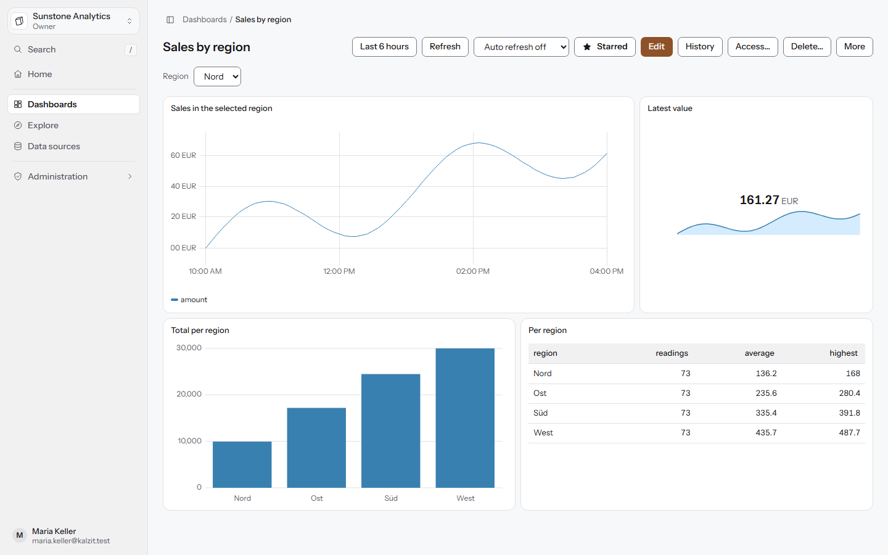

## What works today

- **Dashboards** with folders, versions and a conflict dialog when two people save at once.
  Panels: time series, stat, bar chart and table. Variables (fixed values, free text, values from
  a query) reach the database as parameters, never as text in the query.
- **Explore**: write a query, see the result in a matching visualization, inspect it and add it
  to a dashboard.
- **Start page and navigation**: a greeting with the organization in numbers (dashboards, data
  sources, members, changes of the last days), starred and recently opened dashboards as cards,
  a first-steps checklist built from real data, search with `/` or Ctrl+K, and a sidebar that
  collapses to an icon rail.
- **Data sources**: PostgreSQL, MySQL/MariaDB, SQL Server, SQLite and Prometheus, and MongoDB on
  the server side (its results keep their document shape; the query editor and document views
  in the interface follow). Read-only by default (queries that change data are refused on the server), secrets stored encrypted, and
  addresses that must not be reached (Kalzit's own database, cloud metadata) are refused.
- **Organizations, teams and roles**: owner, admin, editor, viewer and own roles from fine-grained
  permissions, plus access to single folders, dashboards and data sources. Every request is
  checked on the server.
- **Administration**: users, organizations, server and organization settings, audit log.
- Interface in English and German, with light, dark and high contrast themes.

| | |
|---|---|
| 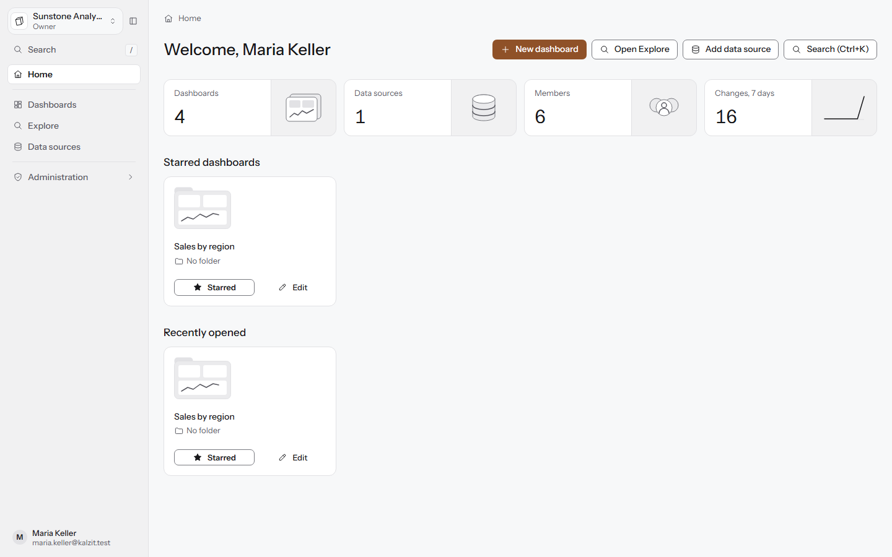 | 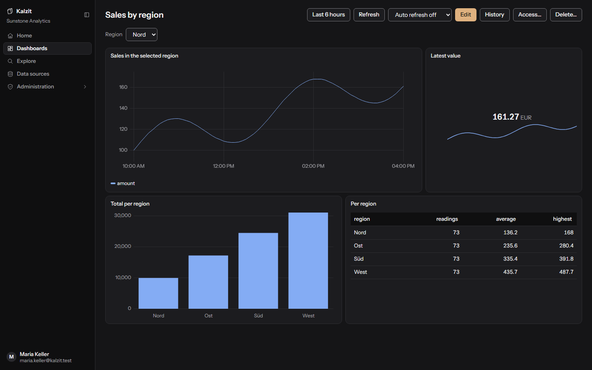 |
| Start page | Dashboard, dark theme |
| 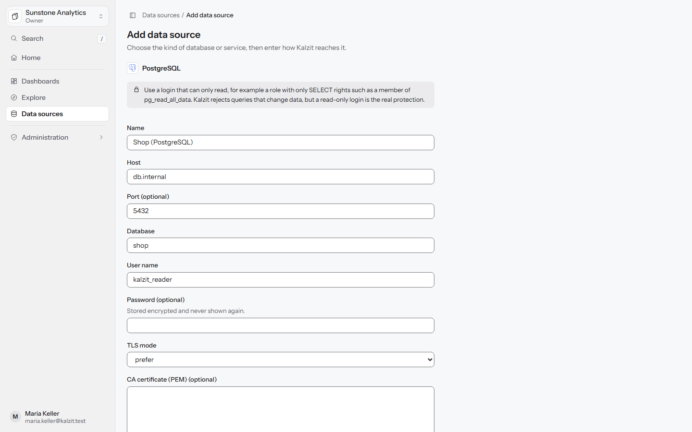 | 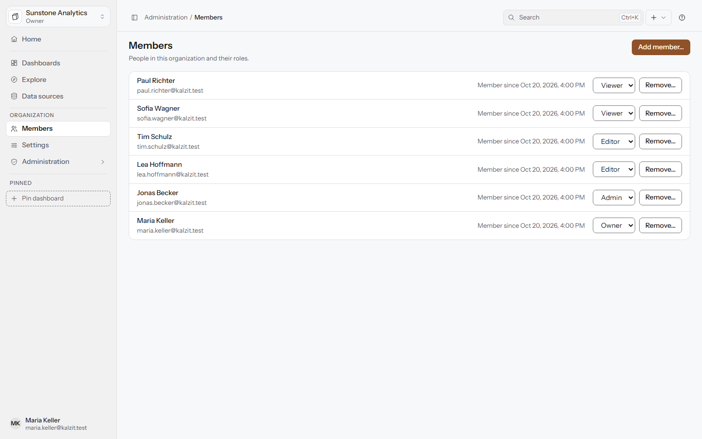 |
| Data source form | Members and roles |
| 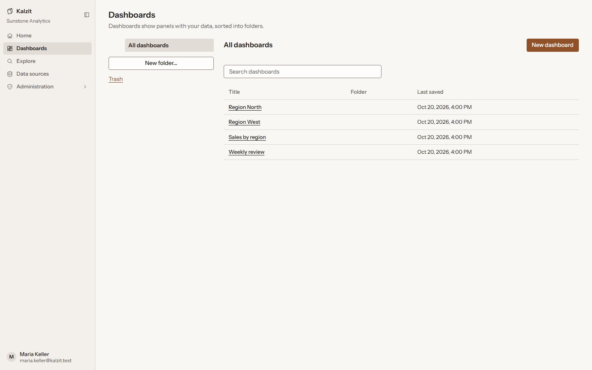 | 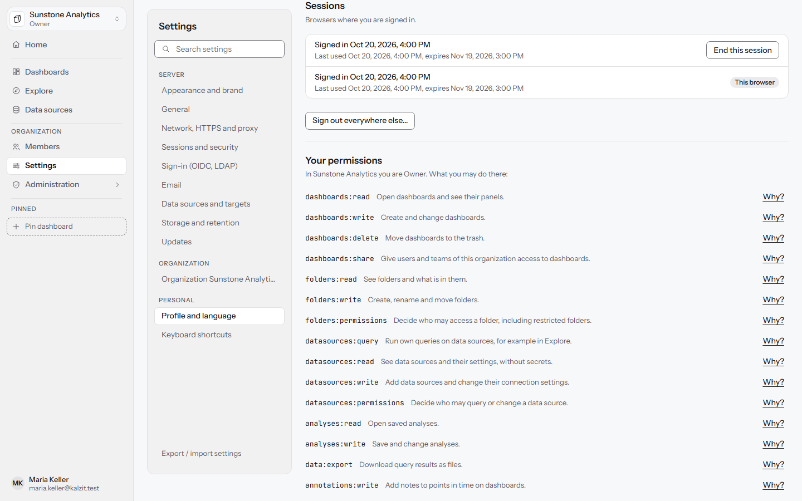 |
| Dashboards | Your account: sessions |
| 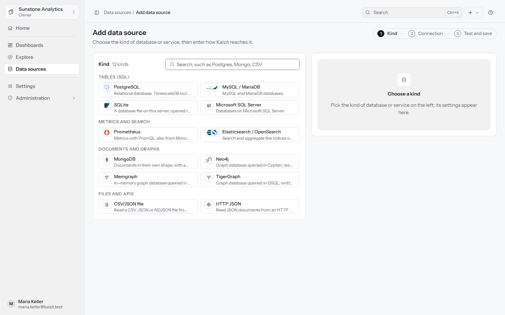 | 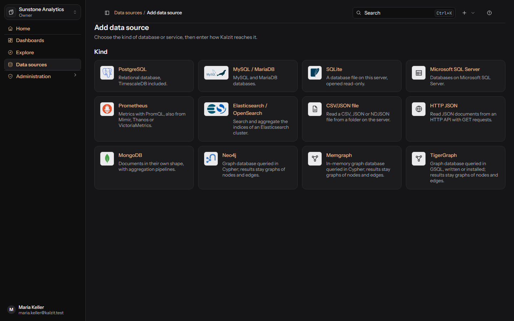 |
| Adding a data source | Adding a data source, dark theme |
| 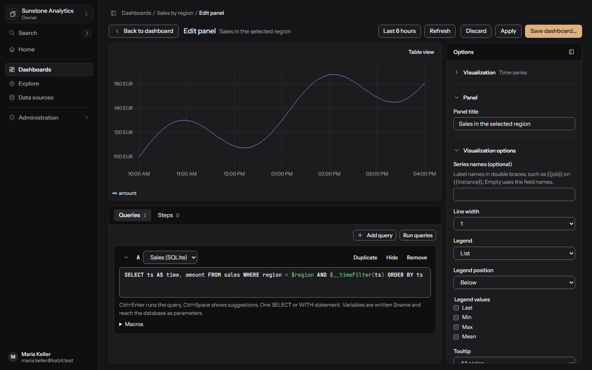 | 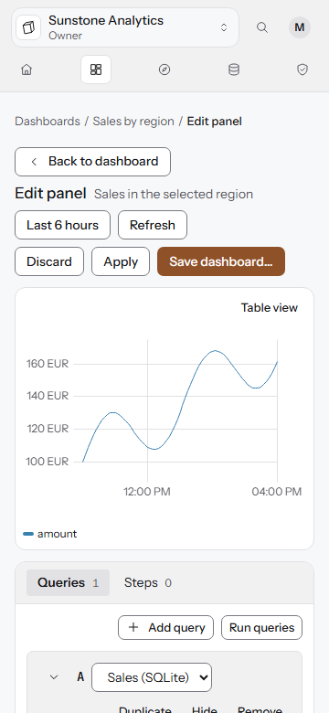 |
| Panel editor, dark theme | Panel editor on a phone |
| 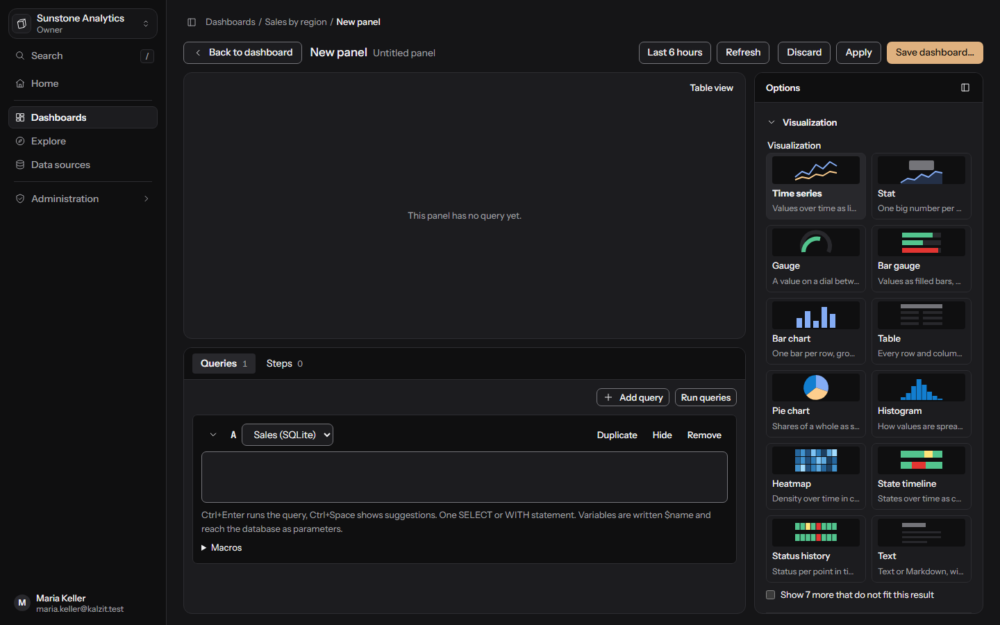 | 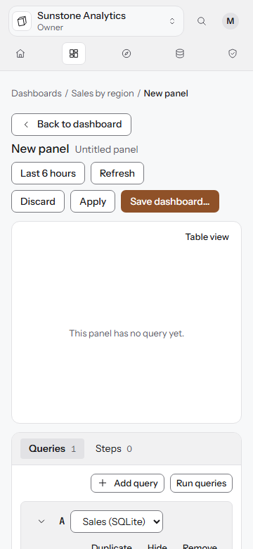 |
| New panel, dark theme | New panel on a phone |
| 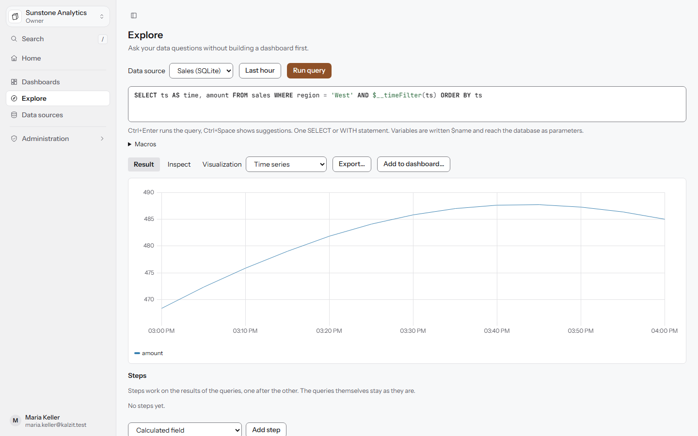 | 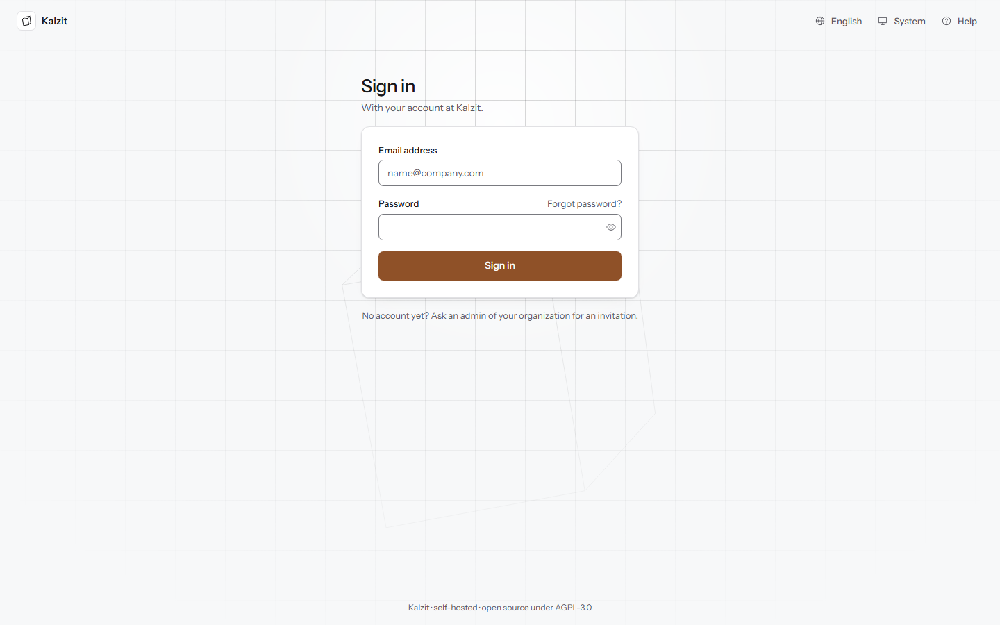 |
| Explore | Sign in |

The screenshots come from the real application with demo data (`npm run screenshots` in `ui/`).

## Running Kalzit

Kalzit is one binary with the web interface built in. To build it from source you need Rust
(stable) and Node.js 26:

```
cd ui
npm ci
npm run build
cd ..
cargo build --release
```

Start it with `target/release/kalzit` (`kalzit.exe` on Windows). It listens on port 3000 and keeps
its data in `/var/lib/kalzit` on Linux and `%ProgramData%\Kalzit\data` on Windows; the
configuration file `kalzit.toml` or `KALZIT_*` environment variables change that. On the first
start, open `http://localhost:3000` and enter the setup code from `setup-token.txt` in the data
folder to create the first organization and its owner.

## Documentation

- [docs/PLAN.md](docs/PLAN.md): what Kalzit becomes, milestone by milestone.
- [docs/ARCHITECTURE.md](docs/ARCHITECTURE.md): how the code is shaped, configuration, data
  directory, backups and tests.
- [docs/api/](docs/api/): the HTTP API (access, data sources and queries, settings and
  dashboards).
- [docs/glossary.md](docs/glossary.md): the terms used in the interface.
- [docs/design/feel.md](docs/design/feel.md): how the interface should look and feel, and the plan
  to get there.
- [ui/README.md](ui/README.md): the web interface and its scripts.

## License

AGPL-3.0, see [LICENSE](LICENSE).

Product names and logos are trademarks of their owners; Kalzit uses them only to identify the
data source it connects to, with no endorsement implied (see
[ui/src/assets/logos/NOTICE.md](ui/src/assets/logos/NOTICE.md)).
