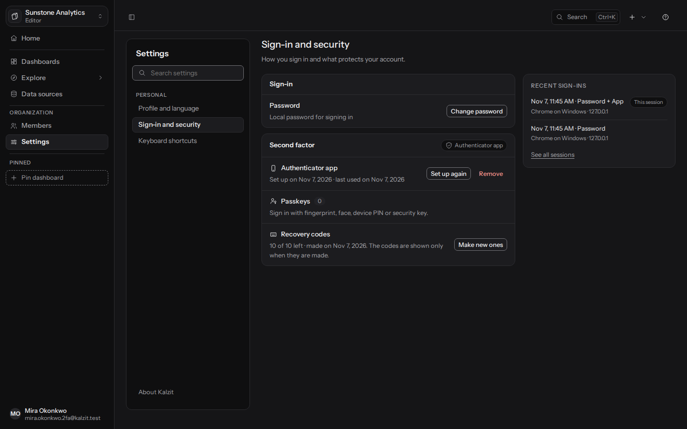
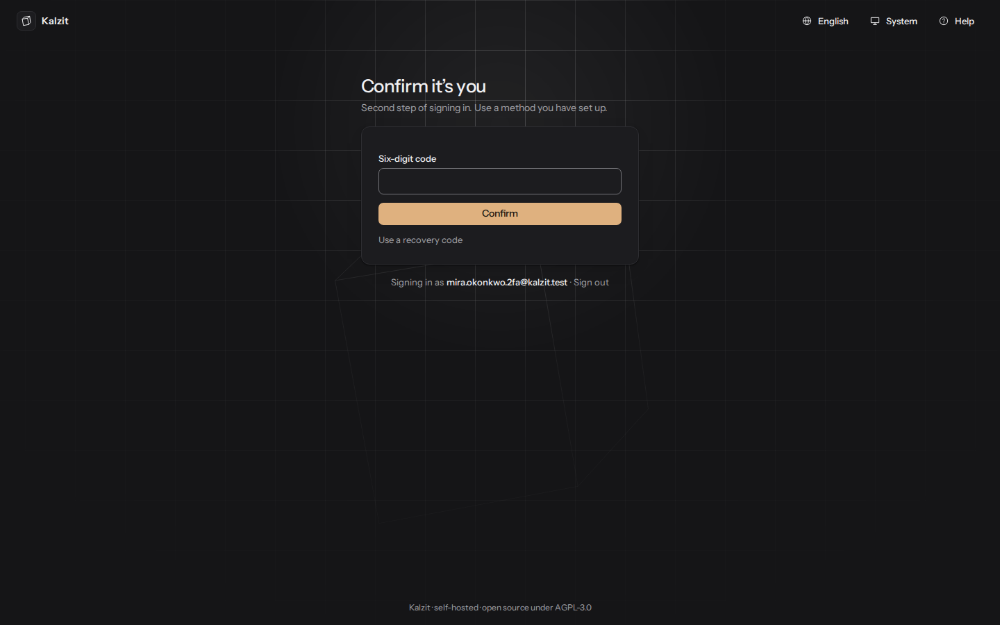
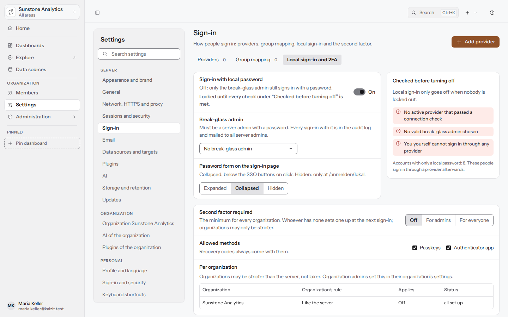

# Sign-in and security

How to protect your account with a second factor, and how administrators require one. The API
behind it is in [docs/api/access.md](../api/access.md#second-factor).

## Your second factor

Open **Settings > Sign-in and security** (German: Einstellungen > Anmeldung und Sicherheit).
A second factor means that your password alone no longer signs anyone in: after the password,
Kalzit asks for one of these.

- **Passkey** (recommended): your fingerprint, face or device PIN, or a security key. Choose
  **Add passkey**, give it a name you will recognize (such as "Office laptop") and follow the
  dialog of your browser or device. You can add several, rename them in their row (Enter saves,
  Escape cancels) and remove them. Passkeys work on the address you added them on; Kalzit must be
  opened by a host name, not an IP address.
- **Authenticator app**: an app on your phone that shows a six-digit code every 30 seconds.
  Choose **Set up**, scan the QR code (or type the key by hand, or on the phone open the link in
  the app) and enter the first code. Codes change every 30 seconds; when one is refused, wait for
  the next and check that your phone's time is right.
- **Recovery codes**: ten codes that each stand in once for your second factor, for example when
  your phone is lost. You get them with your first method and see them only then: download,
  copy or print them, keep them apart from your password, and tick "I have stored the codes
  safely" to go on. **Make new ones** replaces the whole set.

Your first method asks for your password first, so that nobody who took over a signed-in
browser of yours can set up a second factor of their own. If you sign in only through a provider
or directory and have no password, it asks you to sign in again first unless you signed in within
the last five minutes. Setting it up signs you out on every
other device and browser; sign in there again with the new second factor.

Removing a method, making new recovery codes, adding another method and changing your password
first ask you to confirm with a method you have (a passkey, a code from the app or a recovery
code). A confirmation holds for five minutes, and signing in with the second factor counts as
one. While a second factor is required for your account, the last method cannot be removed; set
up another first.

An organization that requires a second factor lets a browser in only once it proved yours: by
signing in with it, by setting it up there, or by confirming it. When the organization shows
"This organization requires a second factor" although you have one, choose **Confirm your second
factor**.

## Signing in

After your email and password, the page asks you to confirm that it is you. With a passkey,
choose **Confirm with a passkey**; with the app, type the six-digit code (it is sent as soon as
all six digits are there); without either, choose **Use a recovery code**. After a recovery code
the page says how many are left.

Five wrong codes within 15 minutes lock the second step of your account for 15 minutes, whatever
device they came from; the page shows until when. Passkeys are not locked. If you cannot use any
of your methods any more, ask an administrator to reset your second factor.

The second step has to be finished within five minutes; until then you are not signed in.

## Requiring a second factor (administrators)

Server administrators set the rule for the whole server under **Settings > Sign-in**:

- **Second factor required**: Off, For admins (server admins and the administrators of every
  organization) or For everyone. This is the minimum for every organization.
- **Allowed methods**: passkeys and app, passkeys only, or the authenticator app only. Recovery
  codes always come with them. A method turned off keeps working for whoever has it.

Organization administrators can be stricter for their organization under **Settings >
Organization**: Like the server, For admins, or For everyone. They cannot be laxer than the
server. The table **Per organization** on the server's page shows each organization's rule, what
applies there and how many members still have no second factor.

There is no grace period: whoever must have a second factor and has none sets one up at the next
sign-in, in three steps (method, setup, recovery codes), before Kalzit opens. People who are
already signed in keep their session until it ends. A rule set in the environment or `kalzit.toml`
applies to the first-run setup too: the first owner sets up a second factor before Kalzit opens.

## Resetting someone's second factor (administrators)

When someone has lost their methods, open **Administration > Members** (or **Users** as a
server admin) and choose **Reset second factor…** in their row. The list shows each person's
methods, "Missing" when one is required and not set up, and a running lockout.

A reset removes the person's app, passkeys and recovery codes and signs them out everywhere; at
their next sign-in they set up a new second factor if one is required. You confirm with your own
second factor first, and you need one to reset others. Add a reason for the audit log. The reset
is recorded in the audit log, and the person gets an email once a mail server is set up.
Organization administrators can reset members who belong only to their organization and are not
server admins; everyone else needs a server admin. Nobody can reset their own second factor this
way.
