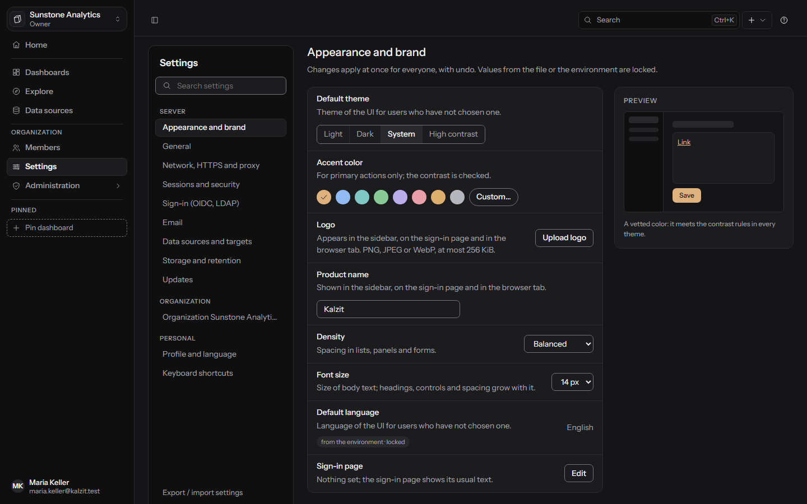
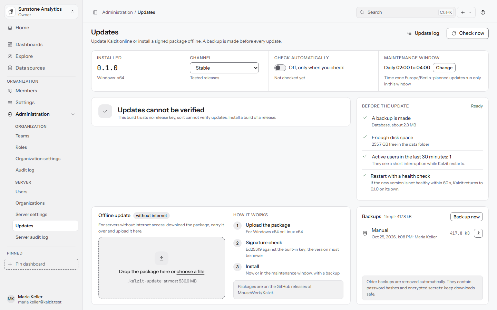

# Administration (Verwaltung)

Organizations, members, teams, roles, the audit log, server settings and updates. Sections appear
only to those who may open them. API: [access](../api/access.md),
[settings and dashboards](../api/settings-dashboards.md) and [updates](../api/updates.md).

**Administration** in the **Organization** group lists the sections, split into **Organization**
(for the organization you work in) and **Server** (for server admins). **Members** also has its
own entry in the sidebar.

## Your account

Open your name at the bottom of the sidebar, then your account (**Your account**):

- **Profile**: your name; the email address is changed by a server admin.
- **Password**: **Current password**, **New password**, **Repeat new password**. Changing it signs
  you out everywhere else.
- **Sessions**: browsers where you are signed in, **End this session** and **Sign out everywhere
  else...**.
- **Your permissions**: what your role allows in the current organization.
- **Preferences**: **Language**, **Theme** (System, Light, Dark, High contrast), **Time zone**
  (all times in Kalzit follow it), **Start dashboard**, **First day of the week**. They apply at
  once, can be undone, and follow you to every browser.

## Organizations

A server can hold several organizations. Server admins create and rename them under
**Administration** > **Organizations** (**New organization...**, with a first owner who manages it).
Server admins are not members of every organization. The organization card at the top of the
sidebar switches between the organizations you belong to (server admins see all).

## Members

**Members** lists the people of the organization and their roles.

- **Add member...** adds an existing account by email address and role. The person needs an
  account on this server; a server admin creates accounts under **Users**.
- Change a role in the list; **Remove...** takes a member out of the organization (their account
  stays and they lose access at once).
- An organization always keeps at least one owner. You can only give a role, change or remove a
  member whose permissions you hold yourself.

## Teams

**Teams** are groups of members that receive roles and access together.

- **New team...**, rename and delete. A team member is a **Member** or a **Maintainer** (who can add
  and remove members of that team).
- **Roles of the team**: every member gets the permissions of these roles on top of their own
  (at most 20; never the owner role).
- Teams can be given access to folders, dashboards and data sources like individual users.
- A team can own **team spaces**, folders and dashboards (see
  [Dashboards](dashboards.md#team-spaces-and-team-ownership)). Adding members to such a team is for
  its maintainers and admins; an admin doing it is recorded in the audit log.
- Deleting a team asks who takes over what it owns: another team, or the organization. Handed to
  the organization, team-only content stays hidden from everyone but admins and grants, until an
  admin decides otherwise.

## Roles and permissions

**Roles** are sets of permissions. The built-in roles cannot be changed:

| Role | Can |
|---|---|
| Viewer | Open dashboards and folders and see their data through the stored queries; see teams |
| Editor | Everything a viewer can, plus create, change, delete and share dashboards, manage folders, run own queries in Explore and read data sources, save analyses, export data, annotate, see members |
| Admin | Everything except deleting the organization |
| Owner | Everything |

Custom roles (**New role**) combine permissions as you need them, grouped as Dashboards and
folders, Data sources and analyses, People and roles, Organization and Other. Examples of
permissions: `dashboards:read`, `dashboards:write`, `dashboards:share`, `folders:permissions`,
`datasources:query`, `datasources:write`, `data:export`, `annotations:write`, `audit:read`,
`settings:write`. You can only give permissions you hold yourself, and the owner-only permissions
cannot be part of a custom role. A role that is still given to members cannot be deleted.

Beyond roles, **Access...** on a folder, dashboard or data source gives users, teams or roles
**Can view / Can edit / Can manage** (data sources: **Can query / Can edit / Can manage**). A
folder marked **Restricted** hides itself and everything in it from everyone without access; the
nearest restricted folder above a resource decides. For everyone else it does not exist ("not
found").

Every request is checked on the server for every resource.

## Audit log

**Audit log** answers who changed what and when in the organization: sign-ins, changes to
dashboards, folders, data sources, members, roles, settings, exports and more. Filter by **Person**,
**Action** or area and a date range; page with **Newer** and **Older**. Events about restricted
folders you cannot see are left out. Events are deleted after the retention time (365 days by
default, setting `audit.retention_days`). Server admins also have a server-wide audit log under
**Server**.

## Usage

**Administration** > **Usage** (**Verwaltung** > **Nutzung**) shows how your organization uses
Kalzit, for the last 24 hours, 7, 30 or 90 days:

- **Totals**: dashboard views, panel runs, data source queries, the share of failed queries and
  of answers from the query cache, and a **Trend** per hour or day.
- **Most viewed dashboards**, **Slowest panels** (median and 95th percentile of their run time),
  **Panels with errors** (by the share of failed runs) and **Data sources** with their queries,
  errors (timeouts, refused, source errors), run times and cache hit rate. Each dashboard, panel
  and data source links to itself.
- **Unused dashboards**: dashboards nobody opened in the last 30 or 90 days, never opened ones
  first.

Organization admins and owners (anyone with the audit log permission) find it in the
organization's sections and see their organization. Server admins find it under **Server** and
choose one organization or **All organizations**; rows of another organization than the current
one name it and do not link. Viewers and editors do not see the page.

**Privacy**: Kalzit counts per dashboard, panel and data source and per hour only, never per
person. It stores no user, session or address for these counts, so nobody, server admins
included, can tell from them who opened or queried what. Counts are kept for 90 days by default.
Under **Settings** > **Storage and retention** server admins turn **Record usage** off (at once,
with undo) and set **Usage retention (days)** (1 to 365). Details:
[usage insights API](../api/usage.md).

## Users (server admins)

**Administration** > **Users** lists every account on the server: create users, rename, set a
password, make a user a server admin, **Lock** and unlock (a locked user is signed out and cannot
sign in). The last server admin and the last owner who can sign in are protected.

## Settings

**Settings** in the sidebar holds one page of sections, for the **Server**, your **Organization**
and **Personal**, with a **Search settings** box that finds a setting by its German or English
name, description or key and jumps to it; every section and setting has its own address.

- Changes apply at once and can be undone.
- Values from `kalzit.toml` or the environment show as **locked** with their source. Network, TLS,
  proxy, session, security and log settings are read-only here: they are set in `kalzit.toml` or
  the environment only, so a wrong value can never lock you out.
- Sections: Appearance and brand, General, Network HTTPS and proxy, Sessions and security,
  Sign-in (OIDC, LDAP) and Email (both planned for M5), Data sources and targets, Plugins
  ([Plugins](plugins.md)), AI ([AI](ai.md)), Storage and retention, Updates, This organization,
  AI of the organization, Plugins of the organization, Profile and language, Keyboard shortcuts,
  and Export / import settings.

### Appearance and brand

Through checked options, never custom CSS: **Default theme**, **Accent color** (eight checked
colors, or **Custom...** as `#rrggbb` when its contrast is high enough: 3:1 against the light and
the dark page and 4.5:1 for the label), **Product name**, **Logo** (PNG, JPEG or WebP, at most 256
KiB; in the sidebar, on the sign-in page and as the browser tab icon; upload, replace and remove
can be undone), density (Compact, Balanced, Comfortable), font size, start page, time zone and
first day of the week, with a live preview. An organization can set its own accent, density, font
size, start page, time zone and week start or follow the server (**Like the server**).

The **Sign-in page** can show your own **Welcome text** (up to 280 characters) and a **Notice**
(up to 2000), with bold, italic and links.

### Export and import settings

**Export / import settings** downloads the server's settings, or those of one organization, as a
JSON file; only settings you may change are exported and never secrets. **Import** shows every
change ("Will change", "Unchanged", "Locked", "Refused", "Unknown here") before anything is
applied, applies all of them together and can be undone.

### Data and retention settings

Under **Data sources and targets**: the allowed folders for SQLite and file sources, an optional
list of allowed targets, the query time limit (30 s), the row limit (100,000) and the query cache
with its memory limit and **Empty cache** ([Performance and caching](performance.md)). Under **Storage
and retention**: the audit log retention, how many dashboard versions are kept (100; 0 keeps
every version), and whether usage is recorded and for how long ([Usage](#usage)). Settings can also come from `KALZIT_SETTING_<KEY>` variables; every key is listed
in [settings and dashboards](../api/settings-dashboards.md#settings).

## Updates

**Administration** > **Updates** (server admins). Kalzit installs only releases signed with its
built-in key; an older version, a changed file or a package for another platform is refused. The
full operator guide, including the release key, command line and recovery, is
[docs/operations/updates.md](../operations/updates.md).

### Online

1. **Check now** (or **Check automatically**, daily, off by default; **Channel** Stable or
   Preview). A new version shows with its release notes, size and verified signature.
2. **Download**, then **Install now**, or plan it: **Plan for today ...** or **Plan for tomorrow
   ...** starts in the **Maintenance window** (02:00 to 04:00 unless you change it).
3. Kalzit backs up its database, replaces itself, restarts and checks that it is healthy. If it
   is not healthy within the timeout (60 s by default), it returns to the previous version and
   database on its own.

Online installation is automatic on Linux under systemd (when the service account may replace the
binary). Elsewhere, such as Windows, Kalzit downloads and verifies the release and shows the
command to run with Kalzit stopped (`kalzit update apply`); the next start checks itself and
returns on its own when it is not healthy. In a container, update the image.

### Offline

For servers without internet access: download the `.kalzit-update` package from the GitHub release
of `MouseWerk/Kalzit`, carry it over and drop it on the Updates page. It is verified (Ed25519
against the built-in key, the version must be newer) and then installed like an online update.

### Backups and rollback

- **Before the update** shows what is ready: a backup of the database (with its size), free disk
  space, and the number of active users who will see a short interruption. With PostgreSQL as
  Kalzit's own database, Kalzit makes no backup: use `pg_dump` and confirm it.
- **Backups** lists them, **Back up now** adds a manual one, each can be downloaded (the download
  is audited). Backups contain password hashes and encrypted secrets: keep downloads safe.
  Older backups are removed automatically.
- **History** lists every update with who started it, how long it took and how it ended
  (Succeeded, Returned, Stopped nothing changed). **Return to this version** puts back a kept
  earlier version; if the database schema changed since, the backup taken when that version was
  left replaces the database and later changes are lost, which Kalzit asks about first. From the
  command line, `kalzit update rollback <version>` with Kalzit stopped.
- Back up the secrets key along with the database; see
  [ARCHITECTURE](../ARCHITECTURE.md#backups).
