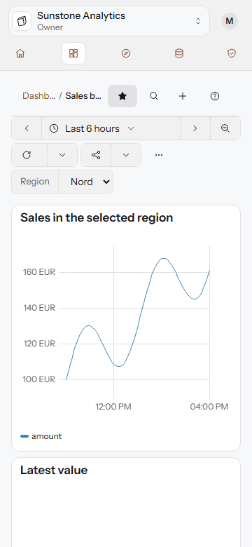
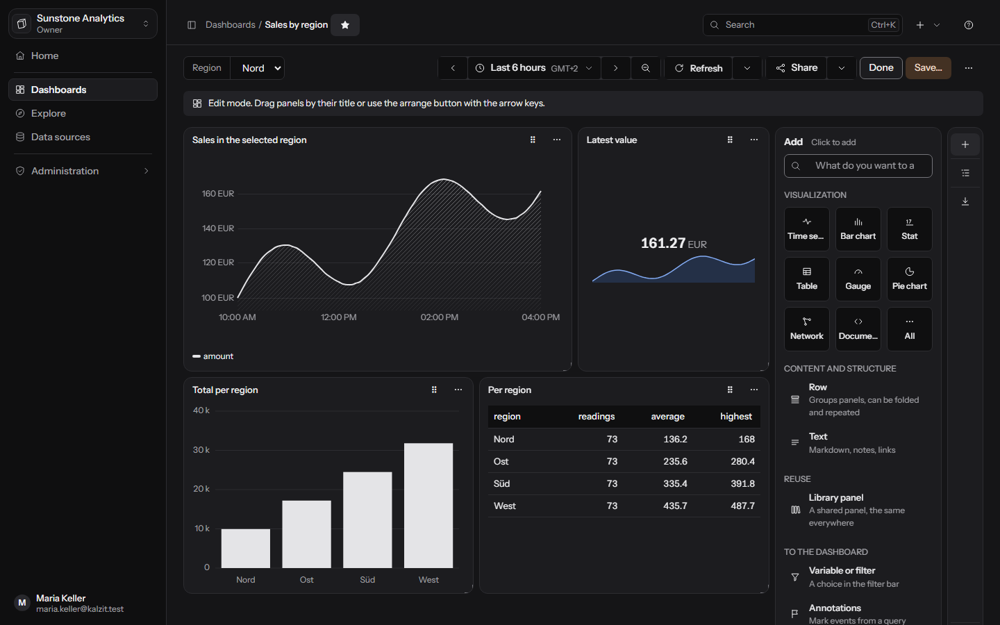
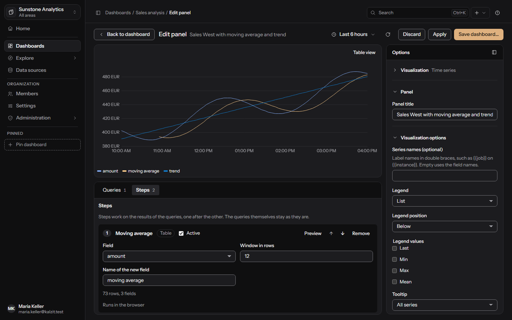
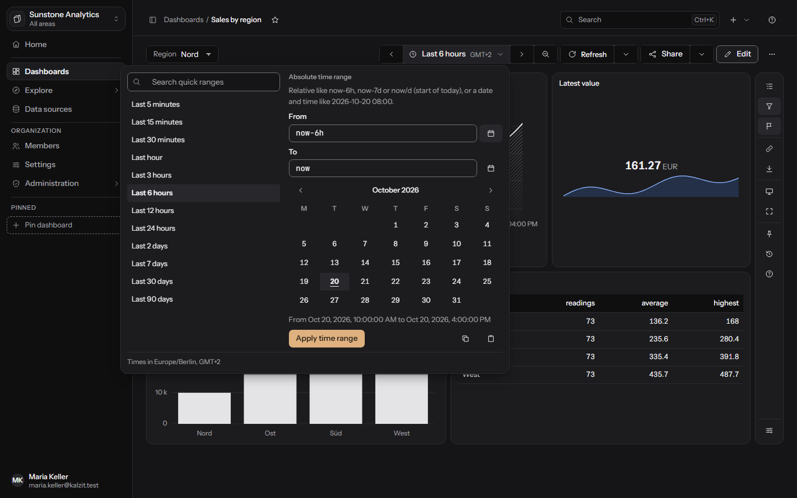

# Dashboards

A dashboard is a page of panels, each showing the result of one or more stored queries. API:
[settings and dashboards](../api/settings-dashboards.md) and
[dashboard features](../api/dashboard-features.md).

## The dashboard list

**Dashboards** lists the dashboards you may open, in folders. Search by title, sort by title,
folder or last saved, and pick a folder in the tree on the left (**All dashboards**, **No
folder**). Folders can be created (**New folder...**), renamed and moved, and marked
**Restricted**: a restricted folder and everything in it is visible only to members with access
(see [Administration](administration.md#roles-and-permissions)). **Access...** on a folder or
dashboard decides who may use it beyond their role.

## Viewing a dashboard

The top bar names the dashboard in its breadcrumbs. Under it one quiet toolbar row holds:

- **Star** at the start: a favorite shows on your start page.
- The **variables** as a filter bar (see [Variables](#variables-and-filters)).
- On the right: the **time range** with its time zone, **Refresh** and **Share** as split buttons,
  **Edit**, and a **More** menu.

A column at the right edge of the canvas, the dashboard tools, holds **Outline** (jump to rows and
panels), **Filters** and **Annotations** (show or hide), **Share**, **Kiosk and TV mode**, **Full
screen**, **History** and **Info** (folder, version, last saved, tags, number of panels, time
zone). It folds away and stays folded for you. On a phone the toolbar takes two rows and the More
menu holds the column's actions.

**More** holds Settings..., Kiosk mode, TV mode, History, Access..., Save as... and Delete...;
what you see depends on your rights.

A panel's actions sit in a menu button in its title bar and appear when you point at the panel or
reach it with the keyboard: its links, view alone, **Annotate**, **Inspect**, export, **Edit**,
**Duplicate**, **Copy to...** and **Remove**. **Inspect** shows the result's size, the executed
query and the server's notes and warnings, and says when the result was cut off at the data
source's row limit.

## Edit mode

Press **Edit** (needs write access). The toolbar shows **Done** (or **Discard changes...** when
something changed) and **Save...**.

- Drag a panel by its title to move it, or use the arrange button and the arrow keys (Shift and
  arrows resize). Rows move by drag or with the up and down arrows.
- The column at the right now has the **Add** pane; see below.
- **Save...** asks for an optional message (up to 500 characters) that appears in the history.
  Every save is a new version.
- Leaving with unsaved changes asks first. If someone else saved in the meantime, a conflict
  dialog compares **Your changes** with **Saved by others in the meantime**; you can keep editing,
  discard yours and open theirs, or **Save mine as the newest version**.

### The Add menu

In edit mode **Add** offers (search with "What do you want to add?"):

| Entry | What it adds |
|---|---|
| Visualization | A new panel; a picker shows each type with a drawing and offers the types that fit first |
| Row | Groups panels, can be folded and repeated |
| Text | Markdown, notes, links |
| Library panel | A shared panel, the same everywhere |
| Variable or filter | A choice in the filter bar |
| Annotations | Mark events from a query |
| Link | To other dashboards or pages |

## Rows

A row groups panels under a title and can be folded. **Add row** creates one; a panel joins a row
through its **Row** setting in the panel editor ("Outside every row" leaves it out). Removing a row
keeps its panels. A row can repeat for each value of a variable that allows several values: the
row with all its panels is shown once per selected value.

## The panel editor

Adding and editing a panel opens a page of its own with an address you can reload or share
(`.../panels/<id>/edit`, `.../panels/new`).

- **Bar on top:** **Back to dashboard**, the time range, refresh, **Discard**, **Apply** and **Save
  dashboard...**.
- **Preview** on top, with a **Table view** toggle.
- **Queries** and **Steps** in tabs below. Each query has a data source, can be folded,
  duplicated and hidden (a hidden query stays with the panel but does not run). Run with
  Ctrl+Enter, the run button, or by leaving a changed query. Steps are described in
  [Calculated fields and statistics](calculated-fields.md).
- **Options** on the right, in groups you can fold: the **Visualization** first, then the panel's
  title and its visualization options, **Field options** and **Links, repeat and time**. See
  [Panels](panels.md).
- Drag the separators or move them with the arrow keys; the editor remembers their place.
- Back, **Apply** and Esc keep the change in the dashboard until you save it. **Discard** (and the
  browser's back button) leaves the panel as it was, after asking when something changed. A new
  panel joins the dashboard only on Apply or Save. A reload keeps your unsaved changes.

Under **Links, repeat and time** a panel gets its place (row), **Repeat for each value of** a
multi-value variable (side by side or below each other, at most so many per line), an own **time
range** such as `now-24h` and a **time shift** such as `1d` or `1w` to compare with an earlier
period, and **data links** shown in its header with variables such as `${name}` filled in.

Changing a query needs query rights on its data source; without them you can still rename,
arrange and restyle the panel.

## Variables and filters

Variables let viewers change values in every query, such as a region. Add one with **Add
variable** in the dashboard settings or the Add menu. Kinds:

- **Fixed values**: a comma-separated list.
- **Free text**: a text box.
- **Values from a query**: the first column of the result becomes the list.

Options: a **Label**, **Allow several values**, and a **Value when the dashboard opens**. Names
use letters, digits and underscores. Queries use a variable as `$name` (MongoDB pipelines write
`"${name}"`); it reaches the database as a parameter, never as text in the query. The
variables appear as the filter bar in the toolbar. A multi-value variable is a list box where Ctrl
or Shift with a click, or Space, picks more. Panels and rows can repeat per selected value.

## Time range and time picker

The time range button opens the picker.

- **Quick ranges** with a search box: last 5 minutes to last 5 years, today so far, yesterday, day
  before yesterday, this week, month and year so far, previous week, month and year, and fiscal
  quarters and years. **Recently used** lists your last ranges in this browser.
- **Absolute time range**: From and To as text, relative like `now-6h`, `now-7d` or `now/d` (start
  of today), or a date and time like `2026-10-20 08:00`, or picked on a calendar. The picker names
  the time zone the times are in.
- Buttons beside the range move it back and forward by its own length and zoom out to twice its
  length. Relative ranges stay relative where they can.
- **Refresh** runs all queries now; its menu sets automatic refresh (every 5 seconds up to every
  day, from the dashboard's list of intervals).
- **Share** > **Copy link with time range** copies a link that opens the dashboard with the range.

Keyboard shortcuts (not in text fields): `t` then Left or Right moves the range, `t` then `z`
zooms out, `t` then `c` copies it and `t` then `v` pastes a range. They also work in the panel
editor. On German keyboards the keys are the same.

**Settings...** > **Time options** (needs edit rights): a time zone and first day of the week for
everyone who opens the dashboard (or each viewer's own), the month the **fiscal year starts in**,
a **now delay** that leaves out the newest, still incomplete data (such as `1m`), the **refresh
intervals** to offer, and a **shared cursor** (off, crosshair, or crosshair and tooltip) that shows
the pointer's time in every time series panel.

## Annotations

Annotations mark points or spans in time on every time chart.

- Add one with Ctrl+click on a chart, the `A` key, or **Annotate** in the panel menu. Give a text,
  tags (comma-separated) and optionally an end time to span a period. Editing needs
  `annotations:write` or write access to the dashboard.
- **Annotation queries** (Add menu > Annotations) add marks from a data source: each row of a
  table result becomes an annotation; the first time column is the time, `timeEnd` ends a span,
  `text` (or the first text column) is the text and a `tags` column holds the tags. Each query has
  a name, a colour and can be turned off. Annotations from queries are changed in their data
  source, not in Kalzit.
- The **Annotations** tool in the column shows or hides them.

## Links

**Links** appear under the dashboard's title. A link goes to an **Address** (starting with
`https://`, `http://`, `mailto:` or `/` for a page of this server, variables such as `${name}`
allowed) or lists **Dashboards with a tag**. Add tags to a dashboard in its settings (comma
separated). Links can open in a new tab. Data links on panels work the same way.

## Library panels

A library panel is kept once in a folder and shown by many dashboards; a change shows on every one
of them. Rights follow the folder.

- Make one from a panel: **Make library panel...** in the panel editor.
- Add one to a dashboard: Add menu > **Library panel**.
- **Dashboards** > **Library** lists them, with how many dashboards use each and which. A library
  panel that dashboards still show cannot be deleted.
- Saving a change asks for confirmation ("shown by N dashboards"). **Keep as a panel of this
  dashboard only** unlinks it.

## Versions and history

Every save is a version. **More** > **History** (or the History tool) lists them with date and
message, **Compare** shows the changes from a version to the current one, and **Restore...** saves
an older version again as the newest. The server keeps a limited number of versions and removes
the oldest beyond it. Restoring checks the options of panels edited since; a version whose options
today's rules refuse cannot be restored once such a panel has changed.

## Trash

**Delete...** moves a dashboard to the **Trash** (**Dashboards** > **Trash**), from where it can
be restored; a folder takes its contents with it. **Delete for good...** removes it with all its
versions and cannot be undone. Only members who may delete dashboards see the trash. A dashboard
in the trash is read-only until restored.

## Export, import, copy

- **Share** > **Export as JSON** downloads the dashboard model; **JSON model...** shows and, in
  edit mode, edits it (the server checks it before it replaces your changes).
- **New** > **Import dashboard** takes a file or pasted JSON, checks it, and asks for the folder
  and a mapping of its data sources (matched by kind and name, which you confirm).
- **Copy to...** in a panel's menu copies the panel to another dashboard you may change; **Save
  as...** saves the dashboard as a new one.

## Team spaces and team ownership

A **team space** (Team-Bereich) is a folder at the top of the tree that belongs to one team. Only
the team sees it; its members work in it with their role (an editor edits, a viewer reads).
Maintainers of a team and admins create one with **Create team space**. The tree marks team spaces
and team folders with the team icon and the team's name. To let another team in, open **Access...**
on the space or a folder in it and give that team **Can view** or **Can edit**.

**Team and visibility** on a folder or in a dashboard's **More** menu gives it an **owner team**
(Eigentümer-Team) and sets its **visibility** (Sichtbarkeit):

- **Everyone with access reads it, only the team edits it**: other members can open it but not
  change, delete or share it (grants still can).
- **Team only**: nobody outside the team sees it.

Who may change this:

- Content of your own team: its editors (for dashboards) and maintainers (for folders).
- Content without a team, or another team's: whoever manages the folder's access (admins, or an
  admin grant on the folder).
- A team space's owner and visibility: admins only.
- Inside a team space, content belongs to that space's team; only admins hand it to another team.

Moving content out of a team space (into the shared tree or another team's space) is for
maintainers of the team and admins; editors move within the space. Each such move is recorded in
the audit log.

The team you work in shows below the organization's name in the workspace card at the top of the
sidebar. With more than one team, pick another one or **All areas** (Alle Bereiche) in its menu: the
Dashboards page shows that team's space first and leaves out other teams' spaces (unless they were
shared with you or your team), and the start page lists follow.

Admins see and manage every team space. Each time they open or change another team's space,
team-only content or a restricted folder through their admin rights, the audit log records it.

## Sharing and access

Within an organization, **More** > **Access...** gives users, teams or roles access to a dashboard
beyond their role (**Can view**, **Can edit**, **Can manage**). It needs the `dashboards:share`
permission or manage access. Folders work the same way and pass access to their dashboards and
subfolders. Public links for people without an account are planned (M6).

Viewers run only the stored queries of a dashboard they may read; free queries need
`datasources:query` (editor and up).

## Kiosk, TV mode, full screen, playlists

- **Kiosk mode** shows the dashboard alone, without the app around it.
- **TV mode** is the same with controls that hide themselves and come back with the mouse or a key.
- A single panel can be shown alone (**View** in its menu) or in **Full screen**. Esc leaves a
  panel shown alone first, then kiosk or TV mode.
- **Playlists** (**Dashboards** > **Playlists**) show dashboards one after another: a name, the
  time per dashboard and entries that are dashboards or tags. Play one for a wall screen;
  everyone sees only the dashboards they may open. Editors create and change playlists.

## Pinning and starring

- **Star** a dashboard from its page or its card on the start page; favorites are listed on the
  start page. Starring is personal.
- **Pin** a dashboard to the sidebar (the pin button in the dashboard tools, or **Pinned** >
  **Pin dashboard** in the sidebar). Pins are personal, per organization, kept in your own order
  (**Move up**, **Move down**, **Unpin**) and limited to 10; once 10 are pinned the sidebar says
  so.
- Set a **Start dashboard** on your account page to open it when you enter Kalzit; **Home** still
  shows the start page.
