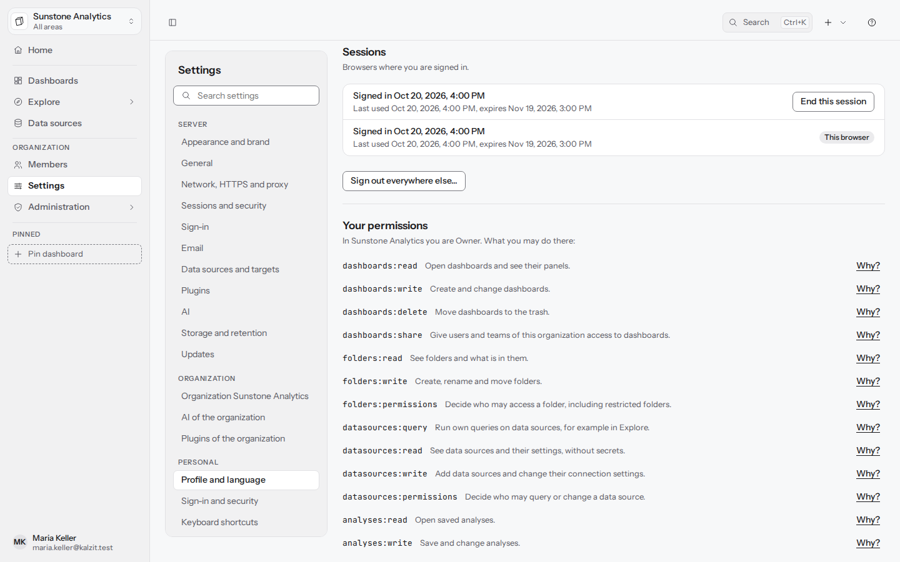
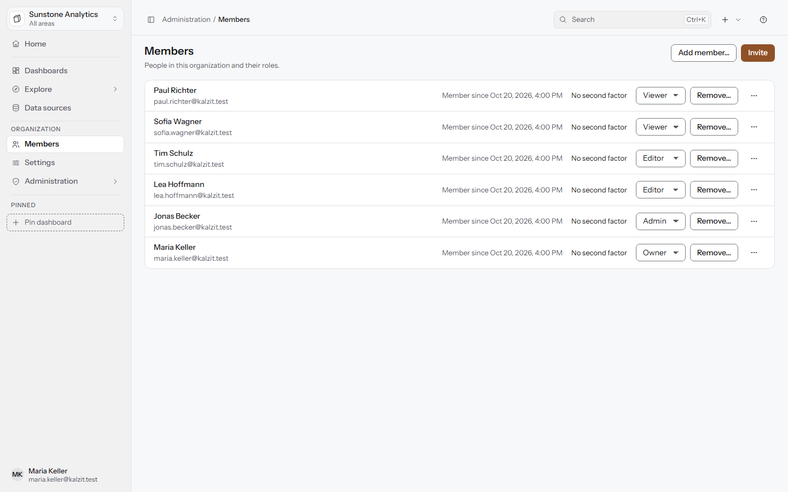
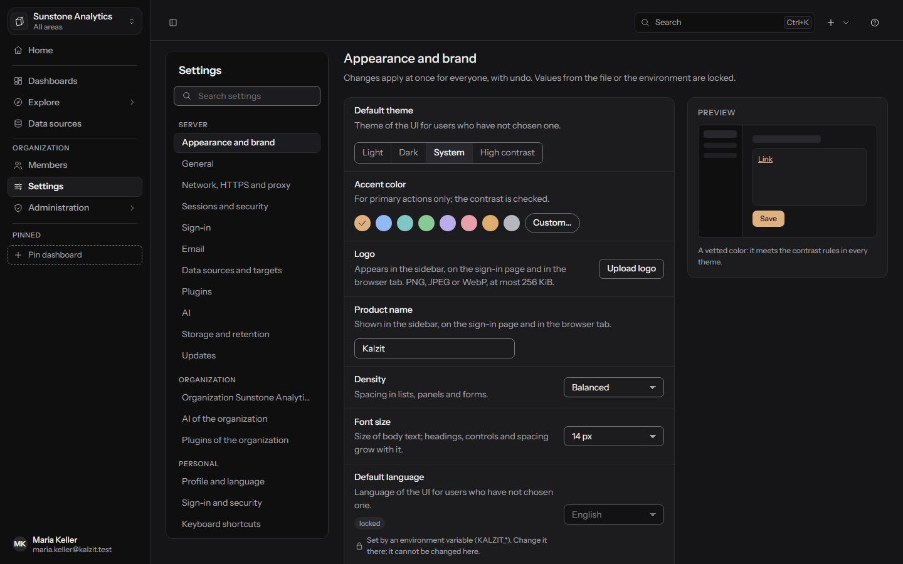
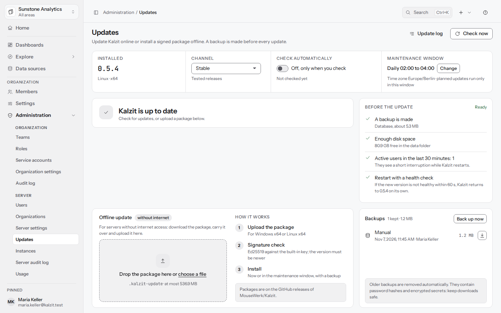

[English](../administration.md) | Deutsch

# Verwaltung

Organisationen, Mitglieder, Teams, Rollen, das Audit-Log, Server-Einstellungen und Updates. Bereiche
erscheinen nur für die, die sie öffnen dürfen. API: [access](../../api/access.md),
[settings and dashboards](../../api/settings-dashboards.md) und [updates](../../api/updates.md).

**Verwaltung** in der Gruppe **Organisation** listet die Bereiche, aufgeteilt in **Organisation**
(für die Organisation, in der du arbeitest) und **Server** (für Server-Admins). **Mitglieder** hat
außerdem einen eigenen Eintrag in der Seitenleiste.

## Dein Konto

Öffne deinen Namen unten in der Seitenleiste, dann dein Konto (**Dein Konto**):

- **Profil**: dein Name; die E-Mail-Adresse ändert ein Server-Admin.
- **Passwort**: **Aktuelles Passwort**, **Neues Passwort**, **Neues Passwort wiederholen**. Eine
  Änderung meldet dich überall sonst ab.
- **Sitzungen**: Browser, in denen du angemeldet bist, **Diese Sitzung beenden** und **Überall sonst
  abmelden…**.
- **Deine Rechte**: was deine Rolle in der aktuellen Organisation erlaubt.
- **Deine Teams**: die Teams, zu denen du in der aktuellen Organisation gehörst, mit deiner Rolle in
  jedem (Mitglied oder Betreuer). Nur lesbar; Teams verwalten Admins und Betreuer.
- **Einstellungen für dich**: **Sprache**, **Darstellung** (System, Hell, Dunkel, Hoher Kontrast),
  **Zeitzone** (alle Zeiten in Kalzit richten sich danach), **Start-Dashboard**, **Erster Tag der
  Woche**. Sie gelten sofort, lassen sich rückgängig machen und begleiten dich in jeden Browser.



## Organisationen

Ein Server kann mehrere Organisationen enthalten. Server-Admins legen sie unter **Verwaltung** >
**Organisationen** an und benennen sie um (**Neue Organisation…**, mit einem ersten Eigentümer, der
sie verwaltet). Server-Admins sind nicht Mitglied jeder Organisation. Die Organisationskarte oben in
der Seitenleiste wechselt zwischen den Organisationen, zu denen du gehörst (Server-Admins sehen
alle).

## Mitglieder

**Mitglieder** listet die Personen der Organisation und ihre Rollen.



- **Einladen** lädt Personen per E-Mail-Adresse ein, mit einer Rolle und, wenn du Teams ändern
  darfst, einem Team (siehe „Einladungen“ unten). Braucht das Recht `users:invite` (Admins und
  Eigentümer).
- **Mitglied hinzufügen…** fügt ein bestehendes Konto per E-Mail-Adresse und Rolle hinzu. Die Person
  braucht ein Konto auf diesem Server; ein Server-Admin legt Konten unter **Benutzer** an.
- Ändere eine Rolle in der Liste; **Entfernen…** nimmt ein Mitglied aus der Organisation (sein Konto
  bleibt, und es verliert sofort den Zugriff).
- Eine Organisation behält immer mindestens einen Eigentümer. Du kannst eine Rolle nur vergeben und
  ein Mitglied nur ändern oder entfernen, wenn du dessen Rechte selbst hast.
- Das Menü eines Mitglieds (**Mehr zu …**) hat **Passwort-Link senden**: Das Mitglied bekommt
  dieselbe Mail wie mit **Passwort vergessen?**. Dafür braucht es einen Mailserver.

### Einladungen

**Einladen** nimmt eine oder mehrere E-Mail-Adressen (getrennt durch Komma, Leerzeichen oder
Eingabe), eine Rolle und optional ein Team. Jeder Einladungslink gilt sieben Tage und einmal.

- Mit einem Mailserver (Einstellungen > E-Mail) schickt Kalzit jeder Person eine Mail in ihrer
  Sprache (oder der Standardsprache des Servers) mit dem Link; nichts darin verfolgt, wer sie liest.
- Ohne Mailserver zeigt **Einladung erstellt** jeden Link, damit du ihn selbst weitergibst, zum
  Beispiel in einem Chat.
- **Offene Einladungen** über den Mitgliedern zeigt jede Einladung, die noch nicht angenommen ist:
  Rolle und Team, wer eingeladen hat, bis wann sie gilt und wie ihre Mail ankam (**Zugestellt** oder
  **Abgewiesen** mit der Antwort des Mailservers). **Link kopieren** kopiert einen offenen Link
  erneut; **Erneut senden** erzeugt einen neuen Link (der alte funktioniert nicht mehr) und startet
  die sieben Tage neu; **Widerrufen** zieht sie zurück. Abgelaufene Einladungen kannst du erneut
  einladen oder entfernen.
- Links zeigen auf die öffentliche Adresse des Servers (`server.public_url` in `kalzit.toml` oder
  `KALZIT_SERVER_PUBLIC_URL`); ohne sie erzeugt Kalzit keine Links und sagt das.
- Jede Einladung, jedes erneute Senden, jeder Widerruf, jeder kopierte Link, jede abgewiesene Mail
  und jede Annahme steht im Audit-Log; die Links selbst nie.

## Teams

**Teams** fassen Mitglieder zusammen, die Rollen und Zugriff gemeinsam erhalten.

- **Neues Team…**, umbenennen und löschen. Ein Teammitglied ist **Mitglied** oder **Betreuer** (darf
  Mitglieder dieses Teams hinzufügen und entfernen).
- **Rollen des Teams**: Jedes Mitglied bekommt die Rechte dieser Rollen zusätzlich zu seinen eigenen
  (höchstens 20; nie die Eigentümer-Rolle).
- Teams können wie einzelne Benutzer Zugriff auf Ordner, Dashboards und Datenquellen bekommen.
- Ein Team kann **Team-Bereiche**, Ordner und Dashboards besitzen (siehe
  [Dashboards](dashboards.md#team-bereiche-und-eigentümer-teams)). Mitglieder zu so einem Team
  hinzufügen dürfen seine Betreuer und Admins; tut es ein Admin, steht das im Audit-Log.
- Beim Löschen eines Teams fragt Kalzit, wer übernimmt, was ihm gehört: ein anderes Team oder die
  Organisation. Geht es an die Organisation, bleiben Inhalte mit „Nur Team“ für alle außer Admins
  und Freigaben verborgen, bis ein Admin anders entscheidet.

## Rollen und Rechte

**Rollen** sind Sätze von Rechten. Die eingebauten Rollen lassen sich nicht ändern:

| Rolle | Darf |
|---|---|
| Betrachter | Dashboards und Ordner öffnen und ihre Daten über die gespeicherten Abfragen sehen; Teams sehen |
| Bearbeiter | Alles, was ein Betrachter darf, und zusätzlich Dashboards anlegen, ändern, löschen und freigeben, Ordner verwalten, eigene Abfragen in Explore ausführen und Datenquellen lesen, Auswertungen speichern, Daten exportieren, Anmerkungen setzen, Mitglieder sehen |
| Admin | Alles außer die Organisation löschen |
| Eigentümer | Alles |

Eigene Rollen (**Neue Rolle**) kombinieren Rechte so, wie du sie brauchst, gruppiert als Dashboards
und Ordner, Datenquellen und Auswertungen, Personen und Rollen, Organisation und Weitere. Beispiele
für Rechte: `dashboards:read`, `dashboards:write`, `dashboards:share`, `folders:permissions`,
`datasources:query`, `datasources:write`, `data:export`, `annotations:write`, `audit:read`,
`settings:write`. Du kannst nur Rechte vergeben, die du selbst hast, und die Rechte, die nur
Eigentümer haben, können nicht Teil einer eigenen Rolle sein. Eine Rolle, die noch Mitgliedern
gegeben ist, lässt sich nicht löschen.

Über Rollen hinaus gibt **Zugriff…** an einem Ordner, Dashboard oder einer Datenquelle Benutzern,
Teams oder Rollen **Darf ansehen / Darf bearbeiten / Darf verwalten** (Datenquellen: **Darf abfragen
/ Darf bearbeiten / Darf verwalten**). Ein Ordner, der als **Eingeschränkt** markiert ist, verbirgt
sich und alles darin vor allen ohne Zugriff; der nächste eingeschränkte Ordner über einer Ressource
entscheidet. Für alle anderen existiert er nicht („nicht gefunden“).

Jede Anfrage wird auf dem Server für jede Ressource geprüft.

## Audit-Log

Das **Audit-Log** beantwortet, wer was wann in der Organisation geändert hat: Anmeldungen,
Änderungen an Dashboards, Ordnern, Datenquellen, Mitgliedern, Rollen, Einstellungen, Exporte und
mehr. Filtere nach **Person**, **Aktion** oder Bereich und einem Zeitraum; blättere mit **Neuere**
und **Ältere**. Ereignisse zu eingeschränkten Ordnern, die du nicht sehen kannst, fehlen. Ereignisse
werden nach der Aufbewahrungszeit gelöscht (standardmäßig 365 Tage, Einstellung
`audit.retention_days`). Server-Admins haben außerdem ein serverweites Audit-Log unter **Server**.

**Exportieren…** unter der Liste speichert jedes Ereignis, das zu den Filtern passt, nicht nur die
Seite, die du siehst, als **CSV** (für Excel und andere Tabellenkalkulationen, mit deutschen oder
englischen Trennzeichen) oder **JSON**. Zeiten sind in UTC; Text, den eine Tabellenkalkulation als
Formel lesen würde, bekommt ein führendes `'`. Exportieren braucht dasselbe Recht wie das Lesen des
Logs, und jeder Export steht selbst im Log (**Audit-Log exportiert**, mit dem Format, den Filtern und
der Zahl der Ereignisse). Eine Datei enthält höchstens 100.000 Ereignisse; für mehr wähle einen
kürzeren Zeitraum oder einen Filter.

## Nutzung

**Verwaltung** > **Nutzung** zeigt, wie deine Organisation Kalzit nutzt, für die letzten 24 Stunden,
7, 30 oder 90 Tage:

- **Summen im Zeitraum**: Dashboard-Aufrufe, Panel-Läufe (Laden und Live-Aktualisierungen), Abfragen
  an Datenquellen, der Anteil fehlgeschlagener Abfragen und der Antworten aus dem Abfrage-Cache,
  und ein **Trend** je Stunde oder Tag.
- **Meistgesehene Dashboards**, **Langsamste Panels** (Median und 95. Perzentil ihrer Laufzeit),
  **Fehleranfällige Panels** (nach dem Anteil fehlgeschlagener Läufe) und **Datenquellen** mit ihren
  Abfragen, Fehlern (Zeitüberschreitungen, abgelehnt, Fehler der Quelle), Laufzeiten und
  Cache-Trefferquote. Jedes Dashboard, Panel und jede Datenquelle verlinkt auf sich selbst.
- **Ungenutzte Dashboards**: Dashboards, die in den letzten 30 oder 90 Tagen niemand geöffnet hat,
  nie geöffnete zuerst.

Admins und Eigentümer der Organisation (alle mit dem Recht für das Audit-Log) finden die Seite in
den Bereichen der Organisation und sehen ihre Organisation. Server-Admins finden sie unter
**Server** und wählen eine Organisation oder **Alle Organisationen**; Zeilen einer anderen als der
aktuellen Organisation nennen sie und verlinken nicht. Betrachter und Bearbeiter sehen die Seite
nicht.

**Datenschutz**: Kalzit zählt nur je Dashboard, Panel und Datenquelle und je Stunde, nie je Person.
Es speichert zu diesen Zählern keinen Benutzer, keine Sitzung und keine Adresse, also kann niemand,
auch kein Server-Admin, daraus ablesen, wer was geöffnet oder abgefragt hat. Die Zähler werden
standardmäßig 90 Tage aufbewahrt. Unter **Einstellungen** > **Speicher und Aufbewahrung** schalten
Server-Admins **Nutzung aufzeichnen** aus (sofort, mit Rückgängig) und setzen **Aufbewahrung der
Nutzung (Tage)** (1 bis 90). Details: [usage insights API](../../api/usage.md).

## Benutzer (Server-Admins)

**Verwaltung** > **Benutzer** listet jedes Konto auf dem Server: Benutzer anlegen, umbenennen, ein
Passwort setzen, einen Benutzer zum Server-Admin machen, **Sperren** und entsperren (ein gesperrter
Benutzer wird abgemeldet und kann sich nicht anmelden). Der letzte Server-Admin und der letzte
Eigentümer, der sich anmelden kann, sind geschützt.

## Einstellungen

**Einstellungen** in der Seitenleiste ist eine Seite mit Abschnitten für den **Server**, deine
**Organisation** und **Persönlich**, mit einem Feld **Einstellung suchen**, das eine Einstellung
über ihren deutschen oder englischen Namen, ihre Beschreibung oder ihren Schlüssel findet und zu ihr
springt; jeder Abschnitt und jede Einstellung hat eine eigene Adresse.

- Änderungen gelten sofort und lassen sich rückgängig machen.
- Werte aus `kalzit.toml` oder der Umgebung erscheinen als **gesperrt** mit ihrer Quelle: Das
  Steuerelement ist abgeschaltet, eine Zeile mit einem Schloss sagt, wo der Wert gesetzt ist, und
  es gibt nichts rückgängig zu machen. Netzwerk-, TLS-, Proxy-, Sitzungs-, Sicherheits- und
  Log-Einstellungen sind hier nur lesbar: Sie werden nur in `kalzit.toml` oder der Umgebung
  gesetzt, damit ein falscher Wert dich nie aussperren kann.
- Ein langer Wert in einer Liste (zum Beispiel eine Zeitzone) endet mit „…“, wenn die Liste
  geschlossen ist; zeige darauf, um ihn ganz zu lesen.
- Abschnitte: Darstellung und Marke, Allgemein, Netzwerk, HTTPS und Proxy ([HTTPS](https.md),
  [Reverse Proxy](reverse-proxy.md)), Sitzungen und Sicherheit, Anmeldung (OpenID Connect, SAML,
  LDAP, Anmeldung mit Passwort und der zweite Faktor), E-Mail, Datenquellen und Ziele, Plugins
  ([Plugins](plugins.md)), KI ([KI](ai.md)), Speicher und Aufbewahrung, Updates, Diese
  Organisation, KI der Organisation, Plugins der Organisation, Profil und Sprache, Anmeldung und
  Sicherheit ([Anmeldung und Sicherheit](account-security.md)), Tastenkürzel, Einstellungen
  exportieren / importieren und Über Kalzit.



### E-Mail (Mailserver)

**Einstellungen** > **E-Mail** legt den Mailserver fest, mit dem Kalzit Einladungen und
Passwort-Links verschickt. Ohne ihn erscheinen Einladungen als Links zum Kopieren, und Admins setzen
Passwörter unter **Benutzer**.

- **Mailserver einrichten**, dann **Server** (Host und Port), **Verschlüsselung** (STARTTLS,
  meist Port 587, oder TLS, meist Port 465), **Benutzer** und **Passwort**, wenn der Server eine
  Anmeldung verlangt, **Absendername**, **Absenderadresse** und optional **Antwort an** eingeben.
- Die Felder hängen voneinander ab, darum werden sie zusammen gespeichert: **Testmail senden**
  schickt eine Mail mit den Werten im Formular und zeigt, was der Server geantwortet hat, wie lange
  es gedauert hat, die TLS-Version und bis wann sein Zertifikat gilt. **Speichern** wartet auf eine
  erfolgreiche Testmail mit diesen Werten und prüft dann Verbindung und Anmeldung noch einmal; ein
  Problem erscheint an seinem Feld (zum Beispiel „535: sign-in refused“ bei Passwort oder „port
  465 speaks TLS directly“ bei Port). Bis dahin gelten die bisherigen Einstellungen.
- Das Passwort wird mit dem Secrets-Schlüssel verschlüsselt gespeichert und nie wieder angezeigt;
  lass das Feld leer, um es zu behalten. Ein anderer Server oder Benutzer braucht das Passwort
  erneut.
- Der Mailserver ist ein Ziel wie eine Datenquelle: Die erlaubten Ziele gelten, und
  Metadaten-Adressen sowie Kalzits eigene Adresse und Datenbank werden abgelehnt. Zugangsdaten gehen
  nur über TLS, und dem Zertifikat des Servers muss der Computer vertrauen, auf dem Kalzit läuft.
- `[smtp]` in `kalzit.toml` oder `KALZIT_SMTP_HOST`, `KALZIT_SMTP_PORT`, `KALZIT_SMTP_SECURITY`,
  `KALZIT_SMTP_USERNAME`, `KALZIT_SMTP_PASSWORD`, `KALZIT_SMTP_FROM_NAME`,
  `KALZIT_SMTP_FROM_ADDRESS` und `KALZIT_SMTP_REPLY_TO` legen den Mailserver stattdessen fest; dann
  zeigt die Seite ihn nur lesbar mit seiner Quelle, und die Testmail funktioniert trotzdem. Gib das
  Passwort lieber in der Umgebung an als in der Datei. `security = "none"` (keine Verschlüsselung)
  ist nur dort möglich, und nur für ein Relay auf demselben Computer (`localhost`).
- **Mailserver entfernen** kehrt zu Links zum Kopieren zurück. Jede Änderung steht im Audit-Log.

### Darstellung und Marke

Über geprüfte Optionen, nie eigenes CSS: **Standard-Darstellung**, **Akzentfarbe** (acht geprüfte
Farben oder **Eigene…** als `#rrggbb`, wenn ihr Kontrast hoch genug ist: 3:1 gegen die helle und
die dunkle Seite und 4,5:1 für die Beschriftung), **Produktname**, **Logo** (PNG, JPEG oder WebP,
höchstens 256 KiB; in der Seitenleiste, auf der Anmeldeseite und als Symbol im Browser-Tab;
Hochladen, Ersetzen und Entfernen lassen sich rückgängig machen), Dichte (Kompakt, Ausgewogen,
Großzügig), Schriftgröße, Startseite, Zeitzone und erster Wochentag, mit einer Live-Vorschau. Eine
Organisation kann eigene Akzentfarbe, Dichte, Schriftgröße, Startseite, Zeitzone und Wochenbeginn
setzen oder dem Server folgen (**Wie der Server**).

Die **Anmeldeseite** kann einen eigenen **Begrüßungstext** (bis zu 280 Zeichen) und einen
**Hinweis** (bis zu 2000) zeigen, mit fett, kursiv und Links.

### Ausgehender Proxy

Unter **Netzwerk, HTTPS und Proxy** schickt **Ausgehender Proxy** Kalzits eigene Anfragen ins
Internet über einen HTTP- oder HTTPS-Proxy, etwa `http://proxy.example.com:3128`: den
Plugin-Katalog, Update-Prüfungen und Downloads, Let's Encrypt (ACME), die KI-Anbieter und die
Webhooks des Alertings. **Ohne Proxy** listet Hosts, Domains (`.example.com`), Adressen und Netze,
die direkt erreicht werden; trag Webhook-Empfänger in deinem eigenen Netz dort ein, denn der Proxy
lehnt private Adressen ab (siehe unten). Wenn
der Proxy eine Anmeldung verlangt, gib den **Proxy-Benutzernamen** ein und setze darunter das
**Proxy-Passwort**; das Passwort wird verschlüsselt gespeichert, nie wieder angezeigt und nur mit der
Proxy-Adresse verwendet, für die es gesetzt wurde. Mit einer `http://`-Proxy-Adresse gehen
Benutzername und Passwort unverschlüsselt zum Proxy (die Seite sagt das); nimm eine
`https://`-Proxy-Adresse, wenn du dem Netz dazwischen nicht vertraust. Datenquellen nutzen diesen
Proxy nie.

Kalzit löst jedes Ziel selbst auf und prüft es, bevor die Anfrage an den Proxy geht, die Namen
müssen sich also auf dem Kalzit-Server auflösen lassen. Jede reine http-Anfrage über den Proxy geht
an die Adresse, die Kalzit geprüft hat (mit dem Namen im `Host`-Header), der Proxy muss also nichts
auflösen. HTTPS-Anfragen gehen per `CONNECT` mit dem Namen, weil das Zertifikat gegen den Namen
geprüft wird: Der Proxy löst den Namen dann erneut auf, und einen Namen, dessen Antwort sich
dazwischen ändert (DNS-Rebinding), halten nur die eigenen Regeln des Proxys auf. **Der Proxy muss
private (RFC 1918), Loopback-, Link-Local- und Cloud-Metadaten-Adressen selbst ablehnen.** Da reine
http-Anfragen an die geprüfte Adresse gebunden sind (IPv4 zuerst), sieht der Proxy diese Adresse,
nicht den Namen: Namensbasierte virtuelle Hosts bekommen den Namen weiterhin im `Host`, aber Regeln
auf dem Proxy, die Domains nach Namen erlauben, greifen bei ihnen nicht; erlaube diese Ziele nach
Adresse oder nimm `https://`. Die Proxy-Adresse darf nicht Kalzits eigener Listener oder der Server
seiner eigenen Datenbank sein: Kalzit vergleicht den Namen wie geschrieben und jede Adresse, zu der
er sich auflöst, beim Speichern der Einstellung und bei jeder Nutzung des Proxys, mit den
Loopback-Adressen, seinen Listenern (ein Listener auf `0.0.0.0` oder `::` mit jeder Adresse dieses
Computers) und den Adressen seines eigenen PostgreSQL-Servers; numerische Formen wie `2130706433`
oder `0x7f000001` zählen als die Adresse, die sie meinen. Ein Name, dessen Antwort sich zwischen
dieser Prüfung und der Anfrage ändert, wird nicht erkannt. Für squid zum Beispiel:

```
acl to_private dst 10.0.0.0/8 172.16.0.0/12 192.168.0.0/16 127.0.0.0/8 169.254.0.0/16 100.64.0.0/10 ::1 fc00::/7 fe80::/10
http_access deny to_private
http_access deny CONNECT to_private
```

Details: [settings and dashboards](../../api/settings-dashboards.md#outbound-proxy).

### Einstellungen exportieren und importieren

**Einstellungen exportieren / importieren** lädt die Einstellungen des Servers oder die einer
Organisation als JSON-Datei herunter; exportiert werden nur Einstellungen, die du ändern darfst, und
nie Geheimnisse. **Importieren** zeigt jede Änderung („Wird geändert“, „Unverändert“, „Gesperrt“,
„Abgelehnt“, „Hier unbekannt“), bevor irgendetwas angewendet wird, wendet alle zusammen an und lässt
sich rückgängig machen.

### Einstellungen für Daten und Aufbewahrung

Unter **Datenquellen und Ziele**: die erlaubten Ordner für SQLite- und Dateiquellen, eine optionale
Liste erlaubter Ziele, das Zeitlimit für Abfragen (30 s), das Zeilenlimit (100.000) und der
Abfrage-Cache mit seinem Speicherlimit und **Cache leeren** ([Performance und
Caching](performance.md)). Unter **Speicher und Aufbewahrung**: die Aufbewahrung des Audit-Logs, wie
viele Dashboard-Versionen behalten werden (100; 0 behält jede Version) und ob und wie lange Nutzung
aufgezeichnet wird ([Nutzung](#nutzung)). Einstellungen können auch aus
`KALZIT_SETTING_<KEY>`-Variablen kommen; jeder Schlüssel ist in
[settings and dashboards](../../api/settings-dashboards.md#settings) aufgeführt.

## Updates

**Verwaltung** > **Updates** (Server-Admins). Kalzit installiert nur Versionen, die mit seinem
eingebauten Schlüssel signiert sind; eine ältere Version, eine veränderte Datei oder ein Paket für
eine andere Plattform wird abgelehnt. Die vollständige Anleitung für Betreiber, mit dem
Release-Schlüssel, der Kommandozeile und der Wiederherstellung, ist
[docs/operations/updates.md](../../operations/updates.md).



### Online

1. **Jetzt suchen** (oder **Automatisch suchen**, täglich, standardmäßig aus; **Kanal** Stabil oder
   Vorschau). Eine neue Version erscheint mit ihren Release Notes, ihrer Größe und der geprüften
   Signatur. Kanal, tägliche Suche und Wartungsfenster werden nur hier gesetzt, gelten sofort und
   lassen sich rückgängig machen; **Einstellungen** > **Updates** verlinkt hierher und enthält die
   Zahl der behaltenen Versionen und das Zeitlimit für die Gesundheitsprüfung.
2. **Herunterladen**, dann **Jetzt installieren**, oder plane es: **Heute … planen** oder **Morgen …
   planen** startet im **Wartungsfenster** (02:00 bis 04:00, sofern du es nicht änderst).
3. Kalzit sichert seine Datenbank, ersetzt sich selbst, startet neu und prüft, dass es gesund ist.
   Ist es innerhalb des Zeitlimits (standardmäßig 60 s) nicht gesund, kehrt es von selbst zur
   vorigen Version und Datenbank zurück.

Die Online-Installation läuft unter Linux mit systemd automatisch (wenn das Dienstkonto die
Programmdatei ersetzen darf). Anderswo, etwa unter Windows, lädt Kalzit die Version herunter, prüft
sie und zeigt den Befehl, den du bei gestopptem Kalzit ausführst (`kalzit update apply`); der
nächste Start prüft sich selbst und kehrt von selbst zurück, wenn er nicht gesund ist. In einem
Container aktualisierst du das Image.

### Offline

Für Server ohne Internetzugang: Lade das `.kalzit-update`-Paket aus dem GitHub-Release von
`MouseWerk/Kalzit` herunter, bring es hinüber und zieh es auf die Seite Updates. Es wird geprüft
(Ed25519 gegen den eingebauten Schlüssel, die Version muss neuer sein) und dann wie ein
Online-Update installiert.

### Sicherungen und Zurücksetzen

- **Vor dem Update** zeigt, was bereit ist: eine Sicherung der Datenbank (mit ihrer Größe), freier
  Speicherplatz und die Zahl aktiver Benutzer, die eine kurze Unterbrechung sehen werden. Mit
  PostgreSQL als Kalzits eigener Datenbank macht Kalzit keine Sicherung: Nutze `pg_dump` und
  bestätige es.
- **Sicherungen** listet sie, **Jetzt sichern** fügt eine manuelle hinzu, jede lässt sich
  herunterladen (der Download steht im Audit-Log). Sicherungen enthalten Passwort-Hashes und
  verschlüsselte Geheimnisse: Bewahre Downloads sicher auf. Ältere Sicherungen werden automatisch
  entfernt.
- **Verlauf** listet jedes Update: wer es gestartet hat, wie lange es gedauert hat und wie es
  endete (Erfolgreich, Zurückgesetzt, Abgebrochen, nichts geändert). **Zu dieser Version
  zurückkehren** stellt eine behaltene frühere Version wieder her; hat sich das Datenbankschema
  seitdem geändert, ersetzt die Sicherung, die beim Verlassen dieser Version entstand, die Datenbank,
  und spätere Änderungen gehen verloren, wonach Kalzit vorher fragt. Auf der Kommandozeile
  `kalzit update rollback <version>` bei gestopptem Kalzit.
- Sichere den Secrets-Schlüssel zusammen mit der Datenbank; siehe
  [Sichern und wiederherstellen](backup.md).
