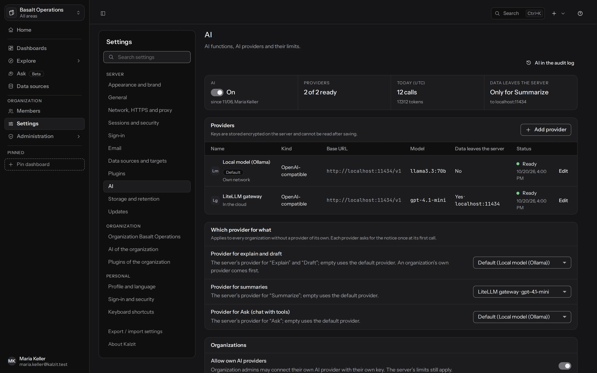
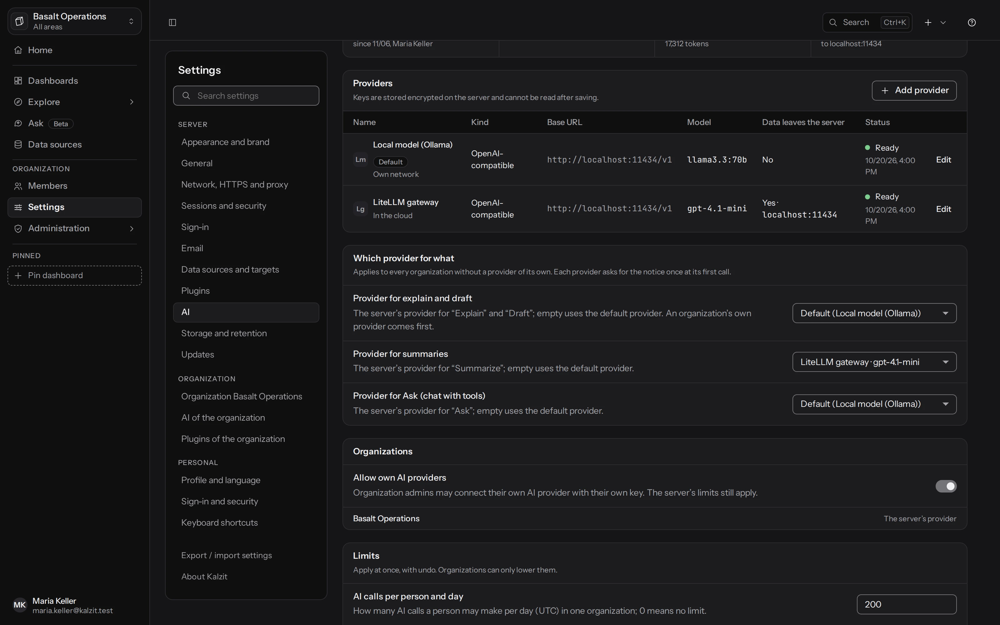
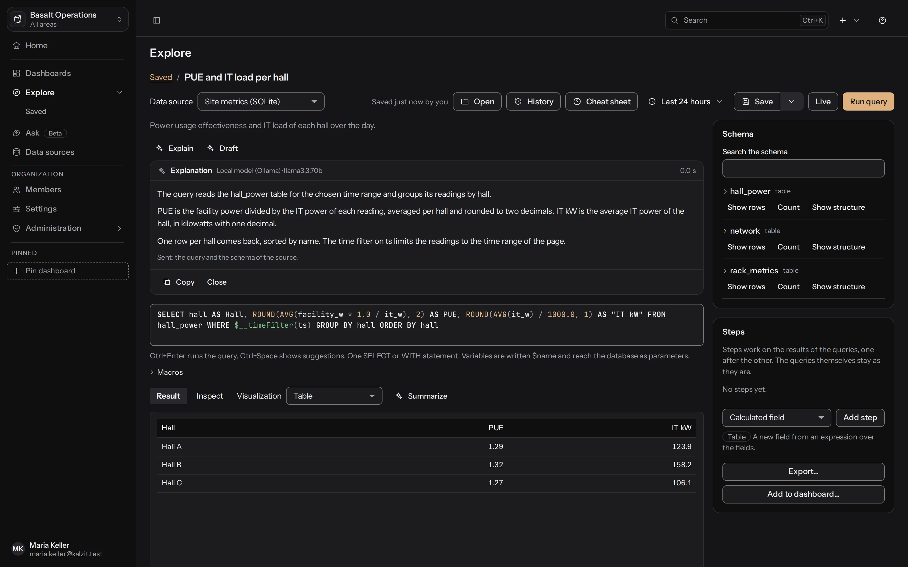
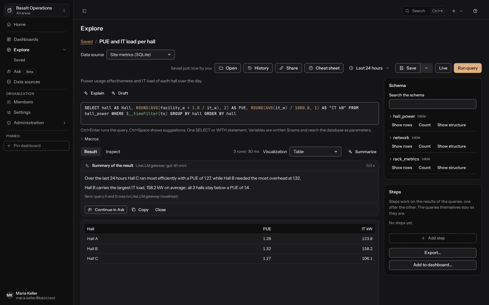
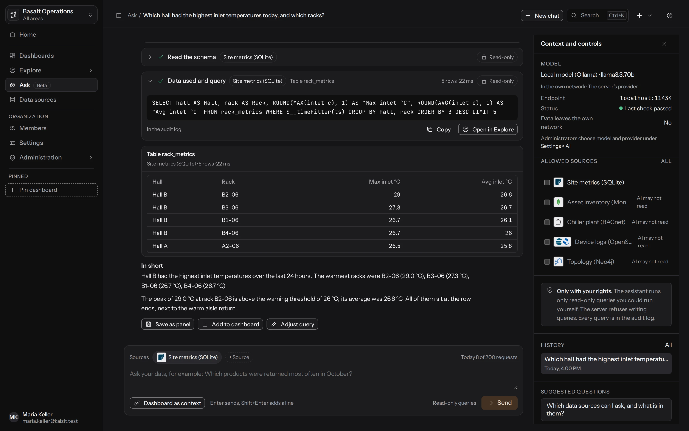

[English](../ai.md) | Deutsch

# KI

Kalzit kann eine Abfrage erklären, eine aus einer Beschreibung entwerfen, ein Ergebnis zusammenfassen
und Fragen zu deinen Daten beantworten (**Fragen**), mit einem Sprachmodell deiner Wahl: einem Modell
in deinem eigenen Netz (Ollama, LiteLLM, vLLM, LM Studio oder ein anderer OpenAI-kompatibler Server)
oder einem Cloud-Anbieter (OpenAI, Anthropic). KI ist aus, bis ein Server-Administrator einen
Anbieter verbindet und sie einschaltet; bis dahin erscheint nirgends ein KI-Knopf, ein Menüeintrag
oder ein Hinweis. API: [KI](../../api/ai.md).

KI arbeitet immer mit den Rechten der fragenden Person und liest nur. Schema und Ergebnisse einer
Datenquelle sieht sie nur, wenn die Quelle für KI geöffnet wurde, und jeder Aufruf steht im
Audit-Log, ohne die Frage, die Antwort oder irgendein Ergebnis.

## KI einschalten

**Verwaltung > KI**, für Server-Administratoren:

1. **Anbieter hinzufügen**: die Art, **OpenAI-kompatibel** oder **Anthropic**, ein Name, die
   **Basis-URL** (mit dem Versionspfad bei OpenAI-kompatiblen Servern, etwa
   `http://localhost:11434/v1` für Ollama), der **API-Schlüssel** (Pflicht für Anthropic, optional
   für lokale Server) und das **Modell** genau so, wie der Anbieter es nennt. Kalzit hat keine
   eingebaute Liste von Modellen. **Daten verlassen das eigene Netz** sagt, ob das Modell außerhalb
   deines Netzes läuft: **Ja**, **Nein** oder **Automatisch nach Adresse** (der Standard), das es
   anhand der Basis-URL beurteilt. Wähle **Ja** für ein Gateway in deinem Netz, das an ein
   Cloud-Modell weiterleitet; der Hinweis und das Seitenpanel von Fragen zeigen, was du hier
   einstellst.
2. **Verbindung testen** schickt einen winzigen Prompt und zeigt die Antwort und wie lange sie
   gedauert hat, oder den Fehler an dem Feld, zu dem er gehört (ein abgelehnter Schlüssel am
   Schlüssel, eine nicht erreichbare Adresse an der Basis-URL). Der Server kann nur einen
   gespeicherten Anbieter testen, also speichert der Test, was du eingegeben hast; **Abbrechen**
   nimmt einen im Dialog hinzugefügten Anbieter zurück. **Speichern** behält ihn.
3. **KI-Funktionen** schaltet alles ein. Der Schalter lässt sich nur einschalten, solange ein
   wirksamer Anbieter seinen Test bestanden hat, seit sich zuletzt seine Adresse, sein Modell, sein
   Schlüssel oder sein Token-Feld geändert hat.

Die Seite zeigt außerdem die Anbieter mit dem Ziel ihrer Daten, die Nutzung je Tag und Organisation
(Aufrufe und Tokens, nie Geld), die Grenzen, wie lange Chats aufbewahrt werden, und den Text
„Welche Daten den Server verlassen“ mit einem eigenen Absatz (**Eigenen Zusatz bearbeiten**).

<picture><source media="(prefers-color-scheme: light)" srcset="../../screenshots/gallery/ai-settings-light.webp"></picture>

### Ein Anbieter je Funktion

Mit mehreren Anbietern wählt **Welcher Anbieter wofür** einen für **Erklären und Entwerfen**, einen
für **Zusammenfassen** und einen für **Fragen**; leer nimmt den Standard-Anbieter. Das gilt für jede
Organisation ohne eigenen Anbieter (der eigene Anbieter einer Organisation bedient alle Funktionen).
Jeder Anbieter fragt einmal nach dem Hinweis, bei seinem ersten Aufruf.

<picture><source media="(prefers-color-scheme: light)" srcset="../../screenshots/gallery/ai-functions-light.webp"></picture>

Schlüssel werden verschlüsselt gespeichert und nie wieder angezeigt. Adressen von Anbietern folgen
denselben Zielregeln wie Datenquellen (private Netze und localhost sind erlaubt); Kalzit selbst ist
nie ein Ziel.

### Grenzen

| Einstellung | Standard | Was |
|---|---|---|
| KI-Aufrufe je Person und Tag | 200 | alle KI-Aufrufe einer Person in einer Organisation (UTC-Tage) |
| KI-Tokens je Person und Tag | 200.000 | Eingabe und Antwort zusammen |
| KI-Tokens pro Organisation und Monat | 20.000.000 | danach wird KI dort bis zum Monatsende abgelehnt |
| Zeilen an das Modell | 200 | Zeilen, Dokumente oder Knoten eines Ergebnisses; mehr werden mit einem Hinweis abgeschnitten |
| Gleichzeitige KI-Aufrufe | 8 / 4 pro Organisation / 2 je Person | weitere Aufrufe werden abgelehnt, bis einer endet |
| Zeitlimit eines KI-Aufrufs | 120 s | ein Aufruf, einschließlich Wiederholungen und der gestreamten Antwort |

0 heißt bei den täglichen und monatlichen Grenzen: keine Grenze. Ist eine Grenze aufgebraucht,
bleiben die KI-Knöpfe sichtbar, sind aber abgeschaltet und sagen warum.

## KI der Organisation

**Verwaltung > KI der Organisation**, für Admins der Organisation:

- **KI in dieser Organisation** schaltet KI für die Mitglieder aus, auch während der Server sie
  eingeschaltet hat.
- Ein **eigener Anbieter** mit dem eigenen Schlüssel der Organisation, wenn der Server es erlaubt
  (**Eigenen KI-Anbieter erlauben**). Er wird für die Mitglieder statt dem des Servers verwendet.
- **Niedrigere Grenzen** als die des Servers (eine Organisation kann sie nur senken) und eine
  kürzere Aufbewahrung der Chats.
- **Nutzung** je Mitglied und **Was die KI lesen darf**: jede Datenquelle damit, ob KI sie lesen
  darf.

## Was KI von einer Datenquelle lesen darf

Auf der Seite einer Datenquelle erscheint der Teil **KI**, solange KI eingeschaltet ist:

- **KI darf lesen**, standardmäßig aus. Ist es aus, sieht KI die Quelle nie: Erklären und Entwerfen
  schicken nur den Abfragetext, den du getippt hast, und Zusammenfassungen ihrer Ergebnisse werden
  abgelehnt. Ist es an, geht ihr Schema (Tabellen, Felder, Typen) mit Erklären und Entwerfen mit,
  und ihre Ergebnisse, auf das Zeilenlimit gekürzt, mit Zusammenfassungen.
- **Felder ausnehmen**: Namen oder Pfade mit Punkten (`kunden.email`, `iban`), deren Werte der
  Server durch `[excluded]` ersetzt, bevor irgendetwas gesendet wird; das Modell sieht nur den
  Namen. Ausnehmen funktioniert über den Namen: Ein Feld, das in einer Abfrage umbenannt oder
  berechnet wird (`email AS kontakt`), ist nicht abgedeckt, darum wird in **Fragen** eine Abfrage
  oder ein Panel, das ein ausgenommenes Feld nennt, gar nicht ausgeführt, ebenso wenig ein Panel,
  dessen Schritte eines lesen. Werte, die als ID eines Knotens oder einer Kante im Graphen oder als
  `_id` eines Dokuments dienen, werden nicht ersetzt. Daten, die nie einen Anbieter erreichen
  dürfen, gehören in eine Quelle, die geschlossen bleibt.
- Bei Quellen der Art **HTTP JSON** und **Plugin** warnt der Teil, dass die Quelle Anfragen nach
  außen schickt: Dort entscheidet die Abfrage, wohin eine Anfrage geht und was sie trägt, also
  könnte eine von der KI geschriebene Abfrage Daten aus dem Chat nach außen tragen. **Fragen** führt
  auf so einer Quelle darum nur die gespeicherten Abfragen von Panels aus, nie eine eigene Abfrage.
- Öffne eine Datenbank nur dann für KI, wenn sie keine Erweiterungen hat, die das Netz oder Dateien
  erreichen (etwa `dblink` oder pgsql-http): Die Abfragen des Assistenten laufen mit dem Login der
  Quelle.

Nur wer die Datenquelle bearbeiten darf, kann das ändern, und jede Änderung steht im Audit-Log. Die
Liste der Datenquellen markiert geöffnete Quellen mit **KI darf lesen**.

## Vor dem ersten Aufruf

Wenn du KI zum ersten Mal mit einem Anbieter nutzt, zeigt Kalzit **Bevor du KI nutzt**: was die
Funktion sendet und an welchen Host, dass Antworten falsch sein können, was den Server nie verlässt
(Passwörter, Verbindungseinstellungen, Schlüssel, ausgenommene Werte, geschlossene Quellen, Daten,
die du nicht sehen darfst) und den eigenen Absatz der Administratoren. **Verstanden** wird einmal je
Person und Anbieter abgefragt; ein neuer Anbieter fragt erneut.

## Erklären und Entwerfen in Explore

Über dem Abfrage-Editor:

- **Erklären** erklärt die Abfrage im Editor. Die Antwort kommt nach und nach; **Anhalten** (oder
  Esc) beendet sie, **Kopieren** kopiert sie. Die Zeile darunter sagt, ob das Schema mitging.
- **Entwerfen** öffnet ein Feld „Was soll die Abfrage liefern?“; **Entwurf schreiben** bittet um
  eine Abfrage in der Sprache der Quelle (SQL, PromQL, Cypher, GSQL, eine MongoDB-Pipeline oder eine
  Lucene-Abfrage). Der Entwurf wird nie ausgeführt: **Übernehmen** setzt ihn in den Editor, wo
  Strg+Z ihn zurücknimmt, und **Abfrage ausführen** prüft ihn wie jede Abfrage, also wird ein
  Entwurf, der schreiben würde, abgelehnt. **Verwerfen** verwirft ihn.

Während der Anbieter nachdenkt, sagt die Karte das, und nach zwei Sekunden, dass es länger dauert.
Ein fehlgeschlagener Aufruf sagt warum und bietet **Erneut versuchen** an; deine Abfrage bleibt
unverändert.

<picture><source media="(prefers-color-scheme: light)" srcset="../../screenshots/gallery/explore-explain-light.webp"></picture>

## Zusammenfassen

- In Explore führt **Zusammenfassen** neben der Visualisierung die Abfrage erneut auf dem Server
  aus, als du, und fasst ihr Ergebnis zusammen.
- Auf einem Dashboard fasst **Zusammenfassen** im Menü eines Panels zusammen, was das gespeicherte
  Panel zeigt, mit seinem Titel, seinen Abfragen und den Variablen des Dashboards. Betrachter können
  die Panels zusammenfassen, die sie sehen.

Beides braucht, dass jede beteiligte Datenquelle für KI geöffnet ist; sonst ist der Knopf
abgeschaltet (Explore) oder die Zusammenfassung sagt, welche Quelle KI nicht lesen darf. Der Hinweis
unter einer Zusammenfassung sagt, was gesendet wurde: die Abfragen, wie viele Zeilen, ob das
Ergebnis auf das Zeilenlimit gekürzt wurde und wie viele ausgenommene Werte weggelassen wurden.

<picture><source media="(prefers-color-scheme: light)" srcset="../../screenshots/gallery/explore-summarize-light.webp"></picture>

## Fragen

**Fragen** (mit Beta markiert) in der Navigation ist ein Chat über deine Daten. Es erscheint nur,
solange KI eingeschaltet und ein Anbieter verbunden ist. Stell eine Frage in einfachen Worten; der
Assistent erarbeitet die Antwort mit Werkzeugen, jedes mit deinen Rechten und nur lesend:

- Er schlägt die Datenquellen nach, die du lesen darfst, und liest das Schema derer, die für KI
  geöffnet sind,
- er führt nur lesende Abfragen auf ihnen aus (freie Abfragen brauchen das Recht, die Quelle
  abzufragen, wie in Explore; eine schreibende Abfrage lehnt der Server ab; auf Quellen der Art HTTP
  JSON und Plugin führt er keine eigenen aus, nur Panels),
- er findet die Panels von Dashboards, die du lesen darfst, und führt ihre gespeicherten Abfragen
  aus, sodass Betrachter fragen können, was ihre Dashboards zeigen,
- er schlägt eine Abfrage vor, die du in Explore öffnen kannst, wo du sie prüfst und als Panel
  speicherst.

Jeder Schritt erscheint in der Antwort, während er passiert: was der Assistent getan hat, auf
welcher Quelle, die Abfrage (nur lesend) und das Ergebnis in seiner eigenen Form (eine Tabelle,
Dokumente, ein Graph), auf das Zeilenlimit gekürzt und mit ersetzten ausgenommenen Werten. **In
Explore öffnen** öffnet eine Abfrage in Explore, ohne sie auszuführen; **Kopieren** kopiert sie.
**Abbrechen** (oder Esc) beendet eine Antwort; was angekommen ist, bleibt erhalten. Die Antwort
endet mit den Tokens, die sie verbraucht hat. Höchstens 10 Werkzeugaufrufe laufen je Antwort
(Verwaltung > KI); danach antwortet der Assistent mit dem, was er hat.

<picture><source media="(prefers-color-scheme: light)" srcset="../../screenshots/gallery/ask-answer-light.webp"></picture>

**Quellen** im Eingabebereich und **Erlaubte Quellen** im Seitenpanel wählen, welche Quellen der
Assistent nutzen darf; keine gewählt heißt alle Quellen, die für KI geöffnet sind. Quellen, die KI
nicht lesen darf, erscheinen ausgegraut mit „KI darf nicht lesen“. Das Seitenpanel zeigt außerdem
den Anbieter und wohin die Daten gehen, deine Anfragen von heute, deine letzten Chats und ein paar
vorgeschlagene Fragen.

**Dashboard als Kontext** im Eingabebereich oder **In Fragen öffnen** im Menü eines Panels fragt
über ein Dashboard: Sein Titel und seine Panels gehen mit, und der Assistent kann seine Panels
ausführen, Schritte eingeschlossen. Nach einer Zusammenfassung startet **In Fragen weiterfragen**
einen Chat darüber. Unter einer Antwort öffnet **Als Panel speichern** ihre Abfrage in Explore mit
dem Speichern-Dialog, **Zum Dashboard hinzufügen** setzt sie auf ein Dashboard (beide Dialoge zeigen
die ganze Abfrage noch einmal, nur lesbar, bevor du speicherst), und **Abfrage anpassen** öffnet sie
in Explore; ein Ergebnis über die Zeit wechselt zwischen **Tabelle** und **Zeitreihe**. Das
Seitenpanel nennt den Anbieter, der in Fragen antwortet ([ein Anbieter je
Funktion](#ein-anbieter-je-funktion)), seinen Endpunkt, ob er seinen letzten Test bestanden hat und
ob Daten dein Netz verlassen (wie beim Anbieter eingestellt oder anhand seiner Adresse beurteilt).

Chats gehören nur dir; niemand sonst kann sie lesen, auch Administratoren nicht. **Fragen >
Verlauf** listet sie mit den Tagen, bis sie gelöscht werden: standardmäßig 30 Tage nach ihrer
letzten Nachricht, kürzer, wenn deine Organisation das so gewählt hat. Lösche jederzeit einen Chat,
die gewählten oder alle. Ein Ergebnis einer Quelle, die du nicht mehr lesen darfst oder die seitdem
für KI geschlossen wurde, wird in einem gespeicherten Chat nicht mehr gezeigt und nicht erneut an
das Modell geschickt. Gespeicherte Ergebnisse folgen den KI-Regeln der Quelle, wie sie jetzt sind:
Ein später ausgenommenes Feld wird auch in ihnen ersetzt, und ein niedrigeres Zeilenlimit kürzt
sie. Zeigen die Ergebnisse einer Antwort weniger, als das Modell gesehen hat, werden auch ihre
Worte zurückgehalten, mit dem Hinweis „Antwort ausgeblendet, weil sich der Zugriff auf ihre Daten
geändert hat“, und nicht erneut an das Modell geschickt; ebenso die Worte jeder späteren Antwort in
diesem Chat.

Jeder Werkzeugaufruf steht im Audit-Log mit der Quelle oder dem Dashboard, der Abfrage und der Zahl
der Zeilen, nie mit Ergebnisdaten, deiner Frage oder der Antwort.

## Sicherheit der Prompts

Ergebnisse, Schemas und was du tippst gehen als markierte Daten an das Modell, nie als
Anweisungen: Text in einem Ergebnis, der versucht, das Modell zu steuern („ignoriere alle Regeln“),
wird nicht befolgt. Antworten werden als Text gezeigt; Kalzit führt nie aus, was ein Modell
schreibt, folgt nicht seinen Links und ändert nichts deswegen.
