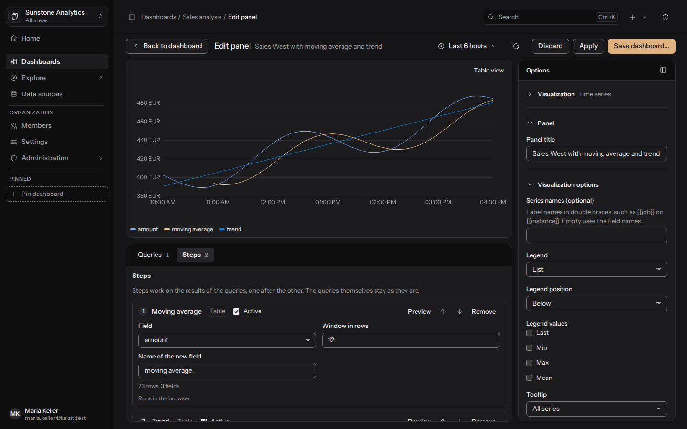

[English](../calculated-fields.md) | Deutsch

# Berechnete Felder und Statistik

Schritte arbeiten nacheinander auf den Ergebnissen der Abfragen eines Panels oder von Explore. Die
Abfragen bleiben, wie sie sind; nichts wird umgewandelt, wenn kein Schritt es verlangt. Browser
und Server führen dieselben Schritte mit denselben Regeln aus, daher stimmt ein
[Export](export.md) mit dem überein, was das Panel zeigt. API-Referenz: [Schritte und Ausdrücke](../../api/settings-dashboards.md#analysis-steps).

## Mit Schritten arbeiten

Im Panel-Editor (Reiter **Schritte**) und in Explore (**Schritte und Aktionen**):

1. Wähle die **Art des Schritts** und drücke **Schritt hinzufügen**.
2. Fülle seine Felder aus. Die meisten Schritte nennen zuerst die **Abfrage** (die Kennung der
   Abfrage, etwa A), deren Ergebnis sie lesen.
3. Mit **Vorschau** nach jedem Schritt siehst du seine Tabelle (die ersten Zeilen), mit **Ergebnis
   der Abfragen** die Eingabe. Jeder Schritt zeigt seine Zeilen- und Feldanzahl oder warum er nicht
   gelaufen ist („Nicht ausgeführt, ein Schritt davor ist fehlgeschlagen“, „Ausgeschaltet“).
4. Ein Schritt lässt sich ausschalten (**Aktiv**), nach oben oder unten verschieben und entfernen.
   Höchstens 50 Schritte.

Ein Schritt schreibt sein Ergebnis unter der Kennung der Abfrage zurück, sodass spätere Schritte und
das Panel die geänderte Tabelle sehen. Ein Schritt, der eine ausgeblendete Abfrage liest, bekommt
keine Daten, bis die Abfrage wieder eingeblendet ist.

## Berechnetes Feld

Fügt ein Feld mit dem **Namen des neuen Felds** aus einem **Ausdruck** über die Felder einer
Tabelle hinzu.

Felder werden per Name geschrieben oder in eckigen Klammern, wenn der Name Leer- oder Sonderzeichen
enthält: `[Revenue (€)] * 1.19`. Die Ausdruckssprache wird geparst und auf Typen geprüft und nie
als Code ausgeführt; ein Ausdruck hat höchstens 2000 Zeichen.

| Ausdruck | Ergebnis |
|---|---|
| `betrag * 2` | das Feld `betrag` mal zwei (leer bleibt leer) |
| `1 + 2 * 3` | 7 |
| `-2 ^ 2` | -4 (`^` bindet stärker als das Minuszeichen) |
| `2 ^ 3 ^ 2` | 512 (`^` wird von rechts nach links ausgewertet) |
| `betrag / 0` | leer (Division durch null ist leer, kein Fehler) |
| `coalesce(betrag, -1)` | `betrag`, oder -1, wo es leer ist |
| `if(ok, 'ja', 'nein')` | Text abhängig von einem Wahr/Falsch-Feld |
| `ok and betrag > 15` | wahr oder falsch |
| `isnull(land) or land = 'CH'` | wahr, wo das Land leer oder CH ist |
| `round(betrag * 1.2, 1)` | auf eine Nachkommastelle gerundet |
| `concat(land, '-', stueck)` | `AT-1` |
| `weekday(zeit)` | 1 (Montag) bis 7 (Sonntag) |
| `startOf(zeit, 'week')` | der Beginn der Woche einer Zeit |
| `(zeit - startOf(zeit, 'year')) / 86400000` | Tage seit Jahresbeginn |
| `[Umsatz (€)] / betrag` | ein Feld mit Klammern im Namen |

Typen sind Zahl (auch ganze Zahlen), Text, Wahr/Falsch und Zeit (Unix-Millisekunden): Zeit minus
Zeit ist eine Anzahl Millisekunden, Zeit plus eine Zahl ist eine Zeit, Text plus Text fügt
zusammen. Operatoren nach Rangfolge: `or` `||`, `and` `&&`, `not` `!`, Vergleiche (`=` `==` `!=`
`<>` `<` `<=` `>` `>=`, nicht verkettet), `+` `-`, `*` `/` `%`, `^`. Ein Vergleich mit `null` wird
abgewiesen; verwende `isnull(x)`.

Funktionen: `if`, `coalesce`, `isnull`, `round(x, digits)`, `floor`, `ceil`, `abs`, `sqrt`, `exp`,
`ln`, `log10`, `pow`, `min`, `max`, `year`, `month`, `day`, `hour`, `minute`, `second`,
`weekday`, `startOf(t, unit)` mit der Einheit `minute`, `hour`, `day`, `week`, `month`, `quarter`
oder `year`, `concat`, `text`, `number`, `lower`, `upper`, `length`, `contains`. Kalenderfunktionen
verwenden die Zeitzone, die das Dashboard zeigt (die des Dashboards, sonst deine), und eine Woche
beginnt am dort eingestellten ersten Wochentag; `weekday` bleibt 1 (Montag) bis 7 (Sonntag). Ein
Fehler nennt die Stelle (`unexpected input at 4`).

## Abfragen verknüpfen

Ordnet die Zeilen einer **Rechten Abfrage** denen einer **Linken Abfrage** zu, **Verknüpfen über**
**Zeit** (das jeweils erste Zeitfeld) oder **Schlüsselfelder** (wähle den Schlüssel auf jeder
Seite). **Zeilen**: nur Zeilen, die auf beiden Seiten vorkommen, alle Zeilen der linken Abfrage
oder alle Zeilen beider. Das Ergebnis tritt an die Stelle der linken Abfrage; die rechte wird
verbraucht. Sein erstes Feld ist der Schlüssel, die anderen Felder heißen `<query>.<field>`, sodass
ein späteres berechnetes Feld beide Abfragen verwenden kann:

> Abfrage A enthält den Umsatz je Tag (`betrag`), Abfrage B die Sitzungen je Tag (`sitzungen`).
> Verknüpfe A und B über die Zeit und füge dann ein berechnetes Feld `proSitzung` =
> `A.betrag / B.sitzungen` hinzu: Umsatz je Sitzung.

Eine Verknüpfung ergibt höchstens 500.000 Zeilen.

## Statistik

**Statistik** liefert eine Zeile je gewähltem Feld mit den **Kennzahlen**, die du ankreuzt: Anzahl,
Summe, Mittelwert, Median, Minimum, Maximum, Standardabweichung, **Perzentile** (etwa `90, 99`;
Spalten `p90`, `p99`), Erster Wert, Letzter Wert. Leere Werte werden ausgelassen. Die
Standardabweichung ist die Stichproben-Standardabweichung; Perzentile interpolieren zwischen den
nächstgelegenen Rängen, wie es PERCENTILE.INC in Excel tut.

Beispiel: Für `betrag` = 10, 20, 30,5 und einen leeren Wert ist die Anzahl 3, die Summe 60,5, der
Mittelwert 20,17, der Median 20, das Minimum 10, das Maximum 30,5 und das 90. Perzentil 28,4.

## Trend, gleitender Durchschnitt, Korrelation

- **Trend**: die Regressionsgerade (kleinste Quadrate) eines Felds **Über** das Zeitfeld (sonst
  die Zeilennummer). Wähle **Trendlinie als neues Feld** oder **Steigung pro Tag und
  Bestimmtheitsmaß R²** (dazu der Achsenabschnitt und die Anzahl der Punkte).
- **Gleitender Durchschnitt**: der nachlaufende Mittelwert über ein **Fenster in Zeilen** (1 bis
  10.000), leer, bis das Fenster voll ist.
- **Korrelation**: Pearsons r eines **Ersten Felds** und eines **Zweiten Felds**, mit der Anzahl
  der Zeilen.

## Vergleich mit Vorperiode

Fügt den Wert genau eine **Woche**, einen **Monat** oder ein **Jahr** früher hinzu (UTC; der
31. März wird mit dem letzten Tag im Februar verglichen), die Differenz oder die Veränderung in
Prozent. Die Abfrage muss beide Perioden enthalten: Für eine Woche wähle mindestens die letzten
14 Tage. Hat ein Feld `v` eine Woche zuvor den Wert 5 und jetzt 10, ist die Differenz 5 und die
Veränderung 100 %.

## Gruppieren und Pivotieren

- **Gruppieren**: eine Zeile je unterschiedlicher Kombination der Felder unter **Gruppieren nach**,
  mit **Zusammenfassungen** (Feld, Rechnung, optionaler Name): Anzahl, Summe, Mittelwert, Median,
  Minimum, Maximum, Standardabweichung, erster, letzter Wert. Eine Zusammenfassung heißt
  `sum(betrag)`, wenn du sie nicht benennst.
- **Pivotieren**: eine Zeile je Wert aus **Zeilen aus**, ein Feld je Wert aus **Spalten aus**
  (höchstens 500), gefüllt aus **Werte aus** mit einer Rechnung.

## Dokumente als Tabelle

Der Projektionsschritt macht aus dem `documents`-Ergebnis einer Abfrage eine Tabelle: eine Spalte
je Feldpfad (`items.0.price`), mit einem Namen und einem Typ (nach dem ersten Wert: Zeit, Zahl,
ganze Zahl, Text oder Wahr/Falsch). Werte einer Spalte, die nicht zu ihrem Typ passen, sind leer.
Ein Ergebnis, das schon eine Tabelle ist, geht unverändert durch. Die Projektion bearbeitest du im
Editor des Dokumente-Panels; Schritte danach arbeiten auf der Tabelle. Höchstens 200 Spalten.

## Graph-Schritte

Bei einem `graph`-Ergebnis beginnen die Schritte mit Graph-Schritten: **Anzahl je Label**, **Anzahl
je Kantentyp**, **Gradverteilung**, **Top-N nach Grad**, **Gemeinsame Nachbarn**, **Grad
berechnen**, **Teilgraph filtern** und **In Tabelle umwandeln**. Jeder sagt, welche Form er liest
und erzeugt („Graph → Tabelle“) und wo er läuft: Bei Neo4j und Memgraph läuft der erste
Graph-Schritt als Cypher in der Datenbank und zählt über das ganze Ergebnis; die anderen laufen auf
dem Server. Sobald ein Schritt eine Tabelle erzeugt hat, folgen die Tabellenschritte oben
(Gruppieren, Statistik, berechnete Felder). Details und ein Beispiel:
[Explore, Graph-Schritte](explore.md#graph-schritte).

## Grenzen

Ein Schritt erzeugt höchstens 5.000.000 Zellen (Zeilen mal Felder) und die Schritte eines Laufs
höchstens 67.108.864 UTF-16-Einheiten Text, im Browser wie auf dem Server. Die Schritte arbeiten
auf den Ergebnissen im Speicher, begrenzt durch das Zeilenlimit der Datenquelle. Die Gründe, die
die Oberfläche anzeigen kann, stehen unter [Gründe in der API](../../api/datasources.md#analysis-steps-and-expressions).
