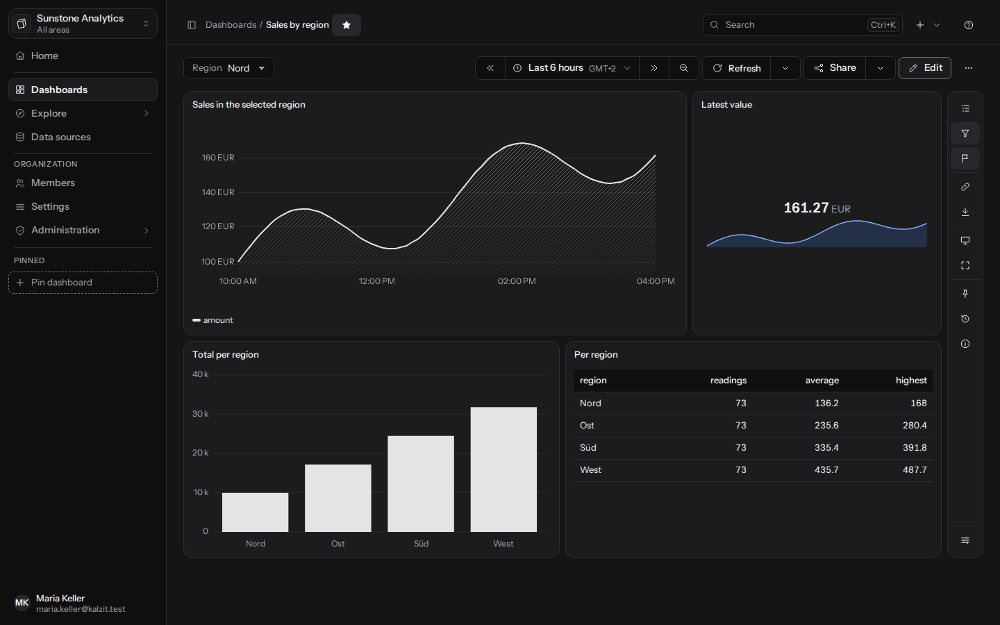
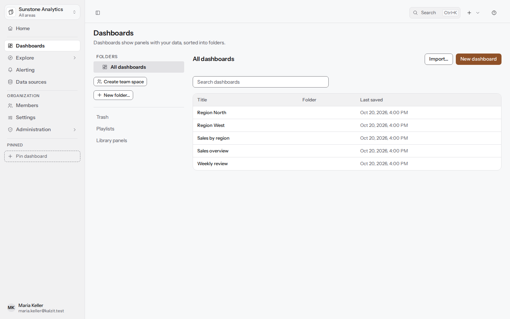
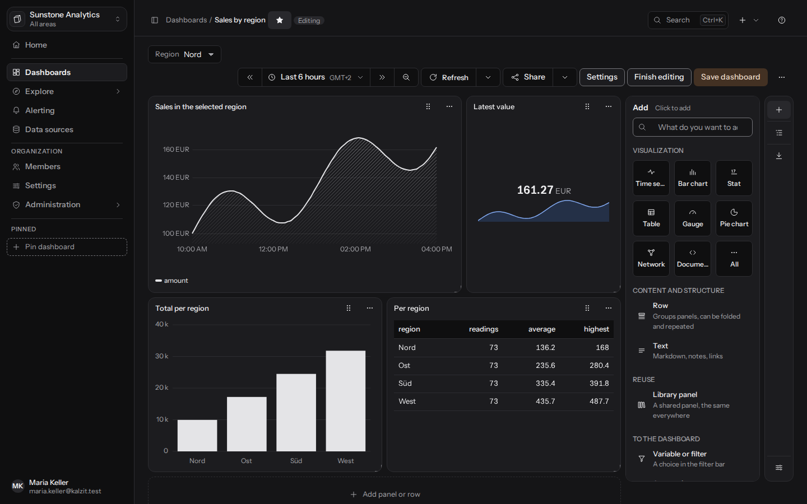
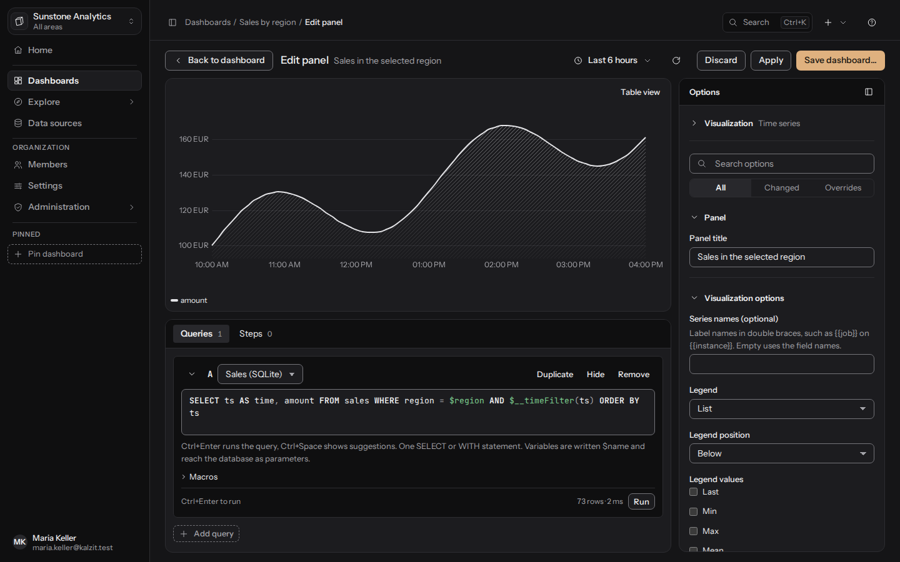
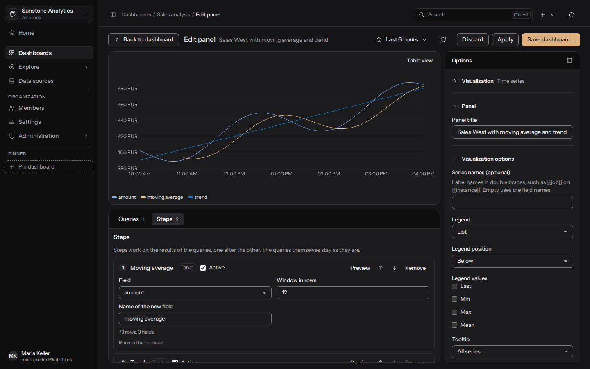
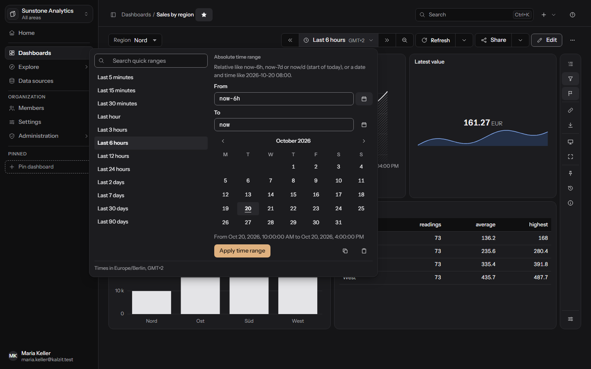
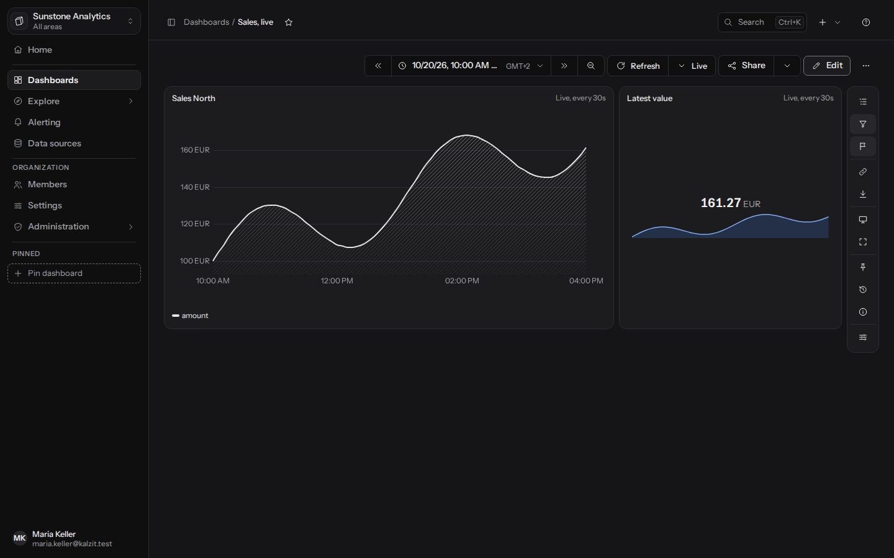

[English](../dashboards.md) | Deutsch

# Dashboards

Ein Dashboard ist eine Seite mit Panels, von denen jedes das Ergebnis einer oder mehrerer
gespeicherter Abfragen zeigt. API: [Einstellungen und Dashboards](../../api/settings-dashboards.md)
und [Dashboard-Funktionen](../../api/dashboard-features.md).



## Die Liste der Dashboards

**Dashboards** listet die Dashboards, die du öffnen darfst, in Ordnern. Suche nach Titel, sortiere
nach Titel, Ordner oder zuletzt gespeichert und wähle links im Baum einen Ordner (**Alle
Dashboards**, **Kein Ordner**). Ordner lassen sich anlegen (**Neuer Ordner…**), umbenennen und
verschieben und als **Eingeschränkt** markieren: Ein eingeschränkter Ordner und alles darin ist
nur für Mitglieder mit Zugriff sichtbar (siehe [Verwaltung](administration.md#rollen-und-rechte)).
**Zugriff…** an einem Ordner oder Dashboard legt fest, wer es über seine Rolle hinaus nutzen darf.



## Ein Dashboard ansehen

Die obere Leiste nennt das Dashboard in ihrem Pfad. Darunter liegt eine ruhige Werkzeugzeile mit:

- **Markieren** am Anfang: Ein Favorit erscheint auf deiner Startseite.
- Den **Variablen** als Filterleiste (siehe [Variablen](#variablen-und-filter)).
- Rechts: dem **Zeitraum** mit seiner Zeitzone, **Aktualisieren** und **Teilen** als geteilte
  Schaltflächen, **Bearbeiten** und einem Menü **Mehr**.

Eine Spalte am rechten Rand der Fläche, die Dashboard-Werkzeuge, enthält **Gliederung** (zu Zeilen
und Panels springen), **Filter und Variablen** und **Anmerkungen** (ein- oder ausblenden),
**Teilen**, **Kiosk- und TV-Modus**, **Vollbild**, **Verlauf** und **Dashboard-Infos** (Ordner,
Version, zuletzt gespeichert, Schlagwörter, Anzahl der Panels, Zeitzone). Sie lässt sich
einklappen und bleibt für dich eingeklappt. Auf dem Handy nimmt die Werkzeugzeile zwei Zeilen ein,
und das Menü Mehr enthält die Aktionen der Spalte.

**Mehr** enthält Einstellungen…, Kioskmodus, TV-Modus, Verlauf, Zugriff…, Speichern unter… und
Löschen…; was du siehst, hängt von deinen Rechten ab.

Die Aktionen eines Panels liegen in einer Menüschaltfläche in seiner Titelleiste und erscheinen,
wenn du auf das Panel zeigst oder es mit der Tastatur erreichst: seine Links, allein ansehen,
**Anmerken**, **Untersuchen**, Export, **Bild speichern (PNG)**, **Bearbeiten**, **Duplizieren**,
**Kopieren nach…** und **Löschen**. **Untersuchen** zeigt die Größe des Ergebnisses, die
ausgeführte Abfrage und die Hinweise und Warnungen des Servers und sagt, wenn das Ergebnis am
Zeilenlimit der Datenquelle abgeschnitten wurde.

## Bearbeitungsmodus

Drücke **Bearbeiten** (braucht Schreibzugriff). Hinter dem Namen des Dashboards steht dann die
Markierung **Bearbeiten**, und die Werkzeugzeile zeigt **Einstellungen**, **Bearbeiten beenden**
(fragt vorher, wenn sich etwas geändert hat) und **Dashboard speichern**.

- Zieh ein Panel an seinem Titel, um es zu verschieben, oder nimm die Schaltfläche zum Anordnen
  und die Pfeiltasten (Umschalt und Pfeiltasten ändern die Größe). Zeilen verschiebst du per
  Ziehen oder mit den Pfeiltasten nach oben und unten.
- Die Spalte rechts hat jetzt den Bereich **Hinzufügen**; siehe unten. **Panel oder Zeile
  hinzufügen** am Ende der Fläche öffnet ihn ebenfalls.
- Tastenkürzel für das ausgewählte Panel (oder das, dessen Karte den Fokus hat): **E** öffnet es
  im Editor, **Strg+D** dupliziert es, **Strg+C** kopiert es, **Strg+V** fügt das kopierte Panel
  ein (in diesem oder einem anderen Dashboard derselben Organisation) und **Entf** löscht es (auf
  dem Mac Cmd statt Strg, und auch die Rücktaste löscht). Duplizieren, Einfügen und Löschen bieten
  Rückgängig an. Die Tasten tun nichts, während du in einem Feld oder einem Abfrage-Editor tippst.
- Im Inspektor schaltet **Zeitbereich überschreiben** einen eigenen Zeitraum und eine eigene
  Verschiebung für das Panel ein.
- **Dashboard speichern** fragt nach einer optionalen Nachricht (bis zu 500 Zeichen), die im
  Verlauf erscheint. Jedes Speichern ist eine neue Version. Zeitraum oder Variablenwert im
  Bearbeitungsmodus zu ändern ändert nur, was du siehst; weichen sie von den gespeicherten ab,
  bietet der Dialog zum Speichern **Aktuellen Zeitraum als Standard des Dashboards speichern** und
  **Aktuelle Variablenwerte als Standard speichern** an. Ohne Haken bleiben die gespeicherten
  Standardwerte.
- Wenn du mit ungespeicherten Änderungen gehst, wirst du vorher gefragt. Hat inzwischen jemand
  anderes gespeichert, vergleicht ein Konfliktdialog **Deine Änderungen** mit **Inzwischen von
  anderen gespeichert**; du kannst weiter bearbeiten, deine verwerfen und die andere Version
  öffnen oder **Meine als neueste Version speichern**.



### Das Menü Hinzufügen

Im Bearbeitungsmodus bietet **Hinzufügen** (Suche mit „Was möchtest du hinzufügen?“):

| Eintrag | Was es hinzufügt |
|---|---|
| Visualisierung | Ein neues Panel; eine Auswahl zeigt jede Art mit einer Zeichnung und bietet die passenden Arten zuerst an |
| Zeile | Gruppiert Panels, lässt sich einklappen und wiederholen |
| Text | Markdown, Hinweise, Links |
| Bibliothekspanel | Ein geteiltes Panel, überall gleich |
| Kopiertes Panel einfügen | Das mit Strg+C kopierte Panel, sichtbar, sobald eines kopiert wurde |
| Variable oder Filter | Eine Auswahl in der Filterleiste |
| Anmerkungen | Ereignisse aus einer Abfrage markieren |
| Link | Zu anderen Dashboards oder Seiten |

## Zeilen

Eine Zeile gruppiert Panels unter einem Titel und lässt sich einklappen. **Zeile hinzufügen** legt
eine an; ein Panel kommt über seine Einstellung **Zeile** im Panel-Editor in eine Zeile
(„Außerhalb aller Zeilen“ lässt es draußen). Eine Zeile zu entfernen behält ihre Panels. Eine
Zeile kann sich für jeden Wert einer Variablen wiederholen, die mehrere Werte erlaubt: Die Zeile
mit all ihren Panels erscheint einmal je ausgewähltem Wert.

## Der Panel-Editor

Ein Panel hinzuzufügen und zu bearbeiten öffnet eine eigene Seite mit einer Adresse, die du neu
laden oder teilen kannst (`.../panels/<id>/edit`, `.../panels/new`).



- **Leiste oben:** **Zurück zum Dashboard**, der Zeitraum, Aktualisieren, **Verwerfen**,
  **Übernehmen** und **Dashboard speichern…**.
- **Vorschau** oben, mit einem Schalter **Tabellenansicht**.
- **Abfragen** und **Schritte** in Reitern darunter. Jede Abfrage hat eine Datenquelle, lässt
  sich einklappen, duplizieren und ausblenden (eine ausgeblendete Abfrage bleibt beim Panel, läuft
  aber nicht). Ausführen mit Strg+Eingabe, mit der Schaltfläche zum Ausführen oder indem du eine
  geänderte Abfrage verlässt. Schritte sind in
  [Berechnete Felder und Statistik](calculated-fields.md) beschrieben.
- **Optionen** rechts, in Gruppen, die sich einklappen lassen: zuerst die **Visualisierung**, dann
  Titel und Visualisierungsoptionen des Panels, **Feldoptionen** und **Links, Wiederholung und
  Zeit**. Siehe [Panels](panels.md).
- Zieh die Trenner oder verschieb sie mit den Pfeiltasten; der Editor merkt sich ihre Lage.
- Zurück, **Übernehmen** und Esc behalten die Änderung im Dashboard, bis du es speicherst.
  **Verwerfen** (und die Zurück-Schaltfläche des Browsers) lässt das Panel, wie es war, nach einer
  Rückfrage, wenn sich etwas geändert hat. Ein neues Panel kommt erst mit Übernehmen oder
  Speichern ins Dashboard. Neu laden behält deine ungespeicherten Änderungen.



Unter **Links, Wiederholung und Zeit** bekommt ein Panel seinen Platz (Zeile), **Wiederholen für
jeden Wert von** einer Variablen mit mehreren Werten (nebeneinander oder untereinander, höchstens
so viele pro Zeile), einen eigenen **Zeitraum** wie `now-24h` und einen **Zeitversatz** wie
`1d` oder `1w`, um mit einem früheren Zeitraum zu vergleichen, und **Datenlinks**, die in seinem
Kopf erscheinen, mit eingesetzten Variablen wie `${name}`.

Eine Abfrage zu ändern braucht Abfragerechte an ihrer Datenquelle; ohne sie kannst du das Panel
trotzdem umbenennen, anordnen und anders gestalten.

## Variablen und Filter

Mit Variablen ändern Betrachter Werte in allen Abfragen, etwa eine Region. Du legst eine mit
**Variable hinzufügen** in den Einstellungen des Dashboards oder im Menü Hinzufügen an. Arten:

- **Feste Werte**: eine Liste mit Kommas.
- **Freier Text**: ein Textfeld.
- **Zeitintervalle**: eine Liste von Intervallen mit Kommas wie `1m, 10m, 1h`, ausgewählt wie
  feste Werte; Abfragen bekommen das Intervall als Text.
- **Konstante**: ein fester **Wert**, den Abfragen als `$name` nutzen. Sie erscheint nicht in der
  Filterleiste, und Betrachter können sie nicht ändern.
- **Werte aus einer Abfrage**: Die erste Spalte des Ergebnisses wird zur Liste. Bei einer Graph-
  oder Dokumentquelle sagt **Werte aus**, was stattdessen zur Liste wird: **Knoten** oder
  **Beziehungen** (eine Property, wahlweise nur von denen mit einem Label oder Typ; leer nimmt die
  ID) oder **Dokumente** (ein Feldpfad wie `customer.id`; eine Liste ergibt einen Wert je
  Eintrag). Ein **Angezeigter Name** benennt jeden Eintrag. Das Ergebnis selbst behält seine
  Form; dies ist der sichtbare Schritt, der es in Werte umwandelt. Die Abfrage liest höchstens
  10.000 Zeilen, Knoten oder Dokumente, und wiederholte Werte zählen mit, also lass die Abfrage
  jeden Wert einmal liefern (`RETURN DISTINCT` in Cypher, eine Stufe `$group` in MongoDB), wenn es
  mehr Einträge gibt.

Optionen: eine **Beschriftung**, **Mehrere Werte erlauben** und ein **Wert beim Öffnen des
Dashboards**. Die Pfeilschaltflächen unter einer Variablen verschieben sie nach oben oder unten
(die Filterleiste zeigt sie in dieser Reihenfolge), und **Duplizieren** fügt direkt darunter eine
Kopie unter einem freien Namen ein. Namen bestehen aus Buchstaben, Ziffern und Unterstrichen.
Abfragen nutzen eine Variable als `$name` (MongoDB-Pipelines schreiben `"${name}"`); sie erreicht
die Datenbank als Parameter, nie als Text in der Abfrage. Die Variablen erscheinen als
Filterleiste in der Werkzeugzeile. Eine Variable mit mehreren Werten ist ein Listenfeld, in dem
Strg oder Umschalt mit einem Klick, oder die Leertaste, weitere auswählen. Panels und Zeilen
können sich je ausgewähltem Wert wiederholen.

### Variablen über Datenformen hinweg

Einer Variablen ist es egal, welche Form sie gesetzt hat und welche Form sie liest. Ein Klick auf
ein MongoDB-Dokument (Dokument-Explorer oder Karte), eine Tabellenzeile oder einen Graphknoten kann
sie setzen (die Option **Ein Klick auf … setzt** des Panels), und jedes Panel, das sie nutzt, läuft
erneut: Ein Cypher-Panel liest sie als `$customerId`, eine TigerGraph-Abfrage als ihren
deklarierten Parameter dieses Namens, SQL als Parameter. So kann ein Klick auf ein Kundendokument
die Beziehungen dieses Kunden in einem Graph-Panel zeigen:

```
MATCH (c:Customer {customerId: $customerId})-[r]-(m) RETURN c, r, m
```

Werte reisen immer als Parameter, nie als Text in einer Abfrage, deshalb bleibt Text mit
Anführungszeichen ein Wert. Ein per Klick gesetzter Wert ist Text; enthält eine Cypher-Property
Zahlen, vergleiche mit `toInteger($customerId)`. GSQL nimmt Variablen nur als deklarierte
Parameter: `$name` in GSQL-Code wird mit einem Hinweis abgelehnt. Ein dynamisches Label oder ein
dynamischer Property-Schlüssel in Cypher (`n:$($label)`, `n[$property]`) nimmt nur eine Variable
**Feste Werte**, deren Werte das Dashboard aufführt. Ein Klick auf einen Wert, den eine Variable
mit festen Werten nicht anbietet, lässt sie, wie sie ist, und sagt das.

## Zeitraum und Zeitauswahl

Die Schaltfläche für den Zeitraum öffnet die Zeitauswahl.



- **Schnellauswahl** mit einem Suchfeld: letzte 5 Minuten bis letzte 5 Jahre, heute bis jetzt,
  gestern, vorgestern, diese Woche, diesen Monat und dieses Jahr bis jetzt, vorige Woche, voriger
  Monat und voriges Jahr sowie Geschäftsquartale und Geschäftsjahre. **Zuletzt verwendet** listet
  deine letzten Zeiträume in diesem Browser.
- **Fester Zeitraum**: Von und Bis als Text, relativ wie `now-6h`, `now-7d` oder `now/d` (Beginn
  des heutigen Tages), als Datum und Uhrzeit wie `2026-10-20 08:00` oder im Kalender gewählt. Die
  Zeitauswahl nennt die Zeitzone, in der die Zeiten stehen.
- Schaltflächen neben dem Zeitraum verschieben ihn um seine eigene Länge zurück und vor und
  zoomen auf die doppelte Länge heraus. Relative Zeiträume bleiben relativ, wo es geht.
- **Aktualisieren** führt alle Abfragen jetzt aus; sein Menü stellt automatisches Aktualisieren
  ein (alle 5 Sekunden bis einmal am Tag, aus der Liste der Intervalle des Dashboards) oder
  **Live**, siehe unten.
- **Teilen** > **Link mit Zeitraum kopieren** kopiert einen Link, der das Dashboard mit dem
  Zeitraum öffnet.

Tastenkürzel (nicht in Textfeldern): `t`, dann Links oder Rechts verschiebt den Zeitraum, `t`,
dann `z` zoomt heraus, `t`, dann `c` kopiert ihn und `t`, dann `v` fügt einen Zeitraum ein. Sie
funktionieren auch im Panel-Editor. Auf deutschen Tastaturen sind es dieselben Tasten.

**Einstellungen…** > **Zeitoptionen** (braucht Bearbeitungsrechte): eine Zeitzone und der erste
Tag der Woche für alle, die das Dashboard öffnen (oder die eigenen jedes Betrachters), der Monat,
in dem das **Geschäftsjahr beginnt**, eine **Verzögerung von „jetzt“**, die die neuesten, noch
unvollständigen Daten weglässt (etwa `1m`), die angebotenen **Intervalle zum Aktualisieren** und
ein **Gemeinsamer Cursor** (aus, Fadenkreuz oder Fadenkreuz und Tooltip), der die Zeit unter dem
Zeiger in jedem Zeitreihen-Panel zeigt.

## Live-Aktualisierung

**Aktualisieren** > **Live** lässt den Server neue Ergebnisse an die Panels schicken, statt dass
der Browser immer wieder nachfragt. Die Schaltfläche neben **Aktualisieren** zeigt dann **Live**,
und das automatische Aktualisieren ruht, solange Live an ist. API:
[Live-Aktualisierung](../../api/live.md).

- Nur Panels auf dem Bildschirm folgen den Live-Ergebnissen; ein Panel, das aus dem Bild gescrollt
  ist, hält an und startet wieder, wenn du zurückscrollst. Jedes Panel behält seine
  Visualisierung: Eine Tabelle bleibt eine Tabelle, Dokumente bleiben Dokumente, ein Graph bleibt
  ein Graph.
- Ein kleiner Text in der Titelleiste jedes Panels sagt, wie es aktuell bleibt, mit den Details in
  seinem Tooltip: **Live**, wenn die Quelle Änderungen meldet (MongoDB mit Change Streams),
  **Live, alle 30s**, wenn die Abfragen in einem Intervall erneut laufen (SQL-, Metrik-, Such-,
  Graph- und Dateiquellen und jeder Zeitraum, der jetzt endet). Das Intervall ist das zuvor
  gewählte Intervall zum Aktualisieren, mindestens 5 Sekunden, sonst 30 Sekunden. Der Tooltip
  sagt auch, warum eine MongoDB-Abfrage regelmäßig nachfragt, zum Beispiel wenn die Quelle schon
  so viele Abfragen beobachtet, wie sie erlaubt, oder wenn die Ergebnisse mehr Speicher bräuchten,
  als der Server erlaubt.
- **Live beendet** heißt, dass der Server die Live-Aktualisierung des Panels beendet hat, zum
  Beispiel weil du den Zugriff auf die Daten verloren hast; der Tooltip sagt, warum. Schalte Live
  aus und wieder an, um es erneut zu versuchen.
- **Live-Aktualisierung pausieren** im selben Menü hält die Panels auf ihren letzten Ergebnissen,
  jedes mit **Live pausiert**; auch das automatische Aktualisieren bleibt aus.
  **Live-Aktualisierung fortsetzen** macht weiter. Live pausiert auch von selbst, solange der Tab
  des Browsers im Hintergrund bleibt, und läuft weiter, wenn du zurückkommst.
- Ein Panel, das aus dem Bild gescrollt ist, behält seine Live-Aktualisierung noch einen Moment,
  sodass Vorbeiscrollen sie nicht anhält und neu startet.
- Startet der Server neu oder bricht die Verbindung ab, verbindet sich Kalzit von selbst wieder
  und wartet nach jedem fehlgeschlagenen Versuch etwas länger. Endet deine Sitzung, stoppt Live,
  bis du dich wieder anmeldest.

Ein Zeitraum, der jetzt endet (wie die letzten 6 Stunden), wandert mit jedem Lauf mit; ein fester
Zeitraum bleibt, wie er ist. Live ist eine Wahl dieser Ansicht des Dashboards und wird nicht mit
ihm gespeichert.



## Anmerkungen

Anmerkungen markieren Zeitpunkte oder Zeitspannen in jedem Zeitdiagramm.

- Du fügst eine mit Strg+Klick auf ein Diagramm, der Taste `A` oder **Anmerken** im Panelmenü
  hinzu. Gib einen Text, Schlagwörter (mit Kommas) und wahlweise eine Endzeit für eine Zeitspanne
  an. Bearbeiten braucht `annotations:write` oder Schreibzugriff auf das Dashboard.
- **Anmerkungsabfragen** (Menü Hinzufügen > Anmerkungen) fügen Markierungen aus einer Datenquelle
  hinzu: Jede Zeile eines Tabellenergebnisses wird zu einer Anmerkung; die erste Zeitspalte ist
  die Zeit, `timeEnd` beendet eine Zeitspanne, `text` (oder die erste Textspalte) ist der Text und
  eine Spalte `tags` enthält die Schlagwörter. Jede Abfrage hat einen Namen und eine Farbe und
  lässt sich ausschalten. Anmerkungen aus Abfragen werden in ihrer Datenquelle geändert, nicht in
  Kalzit.
- Das Werkzeug **Anmerkungen** in der Spalte blendet sie ein oder aus.

## Links

**Links** erscheinen unter dem Titel des Dashboards. Ein Link führt zu einer **Adresse** (beginnend
mit `https://`, `http://`, `mailto:` oder `/` für eine Seite dieses Servers, Variablen wie
`${name}` erlaubt) oder listet **Dashboards mit Schlagwort**. Schlagwörter gibst du einem Dashboard
in seinen Einstellungen (mit Kommas getrennt). Links können sich in einem neuen Tab öffnen.
Datenlinks an Panels funktionieren genauso. Dokument- und Graph-Panels nehmen auch Links an einem
Feld oder einer Property, mit deren Wert eingesetzt (siehe
[Datenlinks](panels.md#datenlinks-aus-feldern-knoten-und-kanten)). Eine Dashboard-Adresse kann
Startwerte für seine Variablen mitbringen: `/dashboards/<id>?var-region=eu` setzt `$region` auf
`eu`.

## Bibliothekspanels

Ein Bibliothekspanel wird einmal in einem Ordner abgelegt und von vielen Dashboards gezeigt; eine
Änderung erscheint auf allen. Die Rechte folgen dem Ordner.

- Eines aus einem Panel machen: **Zum Bibliothekspanel machen…** im Panel-Editor.
- Eines zu einem Dashboard hinzufügen: Menü Hinzufügen > **Bibliothekspanel**.
- **Dashboards** > **Bibliothek** listet sie, mit wie vielen und welchen Dashboards jedes nutzen.
  Ein Bibliothekspanel, das Dashboards noch zeigen, lässt sich nicht löschen.
- Eine Änderung zu speichern verlangt eine Bestätigung („von N Dashboards gezeigt“). **Nur als
  Panel dieses Dashboards behalten** löst die Verbindung.

## Einstellungen des Dashboards

**Einstellungen…** öffnet die Einstellungen des Dashboards als Seite mit Bereichen: **Allgemein**
(Titel, Schlagwörter, Standard für das Aktualisieren, der **Ordner** und **Löschen…**, das das
Dashboard nach einer Rückfrage in den Papierkorb verschiebt und nur für Personen sichtbar ist, die
es löschen dürfen), **Variablen**, **Anmerkungen**, **Links**, **Zeitoptionen**, **Zugriff**,
**Versionen** (der Verlauf, mit Vergleichen und Wiederherstellen) und **JSON**. Ein neuer Ordner
gilt mit **Speichern…**, zusammen mit den anderen Änderungen.

## Versionen und Verlauf

Jedes Speichern ist eine Version. **Mehr** > **Verlauf** (oder das Werkzeug Verlauf) und
**Einstellungen…** > **Versionen** listen sie mit Datum und Nachricht, **Vergleichen** zeigt die
Änderungen von einer Version zur aktuellen, und **Wiederherstellen…** speichert eine ältere
Version erneut als neueste. Der Server behält eine begrenzte Zahl von Versionen und entfernt die
ältesten darüber hinaus. Wiederherstellen prüft die Optionen von Panels, die seitdem bearbeitet
wurden; eine Version, deren Optionen die heutigen Regeln ablehnen, lässt sich nicht
wiederherstellen, sobald sich ein solches Panel geändert hat.

## Papierkorb

**Löschen…** verschiebt ein Dashboard in den **Papierkorb** (**Dashboards** > **Papierkorb**), aus
dem es sich wiederherstellen lässt; ein Ordner nimmt seinen Inhalt mit. **Endgültig löschen…**
entfernt es mit all seinen Versionen und lässt sich nicht rückgängig machen. Nur Mitglieder, die
Dashboards löschen dürfen, sehen den Papierkorb. Ein Dashboard im Papierkorb ist schreibgeschützt,
bis es wiederhergestellt ist.

## Exportieren, importieren, kopieren

- **Teilen** > **Als JSON exportieren** lädt das Modell des Dashboards herunter; **JSON-Modell…**
  zeigt es und bearbeitet es im Bearbeitungsmodus (der Server prüft es, bevor es deine Änderungen
  ersetzt).
- **Neu** > **Dashboard importieren** nimmt eine Datei oder eingefügtes JSON, prüft es und fragt
  nach dem Ordner und einer Zuordnung seiner Datenquellen (nach Art und Name abgeglichen, was du
  bestätigst).
- **Kopieren nach…** im Menü eines Panels kopiert das Panel in ein anderes Dashboard, das du
  ändern darfst; **Speichern unter…** speichert das Dashboard als neues.

## Team-Bereiche und Eigentümer-Teams

Ein **Team-Bereich** ist ein Ordner ganz oben im Baum, der einem Team gehört. Nur das Team sieht
ihn; seine Mitglieder arbeiten darin mit ihrer Rolle (ein Bearbeiter bearbeitet, ein Betrachter
liest). Betreuer eines Teams und Admins legen einen mit **Team-Bereich anlegen** an. Der Baum
kennzeichnet Team-Bereiche und Team-Ordner mit dem Team-Symbol und dem Namen des Teams. Um ein
anderes Team hereinzulassen, öffne **Zugriff…** am Bereich oder an einem Ordner darin und gib
diesem Team **Darf ansehen** oder **Darf bearbeiten**.

**Team und Sichtbarkeit** an einem Ordner oder im Menü **Mehr** eines Dashboards gibt ihm ein
**Eigentümer-Team** und legt seine **Sichtbarkeit** fest:

- **Alle mit Zugriff lesen, nur das Team bearbeitet**: Andere Mitglieder können es öffnen, aber
  nicht ändern, löschen oder teilen (Freigaben können das weiterhin).
- **Nur Team**: Niemand außerhalb des Teams sieht es.

Wer das ändern darf:

- Inhalte deines eigenen Teams: seine Bearbeiter (bei Dashboards) und Betreuer (bei Ordnern).
- Inhalte ohne Team oder eines anderen Teams: wer den Zugriff auf den Ordner verwaltet (Admins
  oder eine Admin-Freigabe am Ordner).
- Eigentümer und Sichtbarkeit eines Team-Bereichs: nur Admins.
- Innerhalb eines Team-Bereichs gehören Inhalte dem Team dieses Bereichs; nur Admins geben sie an
  ein anderes Team.

Inhalte aus einem Team-Bereich hinaus zu verschieben (in den gemeinsamen Baum oder den Bereich
eines anderen Teams) ist Sache der Betreuer des Teams und der Admins; Bearbeiter verschieben
innerhalb des Bereichs. Jede solche Verschiebung wird im Audit-Log festgehalten. Inhalte eines
anderen Teams kommen nur über Admins in einen Team-Bereich, und ein Bibliothekspanel, das in
einem Team-Bereich liegt, erscheint auf Dashboards außerhalb nur, wenn die Betreuer des Teams oder
Admins es dort einsetzen.

Machst du einen Ordner oder ein Dashboard **Nur Team** für ein Team, in dem du nicht bist,
behältst du den Zugriff über eine Freigabe auf deinen Namen. Diese Freigabe bleibt, wenn sich
deine Teams ändern; entferne sie unter **Zugriff…**, wenn du sie nicht mehr brauchst.

Das Team, in dem du arbeitest, steht unter dem Namen der Organisation in der Arbeitsbereich-Karte
oben in der Seitenleiste. Mit mehr als einem Team wählst du in ihrem Menü ein anderes oder **Alle
Bereiche**: Die Seite Dashboards zeigt den Bereich dieses Teams zuerst und lässt Bereiche anderer
Teams weg (außer sie wurden für dich oder dein Team freigegeben), und die Listen der Startseite
folgen.

Admins sehen und verwalten jeden Team-Bereich. Jedes Mal, wenn sie über ihre Admin-Rechte den
Bereich eines anderen Teams, Inhalte mit „Nur Team“ oder einen eingeschränkten Ordner öffnen oder
ändern, hält das Audit-Log es fest.

## Teilen und Zugriff

Innerhalb einer Organisation gibt **Mehr** > **Zugriff…** Benutzern, Teams oder Rollen Zugriff auf
ein Dashboard über ihre Rolle hinaus (**Darf ansehen**, **Darf bearbeiten**, **Darf verwalten**).
Das braucht das Recht `dashboards:share` oder Verwaltungszugriff. Ordner funktionieren genauso und
geben den Zugriff an ihre Dashboards und Unterordner weiter. Öffentliche Links für Personen ohne
Konto sind geplant (M7).

Betrachter führen nur die gespeicherten Abfragen eines Dashboards aus, das sie lesen dürfen; freie
Abfragen brauchen `datasources:query` (ab Bearbeiter).

## Kiosk, TV-Modus, Vollbild, Playlists

- **Kioskmodus** zeigt das Dashboard allein, ohne die App drumherum.
- **TV-Modus** ist dasselbe mit Bedienelementen, die sich selbst ausblenden und mit der Maus oder
  einer Taste zurückkommen.
- Ein einzelnes Panel lässt sich allein zeigen (**Ansehen** in seinem Menü) oder im **Vollbild**.
  Esc verlässt zuerst ein allein gezeigtes Panel, dann den Kiosk- oder TV-Modus.
- **Playlists** (**Dashboards** > **Playlists**) zeigen Dashboards nacheinander: ein Name, die
  Zeit pro Dashboard und Einträge, die Dashboards oder Schlagwörter sind. Spiel eine für einen
  Wandbildschirm ab; alle sehen nur die Dashboards, die sie öffnen dürfen. Bearbeiter legen
  Playlists an und ändern sie.

## Anheften und Markieren

- **Markiere** ein Dashboard auf seiner Seite oder an seiner Karte auf der Startseite; Favoriten
  stehen auf der Startseite. Markieren ist persönlich.
- **Hefte** ein Dashboard an die Seitenleiste **an** (die Schaltfläche zum Anheften in den
  Dashboard-Werkzeugen oder **Angeheftet** > **Dashboard anheften** in der Seitenleiste).
  Angeheftete Dashboards sind persönlich, gelten je Organisation, stehen in deiner eigenen
  Reihenfolge (**Nach oben**, **Nach unten**, **Lösen**) und sind auf 10 begrenzt; sind 10
  angeheftet, sagt die Seitenleiste das.
- Lege auf deiner Kontoseite ein **Start-Dashboard** fest, damit es sich öffnet, wenn du Kalzit
  betrittst; **Start** zeigt weiterhin die Startseite.
