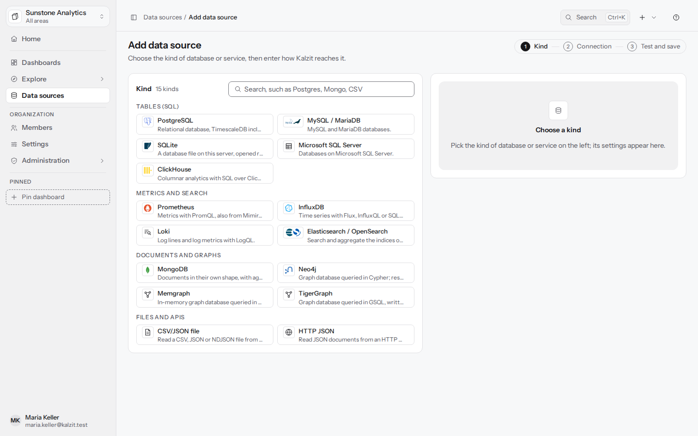
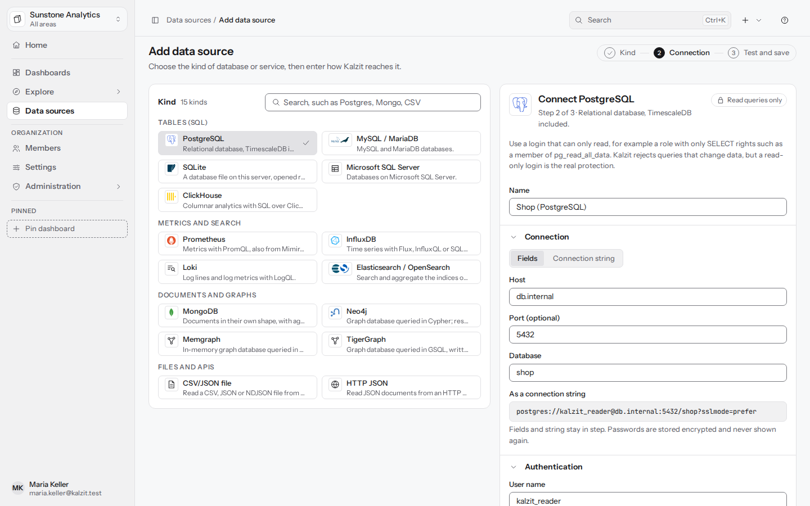

[English](../data-sources.md) | Deutsch

# Datenquellen

Eine Datenquelle ist eine Verbindung zu einer Datenbank oder einem Dienst, den Kalzit abfragt.
Datenquellen gehören zu einer Organisation. API: [data sources and queries](../../api/datasources.md).

## Die Liste

**Datenquellen** zeigt einen Statusüberblick (Zahl der Quellen, Arten und dass alle nur lesbar sind,
wie viele noch nicht getestet sind, mittlere Antwortzeit, die langsamste, wie viele ausgefallen
sind) und eine Liste, die du nach Name oder Art durchsuchen, nach **Status** filtern und sortieren
kannst (**Name A–Z**, **Status, Probleme zuerst**, **Neueste zuerst**). Die Arten sind gruppiert als
Tabellen, Metriken, Dokumente, Graphen, APIs und Dateien.

**Alle testen** testet jede Quelle. Ein Status ist **Verbunden**, **Langsam** (Antwort in 500 ms
oder mehr), **Nicht erreichbar**, **Test fehlgeschlagen**, **Nicht getestet**, **Nur in Dashboards**
(du darfst sie nicht abfragen) oder **Kein Zugriff**.

**Details** öffnet ein Seitenpanel mit zwei Tabs:

- **Übersicht**: Art, Ergebnisformen (**Tabelle**, **Dokumente**, **Graph**), wann sie getestet
  wurde, und die Aktionen **In Explore öffnen**, **Testen** und **Bearbeiten**.
- **Zugriff**: dein eigener Zugriff (**Abfragen**, **Abfragen und bearbeiten**, **Abfragen,
  bearbeiten und Zugriff verwalten** oder **Gespeicherte Abfragen in Dashboards**) und wer über
  seine Rolle hinaus Zugriff hat, mit **Zugriff verwalten…**.

Bearbeiter und höher sehen und fragen jede Datenquelle ab; Betrachter sehen nur die Quellen, die
ihnen gegeben sind. Der Server prüft den Zugriff bei jeder Anfrage.

## Eine Datenquelle hinzufügen

Admins und Eigentümer (das Recht `datasources:write`) fügen Datenquellen hinzu: **Datenquelle
hinzufügen** in der Liste oder im Menü **Neu**.

1. **Art**: Karten mit dem Logo des Produkts und einer kurzen Beschreibung, gruppiert als
   **Tabellen (SQL)**, **Metriken und Suche**, **Dokumente und Graphen**, **Dateien und APIs**;
   suche mit „Postgres, Mongo, CSV“.
2. **Verbindung**: ein Name und die Einstellungen, in Abschnitten (Verbindung, Authentifizierung,
   TLS, Grenzen, Verhalten).
3. **Testen und speichern**: **Verbindung testen** prüft, was du eingegeben hast, ohne etwas zu
   speichern; **Datenquelle hinzufügen** speichert sie. Du kannst so oft testen, wie du willst
   (20-mal pro Minute), und speichern, wenn das Ergebnis stimmt, oder zuerst speichern und später
   testen.



### Verbindungs-Strings

PostgreSQL, MySQL und MariaDB sowie MongoDB lassen sich **Als Verbindungs-String** eingeben
(`postgres://user@host:5432/database?sslmode=require`, `mysql://...`, `mongodb://...` oder
`mongodb+srv://...`) statt in Feldern. Felder und String bleiben im Gleichschritt. Ein Passwort, das
du einfügst, wandert ins Passwortfeld und erscheint nur als Punkte. Alles, was der String angibt und
wofür es hier keine Einstellung gibt, wird abgelehnt statt verworfen.

### Geheimnisse

Passwörter und Tokens werden verschlüsselt gespeichert und nie wieder angezeigt. Wenn du eine Quelle
bearbeitest, kannst du bei einem Geheimnis **Gespeicherten Wert behalten**, **Ändern** oder
**Entfernen** wählen. Änderst du, wohin die Quelle sich verbindet (Host, Port, Benutzer, TLS, URL
oder Pfad), musst du ihre Geheimnisse erneut eingeben: Kalzit schickt ein gespeichertes Geheimnis
nie ungefragt an ein neues Ziel.

### Grenzen für jede Quelle

**Zeitlimit für Abfragen in Sekunden** (1 bis 3600) und **Zeilenlimit** für diese Quelle; die
serverweiten Grenzen (standardmäßig 30 s und 100.000 Zeilen) sind das Maximum. Ein Ergebnis, das am
Zeilenlimit abgeschnitten wurde, sagt das.

### Cache

**Antworten auf dem Server zwischenspeichern** und **Antworten behalten für (Sekunden)**
(standardmäßig 60): Antworten werden pro Person behalten und erneut gezeigt, statt die Datenbank zu
fragen; **Aktualisieren** fragt sie immer. Standardmäßig an für SQL-Datenbanken, Elasticsearch und
die Graphdatenbanken, aus für Prometheus, MongoDB, Dateien, HTTP-APIs und Plugins. Siehe
[Performance und Caching](performance.md).

## Unterstützte Arten

| Art | Verbindungseinstellungen | Form |
|---|---|---|
| PostgreSQL (TimescaleDB eingeschlossen) | Host, Port (5432), Datenbank, Benutzername, Passwort, TLS-Modus (auto, disable, prefer, require, verify-ca, verify-full), CA-Zertifikat | frame |
| MySQL, MariaDB | Host, Port (3306), Datenbank, Benutzername, Passwort, TLS-Modus (auto, disabled, preferred, required, verify_ca, verify_identity), CA-Zertifikat | frame |
| Microsoft SQL Server | Host, Port (1433), Datenbank, Benutzername, Passwort, Verbindung verschlüsseln, Dem Serverzertifikat vertrauen (nur für Tests), CA-Zertifikat | frame |
| SQLite | Absoluter Pfad der Datei; nur lesend geöffnet, nur aus Ordnern, die ein Admin erlaubt hat | frame |
| ClickHouse (HTTP-Schnittstelle) | URL (Port 8123 oder 8443 mit TLS), Datenbank (`default`), Benutzername (`default`), Passwort, CA-Zertifikat | frame |
| Prometheus (auch Mimir, Thanos, VictoriaMetrics) | URL, Benutzername und Passwort für Basic Auth, Bearer-Token, CA-Zertifikat | frame |
| InfluxDB 1.x, 2.x, 3.x (Flux, InfluxQL, SQL) | URL, InfluxDB-Version (v1, v2, v3), Organisation (2.x), Datenbank oder Bucket, Benutzername und Passwort (1.x), API-Token (2.x, 3.x), CA-Zertifikat | frame |
| Loki (LogQL) | URL, Basic Auth oder Bearer-Token, Loki-Org-ID (`X-Scope-OrgID`, für Installationen mit mehreren Org-IDs), CA-Zertifikat | documents (Logzeilen), frame (Metrikabfragen) |
| Elasticsearch, OpenSearch | URL, Basic Auth, API-Schlüssel oder Bearer-Token, CA-Zertifikat, Standard-Index oder Index-Muster, Zeitfeld (standardmäßig `@timestamp`; leer für keinen Zeitfilter) | documents (Treffer), frame (Aggregationen) |
| CSV-, JSON-, NDJSON-Datei | Absoluter Pfad der Datei (aus einem Ordner, den ein Admin für Dateien erlaubt hat), Dateiformat, CSV-Trennzeichen, Dezimalzeichen, „Die erste Zeile enthält die Spaltennamen“ | frame (CSV), documents (JSON, NDJSON) |
| HTTP JSON | URL, Basic Auth oder Bearer-Token, Header und Wert für einen API-Schlüssel, CA-Zertifikat, Pfad zu den Dokumenten in der Antwort | documents |
| MongoDB | Hosts (durch Kommas getrennt), „Server im DNS nachschlagen (mongodb+srv)“, Replica Set, Datenbank, Benutzername, Passwort, Datenbank für die Anmeldung, TLS verwenden, CA-Zertifikat, Größengrenze einer Antwort | documents |
| Neo4j, Memgraph (Cypher über Bolt) | Host, Port (7687), Datenbank, Benutzername, Passwort, Verbindung verschlüsseln, Vertrauens- und CA-Einstellungen, Knotenlimit (10.000), Kantenlimit (50.000) | graph |
| TigerGraph 3.10+ und 4.x (GSQL) | URL des GSQL-Servers, REST++-URL, Graph, Benutzername, Passwort, REST++-Secret, CA-Zertifikat, Freigegebene installierte Abfragen, Knoten- und Kantenlimits | graph |

Jede Art endet mit dem Zeitlimit für Abfragen und dem Zeilenlimit. Dezimalkomma und Trennzeichen
einer Datei lassen sich setzen oder auf automatisch lassen; eine `.csv`-, `.tsv`- oder `.txt`-Datei
wird als CSV gelesen, `.json` als JSON und `.ndjson` oder `.jsonl` als NDJSON.

MongoDB kann mehr, als Dokumente zu liefern. Das Panel **Feldverteilung** zählt die Datenbank über
das ganze Ergebnis, nicht nur die geladene Seite, mit demselben nur lesenden Login. **Live** auf
einem Dashboard oder in Explore folgt einer MongoDB-Abfrage, während sich ihre Daten ändern, wenn
die Installation Change Streams hat (ein Replica Set oder ein Sharded Cluster) und der Zeitraum fest
ist; ein einzelner Server, eine View oder ein Zeitraum, der jetzt endet, führt die Abfrage
stattdessen im Intervall des Dashboards erneut aus, wie jede andere Art. Siehe
[Explore](explore.md#dokumente) und [Dashboards](dashboards.md#live-aktualisierung).

Graphite, Redis, Oracle, Tempo und Jaeger (M7) sind geplant.

### ClickHouse

ClickHouse wird mit SQL über seine HTTP-Schnittstelle abgefragt (Port 8123 oder 8443 mit TLS); das
native Protokoll wird nicht genutzt. Schreib die Abfrage wie bei den anderen SQL-Quellen, mit der
eigenen Syntax von ClickHouse (`FINAL`, `PREWHERE`, `ARRAY JOIN`); die Makros (`$__timeFilter(t)`,
`$__interval`, ...) und Variablen erreichen ClickHouse als Abfrageparameter, nie als Text. Kalzit
schickt jede Abfrage mit `readonly=1`, fügt das Ergebnisformat selbst hinzu und lehnt
`SETTINGS`- und `FORMAT`-Klauseln sowie Tabellenfunktionen ab, die Dateien lesen oder andere Server
erreichen (`file`, `url`, `s3`, `remote`, `mysql`, ...). Nutze `--` für Kommentare. Kalzit schickt
das Zeitlimit für Abfragen als `max_execution_time` und bittet den Server, eine Abfrage zu stoppen,
wenn Kalzit auflegt. Ein Benutzer, dessen Profil schon `readonly = 1` ist, muss erlauben, dass sich
diese beiden Einstellungen ändern (`changeable_in_readonly`), oder `readonly = 2` verwenden.

### InfluxDB

Wähle die **InfluxDB-Version**: 1.x beantwortet InfluxQL (und ab 1.8 Flux, wenn es eingeschaltet
ist), 2.x Flux und InfluxQL, 3.x SQL und InfluxQL. 2.x braucht die **Organisation** für Flux und ein
**API-Token**; 1.x mit Authentifizierung nimmt einen Benutzernamen und ein Passwort; 3.x nimmt ein
Token oder keins, wenn der Server ohne Authentifizierung läuft. **Datenbank oder Bucket** ist der
Standard für InfluxQL und SQL und wird in Flux zu `v.bucket`; das Schema (Measurements, Felder, Tags)
für Vorschläge wird daraus gelesen.

Im Abfrage-Editor wählst du die **Sprache** je Abfrage. In Flux übernehmen `v.timeRangeStart`,
`v.timeRangeStop` und `v.windowPeriod` den Zeitraum und das Intervall des Dashboards, wie in den
eigenen Werkzeugen von InfluxDB; InfluxQL hat `$__timeFilter` und `GROUP BY time($__interval)`; SQL
hat die SQL-Makros. Variablen stehen innerhalb von Strings (`r.host == "$host"`, `host = '$host'`).
Kalzit lehnt Flux ab, das schreibt (`to`, `wideTo`, in jeder Schreibweise), Pakete importiert, die
andere Systeme erreichen (`http`, `sql`, `csv`, ...), oder mit einem Alias importiert, und Flux, das
`host` oder `token` nennt (lies so eine Spalte als `r.host`), und InfluxQL, das etwas anderes ist als
ein `SELECT` ohne `INTO` oder ein `SHOW`. Serien werden zu einer Zeitreihe mit einer Linie je Serie,
beschriftet mit ihren Tags.

### Loki

Log-Abfragen (`{app="api"} |= "error"`) zeigen einen Eintrag je Logzeile mit ihrer Zeit, der Zeile
und den Stream-Labels, neueste zuerst; **Reihenfolge** schaltet auf älteste zuerst um, und
**Höchstzahl Zeilen** (standardmäßig 1.000, höchstens das Zeilenlimit) begrenzt die Zeilen.
Metrikabfragen (`sum by (level) (count_over_time({app="api"}[$__interval]))`) liefern eine Zeitreihe
wie Prometheus. Der Editor schlägt die Labels der letzten sechs Stunden und ihre Werte innerhalb
eines Matchers vor (`{app="`). Für ein Loki mit mehreren Org-IDs setze die **Loki-Org-ID**; eine
Änderung braucht die Geheimnisse erneut, wie die URL. **Live** führt die Abfrage im Intervall des
Dashboards erneut aus; Lokis eigenes Live-Tail wird nicht genutzt.

## Nur lesend

Datenquellen sind nur lesbar. Kalzit lehnt Abfragen ab, die Daten ändern, in jeder Art:

- SQL-Quellen nehmen eine `SELECT`- oder `WITH`-Anweisung an (geparst, nicht per Muster erkannt) und
  führen sie in einer nur lesenden Transaktion aus, wo die Engine eine hat.
- Cypher läuft in einer lesenden Transaktion; GSQL wird geparst und abgelehnt, wenn es schreibt;
  MongoDB-Pipelines, die schreiben, werden abgelehnt; Such-, Loki- und HTTP-Quellen erreichen nur
  lesende Endpunkte.
- ClickHouse-Abfragen laufen mit `readonly=1`; InfluxDB-Abfragen werden je Sprache geprüft (kein
  `to()` in Flux, kein `INTO` in InfluxQL), und InfluxQL wird so geschickt, dass InfluxDB nur Lesen
  ausführt.
- Eine Abfrage, die Daten ändern würde, wird mit einer Meldung abgelehnt („Datenquellen sind nur
  lesbar“).

Das Einstellungsformular fragt trotzdem nach einem **nur lesenden Login**, und das ist der
eigentliche Schutz: eine PostgreSQL-Rolle nur mit `SELECT`, ein MySQL-Benutzer nur mit dem Privileg
`SELECT`, ein SQL-Server-Login in `db_datareader`, ein MongoDB-Benutzer mit der Rolle `read`, ein
Neo4j-Benutzer mit der Rolle `reader`, `queryreader` bei TigerGraph, ein ClickHouse-Benutzer mit
einem Profil `readonly = 1`, ein InfluxDB-Token nur mit Leserechten auf seine Buckets. Kalzit lehnt
MongoDB-Logins ab, die mehr dürfen, und Server ohne Zugriffskontrolle; bei Memgraph und TigerGraph
prüft es die Rechte des Benutzers und lehnt einen Benutzer ab, der schreiben darf (Memgraph
Community braucht **Benutzer mit Schreibrechten erlauben**, dann schützt nur die Abfrageprüfung die
Daten).

Schalte bei TigerGraph die REST++-Authentifizierung ein (`gadmin config set
RESTPP.Factory.EnableAuth true`, dann `gadmin config apply -y` und `gadmin restart restpp -y`); eine
frische Community Edition startet ohne sie, und dann führt REST++ jede installierte Abfrage für
jeden aus, der es erreicht; **Verbindung testen** warnt davor, und die Seite der Datenquelle behält
die Warnung im Blick. Ein `queryreader` kann den Text installierter Abfragen nicht lesen, also
laufen sie nur, wenn sie unter **Freigegebene installierte Abfragen** stehen; eine, die TigerGraph
als datenändernd markiert, wird selbst dann abgelehnt. Der Abfrage-Editor listet die Parameter der
gewählten Abfrage mit ihren Typen, und ein Parameter ohne Wert nimmt die Dashboard-Variable mit
demselben Namen, wie in geschriebenem GSQL; ein Wert vom falschen Typ (Text für einen `INT`, eine zu
große Zahl) wird abgelehnt, bevor er gesendet wird. Ein `queryreader` von TigerGraph 4.2 wird
angenommen, und seine Auswahl listet die installierten Abfragen des Graphen. Das eigene HTTPS von
TigerGraph braucht eine Enterprise-Lizenz; stelle mit der Community Edition einen Reverse Proxy mit
TLS vor REST++ und den GSQL-Server und gib seine CA unter **CA-Zertifikat** an. Kalzit erneuert ein
abgelaufenes Anmelde-Token selbst.

Graph-Quellen antworten in der Form `graph`: Neo4j und Memgraph über Cypher, TigerGraph über GSQL
(`PRINT` von Knoten- und Kantenmengen wird zum Graphen; andere ausgegebene Werte werden zu einer
Tabelle). Kanten erscheinen nur, wenn die Abfrage sie zurückgibt. Was du mit dem Ergebnis machst,
steht in [Explore](explore.md#graphen) und [Panels](panels.md#graph-panels).

### Graphalgorithmen (Neo4j GDS, Memgraph MAGE)

Cypher darf die Graphalgorithmen von Neo4j Graph Data Science (GDS) und Memgraph MAGE aufrufen,
aber nur die, die lesen, aus einer geprüften Liste; der Server prüft jede Abfrage.

- **Neo4j GDS**: die Modi `stream` und `stats` der gelisteten Algorithmen, etwa
  `gds.louvain.stream`, `gds.leiden.stream`, `gds.pageRank.stream`, `gds.betweenness.stream`,
  `gds.wcc.stream`, `gds.nodeSimilarity.stream` oder `gds.shortestPath.dijkstra.stream`, auch in
  den Stufen `alpha` und `beta`, dazu `gds.graph.list`, `gds.version` und die Funktionen
  `gds.util.asNode`, `gds.util.asNodes` und `gds.similarity.*`. Abgelehnt: die Modi `write` und
  `mutate`, `estimate` und jede andere `gds.graph.*`-Prozedur, `gds.graph.project` eingeschlossen.
- **Memgraph MAGE**: die `get`-Prozeduren, die rechnen, ohne etwas zu behalten, etwa
  `community_detection.get`, `community_detection.get_subgraph`, `pagerank.get`,
  `betweenness_centrality.get`, `degree_centrality.get` und `weakly_connected_components.get`.
  Abgelehnt: die Online-Module (`set`, `update`, `reset`), Loader, Exporter und `periodic` sowie
  `cycles.get` und `node_similarity.*`, deren Aufwand mit dem Graphen zu schnell wächst. Memgraph
  erzwingt keine lesenden Transaktionen und stoppt keinen laufenden Algorithmus, starte Memgraph
  also mit einem Abfrage-Timeout (`--query-execution-timeout-sec`, standardmäßig 600; senke ihn für
  geteilte Server): Dort ist die Liste die einzige Grenze.
- APOC-Prozeduren bleiben abgelehnt, ebenso jede Prozedur, die nicht auf der Liste steht.

GDS läuft auf einem Graphen, der in seinen In-Memory-Katalog projiziert ist. Projizieren ändert
diesen Katalog, der die lesende Transaktion überdauert, die Kalzit zurückrollt, und eine Projektion
kann viel Speicher brauchen; darum projiziert oder entfernt eine Abfrage in Kalzit nie einen
Graphen: Ein Administrator projiziert ihn in Neo4j (zum Beispiel
`CALL gds.graph.project('people', 'Person', 'KNOWS')`), und Abfragen in Kalzit nennen ihn:

```cypher
CALL gds.louvain.stream('people') YIELD nodeId, communityId
RETURN gds.util.asNode(nodeId).name AS name, communityId ORDER BY communityId
```

Der Graph wird als Text oder als `$parameter` genannt, und eine optionale Konfiguration wird als Map
ausgeschrieben (`CALL gds.pageRank.stream('people', {maxIterations: 20})`). Abgelehnt: anonyme
Projektionen von GDS 1.x (`nodeQuery`, `relationshipQuery`, `nodeProjection`,
`relationshipProjection`), die Cypher als Text tragen, und die Einstellungen `sudo` (schaltet die
Speicherprüfung von GDS ab) und `concurrency`, `readConcurrency`, `writeConcurrency` (der Standard
von GDS gilt).

`gds.graph.list` zeigt jedem abfragenden Benutzer die Konfiguration jedes Graphen, den der Login
sehen kann, einschließlich des Cyphers einer Cypher-Projektion. Gib Kalzit einen Login, der nur
Graphen sieht, die für Kalzit gedacht sind, oder halte vertrauliches Cypher aus Projektionen heraus.

**Communities in Graph-Panels.** Das Panel berechnet Communities im Browser für bis zu 2.000 Knoten.
Für einen größeren Graphen aus einer Neo4j- oder Memgraph-Quelle und eine betrachtende Person, die
diese Quelle abfragen darf (`datasources:query`), fragt es die Datenbank: Memgraph führt
`community_detection.get_subgraph` von MAGE über die gezeigten Knoten aus; Neo4j führt GDS Louvain
auf einem Graphen aus, den Kalzit aus den gezeigten Knoten unter einem für diese Anfrage erzeugten
Namen projiziert und gleich danach entfernt, auch wenn die Anfrage auf halbem Weg aufgegeben wird;
pro Quelle läuft immer nur eine solche Anfrage, und einen zurückgebliebenen Graphen (eine
abgebrochene Verbindung) entfernt eine spätere Anfrage, sobald er älter ist als das Zeitlimit der
Anfrage plus 10 Minuten, sodass Kalzit-Server, die sich eine Datenbank teilen, die Graphen der
anderen behalten. Diese Abfragen sind im Server festgelegt, nicht von jemandem getippt. Ohne GDS
oder MAGE oder ohne das Recht sagt das Panel, dass Communities bis 2.000 Knoten berechnet werden.
Für Neo4j braucht das GDS 2.4 oder neuer, und der Benutzer braucht das Recht, GDS-Prozeduren
auszuführen.

## Ziele

Quellen dürfen auf private Netze und localhost zeigen. Immer abgelehnt werden Kalzits eigener
Datenordner und seine Datenbank, Link-Local- und Cloud-Metadaten-Adressen sowie SQLite- oder andere
Dateien außerhalb der Ordner, die ein Administrator erlaubt hat (die Server-Einstellungen
**datasources.sqlite_dirs** und **datasources.file_dirs**). Administratoren können Quellen weiter auf
eine Liste von Hosts und Netzen beschränken (**datasources.allowed_targets**). Eine abgelehnte
Adresse zeigt „Der Server erlaubt keine Verbindungen zu dieser Adresse“. Nur ein Admin der
Datenquelle kann ändern, wohin eine Quelle sich verbindet.

## Eine Verbindung testen

**Verbindung testen** im Formular prüft die Einstellungen, die du eingegeben hast, gespeichert oder
nicht, sodass du eine Änderung ausprobieren kannst, bevor du sie behältst; bei einer bearbeiteten
Quelle wird ein Passwort, das du leer lässt, aus der gespeicherten Quelle genommen. **Testen** im
Kopf und in der Liste prüft die gespeicherte Quelle. So oder so: Die Quelle ist erreichbar, der
Login funktioniert und der Login ist nur lesend. Ein Test ungespeicherter Einstellungen folgt
denselben Regeln wie das Speichern (private Netze, Kalzits eigene Datenbank, Ordner) und braucht das
Recht, Datenquellen zu ändern. Er zeigt die Engine und Version und die Antwortzeit („Verbunden in
N ms“) oder den Grund für das Scheitern. Ein Login mit Administratorrechten (ein
PostgreSQL-Benutzer mit allen Rechten, ein SQL-Server-Sysadmin) wird gemeldet, mit dem Rat, einen nur lesenden Login
zu verwenden.

## Zugriff je Team

Über ihre Rolle hinaus bekommen Mitglieder, Teams oder Rollen Zugriff auf eine einzelne Datenquelle
mit **Zugriff verwalten…** (im Seitenpanel oder im Formular): **Darf abfragen** (eigene Abfragen in
Explore und Panels), **Darf bearbeiten** (auch die Verbindung und ihre Einstellungen ändern) und
**Darf verwalten** (auch entscheiden, wer Zugriff hat). Ein Entzug beendet freie Abfragen, Tests und
das Lesen des Schemas sofort. Ein Mitglied, das eine Quelle nicht sehen darf, bekommt „nicht
gefunden“. Siehe [Verwaltung](administration.md#rollen-und-rechte).

## Papierkorb

**Löschen…** verschiebt eine Datenquelle in den **Papierkorb** (**Datenquellen** > **Papierkorb**).
Dashboards, die sie nutzen, zeigen einen Fehler, bis du sie wiederherstellst (**Wiederherstellen**). Nur
Mitglieder, die Datenquellen ändern dürfen, sehen den Papierkorb.

**Endgültig löschen…** im Papierkorb entfernt eine Datenquelle samt ihren gespeicherten Passwörtern
und Schlüsseln endgültig, nachdem du bestätigt hast. Das geht nicht, solange ein Dashboard (auch
eines im Papierkorb) oder ein Bibliothekspanel die Quelle noch nutzt; die Meldung sagt, wie viele,
also nimm die Quelle zuerst aus ihnen heraus. Das Löschen wird ins Audit-Log geschrieben. Es braucht
das Recht, zu ändern, wohin eine Quelle sich verbindet (ein Admin der Datenquelle). Ältere Versionen
eines Dashboards, die die Quelle genutzt haben, nennen sie weiterhin: Stellst du so eine Version
wieder her, zeigt sie für ihre Panels „Datenquelle nicht gefunden“, bis du eine andere Quelle
wählst.


