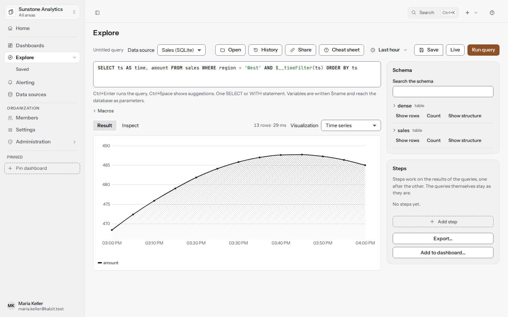
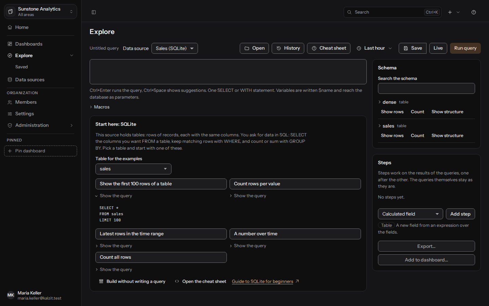
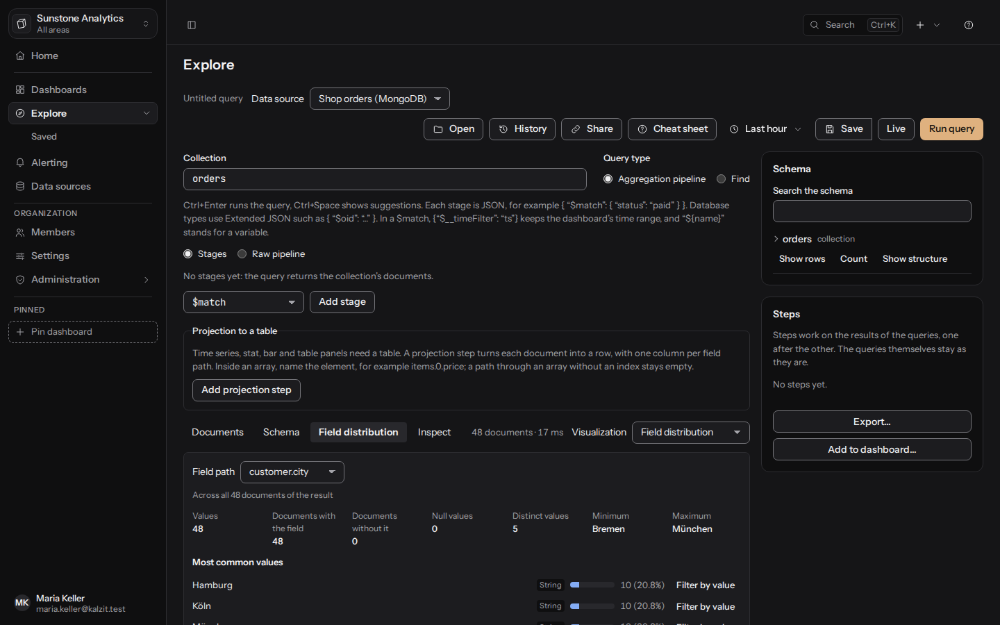
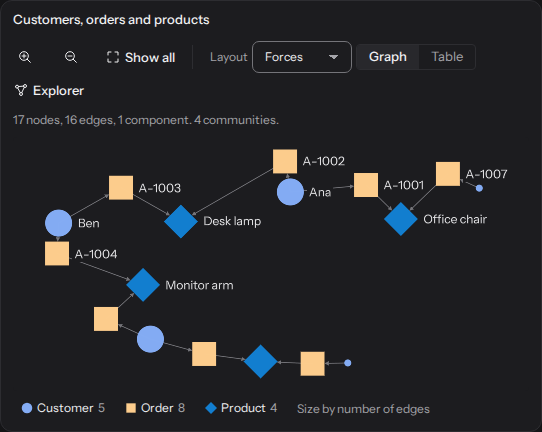
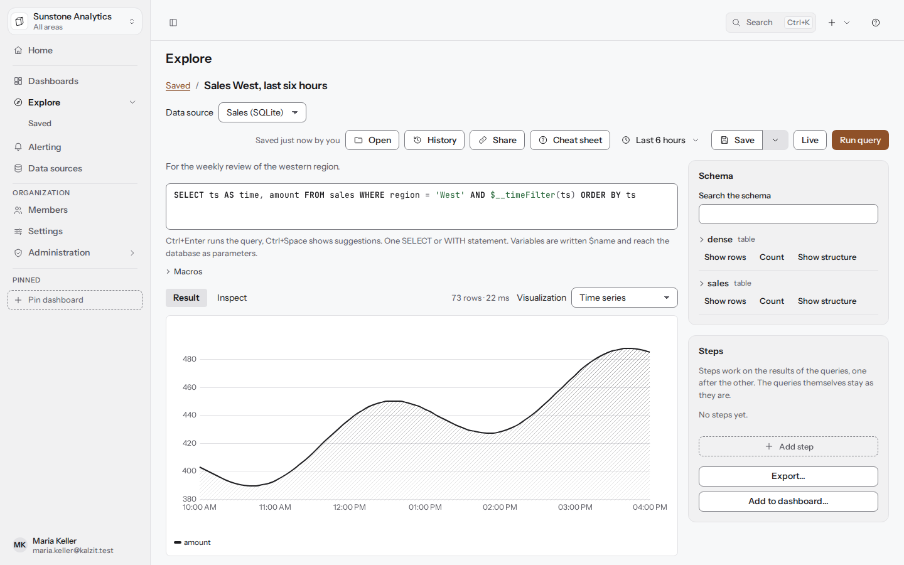

[English](../explore.md) | Deutsch

# Explore

Explore führt freie Abfragen ohne Dashboard aus, zeigt das Ergebnis in einer passenden
Visualisierung, lässt dich es untersuchen und zu einem Dashboard hinzufügen. API:
[Datenquellen und Abfragen](../../api/datasources.md).

Explore braucht das Recht `datasources:query` (Bearbeiter, Admins und Eigentümer haben es, und
alle mit Abfragezugriff auf eine Datenquelle). Betrachter sehen weiterhin die für sie freigegebenen
Dashboards, die ihre gespeicherten Abfragen ausführen, und öffnen Auswertungen unter
**Auswertungen** in der Seitenleiste, um sie anzusehen und auszuführen
([Auswertungen](saved-analyses.md#die-liste)).

## Bei null anfangen

Neu in der Abfragesprache einer Quelle? **Hier anfangen** erscheint, solange der Editor leer ist:
Seine Einstiegsaktionen setzen eine sichere, lesende Abfrage ein, und **Abfrage zeigen** zeigt, wie
ein Einstieg oder Schritt geschrieben wird. In der Schemaliste tun **Zeilen zeigen**, **Zählen**
und **Aufbau zeigen** neben einer Tabelle, Collection oder einem Label dasselbe für diesen
Eintrag. **Spickzettel** (Umschalt+F1, oder Strg+/ bzw. Cmd+/ außerhalb des Editors) listet die
gängigen Klauseln, Makros und Variablen der aktuellen Sprache, und eine fehlgeschlagene Abfrage
kommt mit einem Hinweis, was zu ändern ist. Kleine Tipps erscheinen einmal und lassen sich
wegklicken; schalte sie unter **Konto** > **Einstellungen für dich** > **Tipps anzeigen** aus.
Beispiele je Art der Quelle: [Abfragesprachen für Einsteiger](query-languages.md).

## Eine Abfrage ausführen

1. Wähle eine **Datenquelle**. Die zuletzt benutzte wird gemerkt.
2. Schreib die Abfrage in den Editor (CodeMirror). Strg+Eingabe führt sie aus, Strg+Leertaste
   zeigt Vorschläge aus dem Schema der Quelle (Tabellen, Spalten, Metriken, Labels, Felder).
3. Drücke **Abfrage ausführen**. Der Reiter **Ergebnis** zeigt die Visualisierung; **Untersuchen**
   zeigt die Größe des Ergebnisses, die ausgeführte Abfrage und Hinweise des Servers. Neben den
   Reitern steht, wie viel zurückkam und wie lange es gedauert hat („312 Dokumente · 18 ms“).
4. Wähle bei Bedarf eine andere **Visualisierung**; Arten, die nicht zum Ergebnis passen, kommen
   zuletzt.

Dokumente bekommen drei eigene Reiter: **Dokumente** (der Baum), **Schema** (ihre Felder und
Typen) und **Tabelle (Projektion)**. Die Tabelle braucht eine Projektion: „In Tabelle
projizieren“ fügt sie als sichtbaren ersten Schritt mit den Feldern der obersten Ebene hinzu, und
ihre Spalten änderst du unter der Abfrage.

**Teilen** kopiert einen Link zu dem, was auf dem Bildschirm ist: Datenquelle, Abfrage, Zeitraum,
Schritte und Visualisierung (eine Auswertung ohne Änderungen wird stattdessen über ihren Namen
verlinkt). Der Link funktioniert für Personen in deiner Organisation; ihn zu öffnen führt die
Abfrage aus, sie brauchen also das Recht, diese Datenquelle abzufragen, wie bei jeder Abfrage in
Explore.

Eine Abfrage, die der Server ablehnen würde, sagt schon vor dem Ausführen, warum. Der Zeitraum ist
der, den du für Explore eingestellt hast; die Makros unten übernehmen ihn. Variablen und Makros
erreichen die Datenbank als Parameter, nie als Text in der Abfrage. Schreibende Abfragen werden
immer abgelehnt, siehe [Datenquellen](data-sources.md#nur-lesend).

## Live

**Live** neben **Abfrage ausführen** hält die ausgeführte Abfrage aktuell: Der Server führt sie
erneut aus, sobald sich ihre Daten ändern (MongoDB mit Change Streams) oder in einem Intervall
(jede andere Quelle und jeder Zeitraum, der jetzt endet), und das Ergebnis aktualisiert sich von
selbst. Eine Zeile über dem Ergebnis sagt, wie es aktuell bleibt, und, falls der Server es
abgelehnt oder beendet hat, warum. Drücke noch einmal **Live**, um aufzuhören. Live in Explore
braucht das Recht, die Datenquelle abzufragen, wie das Ausführen der Abfrage; der Server prüft es.
Mit **Weitere Dokumente laden** geladene Seiten fallen weg, wenn ein neues Ergebnis kommt. API:
[Live-Aktualisierung](../../api/live.md).

## Abfragen je Art der Quelle

| Art | Abfrage | Form des Ergebnisses |
|---|---|---|
| PostgreSQL, MySQL und MariaDB, SQL Server, SQLite | Eine Anweisung `SELECT` oder `WITH` | `frame` |
| Prometheus | PromQL; optional **Sofortabfrage** und **Kleinster Schritt** | `frame` |
| Elasticsearch, OpenSearch | **Lucene**-Abfragetext oder **JSON-DSL**; Index oder Muster, Anzahl der Treffer, Zeitfeld | `documents` (Treffer), `frame` (Aggregationen) |
| MongoDB | **Aggregations-Pipeline** (Stufen) oder **Find** (Filter, Projektion, Sortierung, Limit, Überspringen) auf einer Collection | `documents` |
| CSV-, JSON-, NDJSON-Dateien | Keine eigene Abfrage; die Datenquelle nennt die Datei und wie sie gelesen wird | `frame` (CSV), `documents` (JSON, NDJSON) |
| HTTP JSON | Ein **Pfad** unter der URL der Quelle, **Abfrageparameter** und der **Pfad zu den Dokumenten** | `documents` |
| Neo4j, Memgraph | Cypher (nur lesend) | `graph` |
| TigerGraph | **GSQL schreiben** (`INTERPRET QUERY ...`) oder **Eine installierte Abfrage ausführen** | `graph` |

### Makros

Makros übernehmen den Zeitraum des Dashboards oder von Explore:

- **SQL**: `$__timeFilter(column)` (wahr für Zeilen im Zeitraum), `$__timeFrom`, `$__timeTo`,
  `$__interval` (ein vorgeschlagenes Intervall zum Gruppieren wie `1m`), `$__interval_ms`.
  Variablen schreibst du `$name`.
- **PromQL**: `$__interval`, `$__interval_ms`, `$__rate_interval` (vier Intervalle, mindestens 1m,
  ein sicheres Fenster für `rate()`), `$__range`, `$__timeFrom`, `$__timeTo` (Unix-Sekunden).
  Variablen nur in Zeichenketten in Anführungszeichen, etwa `job="$job"`.
- **Cypher**: `$__timeFrom`, `$__timeTo` (UTC-DateTime-Werte), `$__timeFromMs`, `$__timeToMs`,
  `$__interval_ms`.
- **Lucene und JSON-DSL**: `$__timeFrom`, `$__timeTo` (Unix-ms), `$__interval`, `$__interval_ms`;
  in Lucene werden Variablen zu Phrasen in Anführungszeichen, in der JSON-DSL steht ein Makro oder
  eine Variable als ganze Zeichenkette, etwa `"$__interval"`.
- **MongoDB**: In einem `$match` oder Filter behält `{"$__timeFilter": "ts"}` den Zeitraum, und
  `"${name}"` steht für eine Variable.

Der Editor listet die Makros der aktuellen Art neben der Abfrage.

### Suchquellen

Wähle einen **Index oder Muster** (etwa `logs-*,-logs-old`; leer nimmt den Index der Datenquelle),
die **Abfragesprache**, die **Anzahl Treffer** (500, wenn leer) und ob **Nach dem Zeitraum
filtern** mit einem **Zeitfeld** gelten soll. **Mit einer Vorlage beginnen**: neueste Dokumente,
Anzahl je Wert (Terms), Anzahl über die Zeit (Datumshistogramm), Anzahl je Wert über die Zeit.
Aggregationen liefern eine Tabelle mit einer Zeile je Bucket.

### MongoDB

Wähle **Collection** und **Art der Abfrage**. In der Pipeline-Ansicht ist jede Stufe JSON, zum
Beispiel `{ "$match": { "status": "paid" } }`, und lässt sich verschieben, ausschalten und in der
Vorschau ansehen (**Vorschau nach Stufe N**); **Rohe Pipeline** zeigt die ganze Liste.
Datenbanktypen stehen in Extended JSON wie `{ "$oid": "..." }`. Stufen, die schreiben (`$out`,
`$merge`), lehnt der Server ab. Eine ausgeschaltete Stufe wird nicht mit der Abfrage gespeichert.

### Dateien und HTTP JSON

Eine Dateiquelle zeigt die Datei, wie sie gelesen wird, und ihre Spalten. Eine HTTP-JSON-Quelle
sendet nur Anfragen mit `GET`; ihre Vorschau zeigt die Anfrage.

### Graphquellen

Der Cypher-Editor (Neo4j, Memgraph) schlägt Labels, Beziehungstypen und Property-Schlüssel aus
der Datenbank vor; jede Abfrage läuft in einer lesenden Transaktion. Variablen erreichen Cypher
als Parameter (`$customerId`). Bei TigerGraph wählst du **GSQL schreiben** für eine interpretierte
Abfrage (`INTERPRET QUERY (STRING name) FOR GRAPH Shop { ... }`) oder **Eine installierte Abfrage
ausführen** und wählst eine der installierten Abfragen des Graphen; der Editor listet ihre
Parameter mit ihren Typen, und ein leer gelassener Parameter nimmt die Dashboard-Variable mit
demselben Namen. GSQL nimmt Variablen nur als deklarierte Parameter: `$name` in GSQL-Code wird mit
einem Hinweis abgelehnt. Siehe [Datenquellen](data-sources.md#nur-lesend) für das lesende Login und
die Warnung zu REST++.

## Formen von Ergebnissen

Jedes Ergebnis behält seine eigene Form. Umwandlungen sind ausdrückliche Schritte, die du
hinzufügst.

### Frames

Tabellen und Zeitreihen. Ein Zeitreihen-Panel braucht ein Zeitfeld und mindestens ein Zahlenfeld.
Wähle eine Tabelle, Zeitreihe, Kennzahl, ein Balkendiagramm oder ein anderes
[Frame-Panel](panels.md).

### Dokumente

Ein Ergebnis `documents` bleibt eine Menge von Dokumenten. Nutze Dokument-Explorer, Schema,
Feldverteilung oder Dokumentkarte ([Panels](panels.md#dokument-panels)). Einen Wert im Baum
auszuwählen, oder **Nach Wert filtern** neben einem häufigen Wert der Feldverteilung, fügt der
Abfrage einen Filter auf diesen Pfad als sichtbare Stufe `$match` hinzu. Bei MongoDB zählt die
Feldverteilung das ganze Ergebnis in der Datenbank, nicht nur die geladenen Dokumente, und sagt
das: **Über alle N Dokumente des Ergebnisses**.

Für eine Tabelle nimmst du den ausdrücklichen Schritt Projektion:
**Projektionsschritt hinzufügen** benennt Spalten über Feldpfade (`items.0.price` für ein Element
eines Arrays), mit optionalen Namen und Typen. Entfernst du den Schritt, bekommst du die Dokumente
zurück. Ein Ergebnis zeigt höchstens eine begrenzte Zahl von Dokumenten (**Bei N Dokumenten
abgeschnitten.**), und **Weitere Dokumente laden** holt die nächsten (MongoDB, Elasticsearch und
OpenSearch, JSON- und NDJSON-Dateien).

### Graphen

Ein Ergebnis `graph` bleibt Knoten und Kanten: das Panel **Netzwerk**, **Hierarchie** oder
**Pfade** ([Panels](panels.md#graph-panels)). Gib Pfade aus der Abfrage zurück (zum Beispiel mit
`shortestPath`), um das Panel Pfade zu nutzen. Im Explorer-Modus lädt ein Klick die Nachbarn eines
Knotens. Was der Explorer auf einem Dashboard-Panel geladen hat, öffnet sich hier mit **Als
Abfrage in Explore öffnen** als Cypher-Abfrage; sie öffnet sich, ohne zu laufen, sodass du sie lesen kannst, bevor du
**Abfrage ausführen** drückst.

## Schritte

Die Seitenleiste **Schritte und Aktionen** enthält Rechenschritte, die nacheinander auf die
Ergebnisse wirken: berechnete Felder, Verknüpfungen, Statistik, Trend, gleitender Durchschnitt,
Korrelation, Vergleich mit dem vorigen Zeitraum, Gruppieren, Pivot und die Projektion von
Dokumenten. Die Abfragen bleiben, wie sie sind. Siehe
[Berechnete Felder und Statistik](calculated-fields.md).

In Explore ist jeder Schritt eine kompakte Karte: seine Nummer und sein Name und darunter, was er
tut (die Felder, die er nutzt). Ein Klick öffnet ihn zum Bearbeiten. **Schritt hinzufügen** öffnet
die Arten von Schritten als Menü; ein hinzugefügter Schritt öffnet sich sofort.

### Graph-Schritte

Liefert die Abfrage einen Graphen, bietet „Schritt hinzufügen“ zuerst Graph-Schritte an: „Anzahl
je Label“, „Anzahl je Kantentyp“, „Gradverteilung“, „Gemeinsame Nachbarn“ (etwa Kunden, die
dieselben Produkte gekauft haben), „Top-N nach Grad“, „Grad berechnen“ (der Grad als Property des
Knotens) und „Teilgraph filtern“ (diese drei bleiben ein Graph) sowie „In Tabelle umwandeln“
(Knoten oder Kanten mit den gewählten Properties als Zeilen). Jeder Schritt zeigt die Form, die
er liest und erzeugt („Graph → Tabelle“), und wo er läuft: „Läuft in Neo4j (Cypher)“ beim ersten
Graph-Schritt einer Neo4j- oder Memgraph-Abfrage, der dann über das ganze Ergebnis zählt, nicht
nur über die gezeichneten Knoten; „Im Server“ bei den anderen. „Formen der Schritte“ unter der
Liste verfolgt das Ergebnis von Schritt zu Schritt. Tabellenschritte wie „Gruppieren“ stehen zur
Verfügung, sobald ein Schritt eine Tabelle erzeugt hat. Die Zeichnung zeigt weiter den eigenen
Graphen der Abfrage.

## Zum Dashboard hinzufügen

**Zum Dashboard hinzufügen…** bringt die Abfrage, ihre Datenquelle, die Visualisierung und die
Schritte in ein Panel: Wähle **In ein bestehendes Dashboard** (das du ändern darfst) oder **In ein
neues Dashboard**, dann **Panel hinzufügen**. Der Verlauf des Dashboards hält das Speichern als
„Panel aus Explore hinzugefügt“ fest.

## Speichern

**Speichern** (Strg+S) behält die Abfrage mit ihren Schritten und ihrer Visualisierung als
Auswertung, **Öffnen** (Strg+O) holt eine zurück. Siehe [Auswertungen](saved-analyses.md).

## Exportieren

**Exportieren…** lädt das Ergebnis mit allen aktiven Schritten herunter, in seiner eigenen Form:
eine Tabelle als CSV, Excel oder JSON, Dokumente als NDJSON oder JSON, einen Graphen als GraphML
oder JSON; siehe [Exportieren](export.md).

## Abfrageverlauf

**Verlauf** in der Werkzeugleiste von Explore öffnet eine Seitenleiste mit den Abfragen, die du in
Explore ausgeführt hast.

- Er ist privat: Niemand sonst kann ihn lesen, auch keine Admins. In jeder Organisation hast du
  einen eigenen Verlauf.
- Einträge bleiben 30 Tage, höchstens 500 je Organisation. Nur erfolgreiche Läufe werden
  behalten, und dieselbe Abfrage erneut auszuführen schiebt nur den neuesten Eintrag nach oben.
- Der getippte Text wird so gespeichert, wie du ihn getippt hast, mit allen Werten darin (einer
  ID, einer E-Mail-Adresse). Schreib keine Geheimnisse in Abfragen. Ergebnisse werden nie
  gespeichert.
- **Im Verlauf suchen** findet Einträge über ihren Abfragetext, **Nach Datenquelle filtern**
  behält eine Quelle. Einträge einer Datenquelle, die du nicht mehr abfragen darfst, werden nicht
  aufgeführt.
- **In den Editor laden** setzt eine Abfrage in den Editor, ohne sie auszuführen; **Erneut
  ausführen** lädt und führt sie aus.
- **Aus dem Verlauf löschen** entfernt einen Eintrag; **Verlauf löschen** entfernt alle nach einer
  Rückfrage und lässt sich nicht rückgängig machen.
