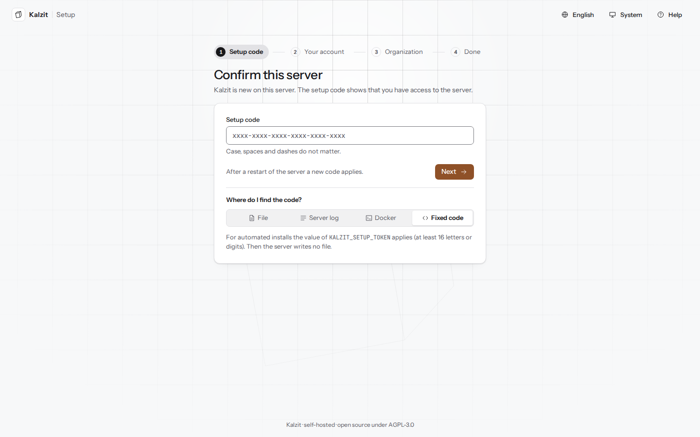
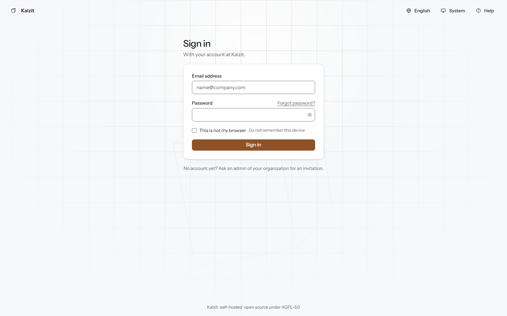
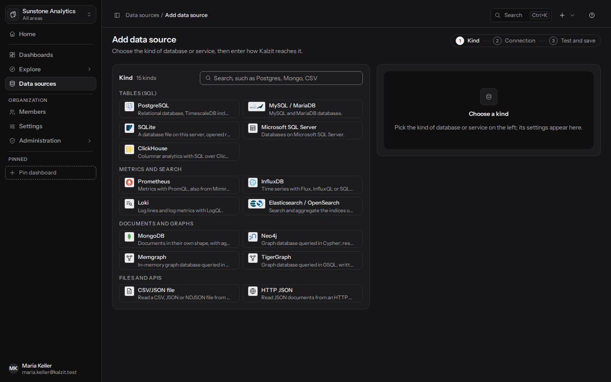
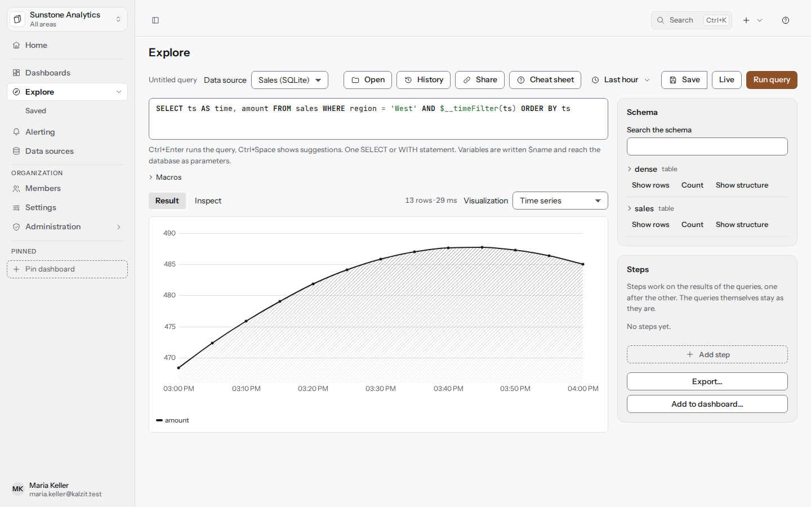

[English](../getting-started.md) | Deutsch

# Erste Schritte

Diese Seite führt dich von einem frischen Server bis zur ersten Abfrage auf einem Dashboard. Wie du
den Server installierst und startest, steht unter [Installation](installation.md) (das
Container-Image) und in der [README](../../../README.md#quick-start); Sicherungen und Dienste für
den Betrieb findest du in [ARCHITECTURE](../../ARCHITECTURE.md).

## Einrichtung

Beim ersten Start fragt Kalzit nach einem einmaligen **Einrichtungscode**. Öffne die Adresse des
Servers, standardmäßig `http://localhost:3000`. Die Einrichtung hat vier Schritte; **Zurück**
behält alles, was du eingegeben hast.

1. **Einrichtungscode**: Gib den Code ein und drück **Weiter**. Er wird sofort geprüft.
   **Wo finde ich den Code?** zeigt den Weg für jede Art der Installation, die zu diesem Server
   passende zuerst:
   - **Datei**: `setup-token.txt` im Datenordner, standardmäßig
     `C:\ProgramData\Kalzit\data\setup-token.txt` unter Windows und
     `/var/lib/kalzit/setup-token.txt` unter Linux. Die Datei ist geschützt; ein Editor oder der
     Explorer kann sie daher nicht öffnen. Der Reiter zeigt den Befehl für das System des Servers
     mit einer Schaltfläche zum Kopieren:
     - Windows: Öffne PowerShell mit **Als Administrator ausführen** und gib
       `Get-Content "C:\ProgramData\Kalzit\data\setup-token.txt"` oder
       `& "C:\Program Files\Kalzit\kalzit.exe" setup-code` ein. Nach einer ersten Installation
       öffnet die letzte Seite des MSI die Einrichtung für dich (**Einrichtung im Browser
       öffnen**).
     - Linux (deb und rpm): `sudo cat /var/lib/kalzit/setup-token.txt` oder
       `sudo kalzit setup-code`; der Datenordner gehört dem Benutzer `kalzit`.

     `kalzit setup-code` findet einen eigenen Datenordner über `kalzit.toml`. Fehlen die nötigen
     Rechte, sagt der Befehl das („run as administrator“, „use sudo“). Gibt es keine Datei, zeigt
     er keinen Code und sagt, dass die Einrichtung abgeschlossen ist oder der Server noch nicht
     gestartet wurde (oder einen anderen Datenordner nutzt). `kalzit setup-code --url` gibt die
     Adresse der Einrichtungsseite mit dem Code im Fragment aus (`#code=...`): Im Browser
     geöffnet, trägt die Seite den Code ein und entfernt ihn aus der Adresszeile. Das Fragment
     erreicht nie den Server oder seine Logs, aber der Browserverlauf kann die Adresse behalten,
     bis die Einrichtung abgeschlossen ist; danach gilt der Code nicht mehr.
   - **Server-Log**: Das Log nennt beim Start, wo die Datei liegt; den Code enthält es nie.
   - **Docker**: `docker exec kalzit kalzit setup-code` (mit Compose:
     `docker compose exec kalzit kalzit setup-code`).
   - **Fester Code**: der Wert von `KALZIT_SETUP_TOKEN`, für automatische Installationen.

   Groß- und Kleinschreibung, Leerzeichen und Bindestriche spielen keine Rolle. Nach mehreren
   falschen Codes musst du warten; die Schaltfläche zählt die Zeit herunter. Ein Neustart des
   Servers erzeugt einen neuen Code: Die Seite sagt dann, dass der eingegebene Code nicht mehr
   gilt, statt dass er falsch ist.
2. **Dein Konto**: dein Name, deine E-Mail-Adresse und ein Passwort mit mindestens 12 Zeichen.
   Die Regeln unter dem Feld werden beim Tippen abgehakt; eine Mischung aus Zeichen wird
   empfohlen, ist aber nicht Pflicht. Dieses Konto wird Eigentümer der ersten Organisation und
   Server-Admin.
3. **Organisation**: der Name der Organisation und die Vorgaben für alle, die nichts anderes
   gewählt haben: **Sprache**, **Darstellung** und **Zeitzone** (aus deinem Browser übernommen).
   Sprache und Darstellung sind Vorgaben des Servers, die Zeitzone die der Organisation. Drück
   **Einrichtung abschließen**: Erst jetzt werden Organisation und Konto angelegt, und du bist
   angemeldet.
4. **Fertig**: die nächsten Schritte als Karten. **Datenquelle hinzufügen** öffnet den Dialog
   zum Verbinden einer Datenquelle, **Explore mit Beispieldaten** fügt die mitgelieferte
   Beispieldatenbank hinzu (siehe unten) und öffnet Explore damit, **Personen einladen** führt zu
   den Mitgliedern. **Zur Startseite** öffnet Start.

Ist Kalzit schon eingerichtet, sagt die Einrichtungsseite nur das und führt zur Anmeldung. Hat
jemand anderes die Einrichtung abgeschlossen, während du das Formular ausgefüllt hast, sagt das
der letzte Schritt; wurde der Server zwischendurch neu gestartet, kommst du zurück zum Code, und
alles andere bleibt erhalten.

### Beispieldaten

Kalzit bringt eine kleine, nur lesbare SQLite-Datenbank mit Bestellungen, Produkten, Kunden und
Regionen zum Ausprobieren mit. **Explore mit Beispieldaten** im letzten Schritt der Einrichtung
fügt sie als Datenquelle namens **Beispieldaten** hinzu, einmal je Organisation; dafür brauchst
du das Recht, Datenquellen hinzuzufügen. Kalzit schreibt die Datei in den Ordner `samples` seines
Datenordners, den einzigen Ort dort, aus dem eine SQLite-Datenquelle lesen darf. Entferne die
Datenquelle wie jede andere; die Datei bleibt.

## Anmelden

Gib die **E-Mail-Adresse** und das **Passwort** deines Kontos ein und drück **Anmelden**. Das
Passwortfeld kann zeigen, was du getippt hast, und warnt bei aktivierter Feststelltaste. Nach zu
vielen fehlgeschlagenen Anmeldungen musst du warten: Die Seite sagt, wie lange, und die
Schaltfläche zählt herunter, bis du es wieder versuchen kannst. **Passwort vergessen?** öffnet
**Passwort zurücksetzen** (siehe unten). Ist deine Sitzung während der Arbeit abgelaufen, sagt
die Seite das und bringt dich nach dem Anmelden dorthin zurück, wo du warst. Konten sind vorerst
lokal; Anmeldung über OIDC oder LDAP ist geplant (M5). Eine Wahl „Angemeldet bleiben“ gibt es
noch nicht: Eine Sitzung dauert so lange, wie die Sitzungseinstellungen des Servers erlauben.

Die Leiste oben hat **Sprache**, **Darstellung** und **Hilfe**. Eine Sprache oder Darstellung,
die du dort wählst, wird beim Anmelden zu deiner Einstellung, sofern du noch keine hast.
**Hilfe** öffnet diese Seite und [Installation](installation.md); beide werden mit Kalzit
ausgeliefert und lassen sich ohne Konto lesen.

### Passwort vergessen

**Passwort zurücksetzen** fragt nach deiner E-Mail-Adresse und schickt einen Link, der 60 Minuten
lang und nur einmal gilt. Die Seite antwortet gleich, ob es ein Konto mit der Adresse gibt oder
nicht, damit niemand herausfinden kann, wer hier ein Konto hat; kommt nichts an, sieh im
Spam-Ordner nach und versuch es nach einer Minute noch einmal. Der Link öffnet **Neues
Passwort**: Wähl eines (mindestens 12 Zeichen); das Speichern meldet dich überall sonst ab. Ein
neuerer Link ersetzt einen älteren, und ein Link gilt nicht mehr, sobald dein Passwort auf
anderem Weg geändert wurde. Konten, die sich über die Anmeldung ihrer Organisation anmelden,
bekommen stattdessen eine Mail, wo sie das Passwort ändern.

Verschickt der Server keine Mails, sagt die Seite, dass ein Admin deiner Organisation dir ein
neues Passwort setzen kann.

### Eine Einladung annehmen

Ein Einladungslink (per Mail oder von einem Admin weitergegeben) öffnet **Willkommen bei Kalzit**
mit der Organisation, wer dich eingeladen hat, deiner Rolle und deinem Team und bis wann der Link
gilt. Wähl deinen Namen und ein Passwort und drück **Einladung annehmen**: Du bist angemeldet und
startest in dieser Organisation. Hast du auf diesem Server schon ein Konto, meldet dich
**Anmelden und beitreten** zuerst an und fügt dich dann allein über den Link zur Organisation
hinzu. Ein Link gilt sieben Tage und nur einmal; ein abgelaufener nennt den Tag und wen du um
einen neuen bittest, und ein widerrufener Link sagt, dass er nicht mehr gilt.

## Deine erste Datenquelle

Eine Datenquelle ist eine Verbindung zu einer Datenbank oder einem Dienst. Nur Admins und
Eigentümer fügen sie hinzu.

1. Öffne **Datenquellen** und drück **Datenquelle hinzufügen**.
2. Wähl den Typ (zum Beispiel PostgreSQL) aus den Karten, gruppiert nach Tabellen (SQL), Metriken
   und Suche, Dokumente und Graphen, Dateien und APIs. Das Suchfeld findet einen Typ über seinen
   Namen.
3. Gib die Verbindung ein, als Felder oder als Verbindungszeichenfolge, und einen Namen.
4. Drück **Verbindung testen**, um deine Eingaben zu prüfen (noch wird nichts gespeichert), dann
   **Datenquelle hinzufügen**.

Nimm einen Datenbank-Login, der nur lesen darf; unter [Datenquellen](data-sources.md) stehen alle
Typen und was die Prüfung macht.

## Deine erste Abfrage in Explore

1. Öffne **Explore**, wähl die Datenquelle und schreib eine Abfrage, zum Beispiel ein `SELECT` auf
   einer SQL-Datenquelle.
2. Drück **Abfrage ausführen** oder Strg+Eingabe.
3. Das Ergebnis erscheint in einer Visualisierung, die zu seiner Form passt (Tabelle, Zeitreihe,
   Dokumente oder Graph). Der Reiter **Untersuchen** zeigt die ausgeführte Abfrage und die
   Hinweise des Servers.

Mehr dazu: [Explore](explore.md).

## Dein erstes Dashboard

Am schnellsten geht es so: Drück in Explore **Zum Dashboard hinzufügen…**, wähl **In ein neues
Dashboard** und drück **Panel hinzufügen**. Das Dashboard öffnet sich mit dem Panel.

Oder fang in der Liste der Dashboards an: **Dashboards**, **Neues Dashboard**, ein Titel,
**Anlegen**; dann **Bearbeiten**, **Hinzufügen** und eine Visualisierung wählen. Wähl im
Panel-Editor die Datenquelle, schreib die Abfrage und drück **Übernehmen**, dann **Speichern…**,
um das Dashboard als neue Version zu sichern.

Mehr dazu: [Dashboards](dashboards.md) und [Panels](panels.md).

## Karte „Erste Schritte“

Bis du die Grundlagen erledigt hast, zeigt die Seitenleiste eine Karte **Erste Schritte**:
**Datenquelle hinzufügen**, **Dashboard erstellen**, **Teammitglied einladen**. Sie hakt ab, was
erledigt ist, und lässt sich ausblenden.

## Wie es weitergeht

- Kollegen einladen: [Verwaltung](administration.md#mitglieder).
- Zahlen aussagekräftig machen: [berechnete Felder und Statistik](calculated-fields.md).
- Die Tasten lernen: Drück irgendwo `?`.
