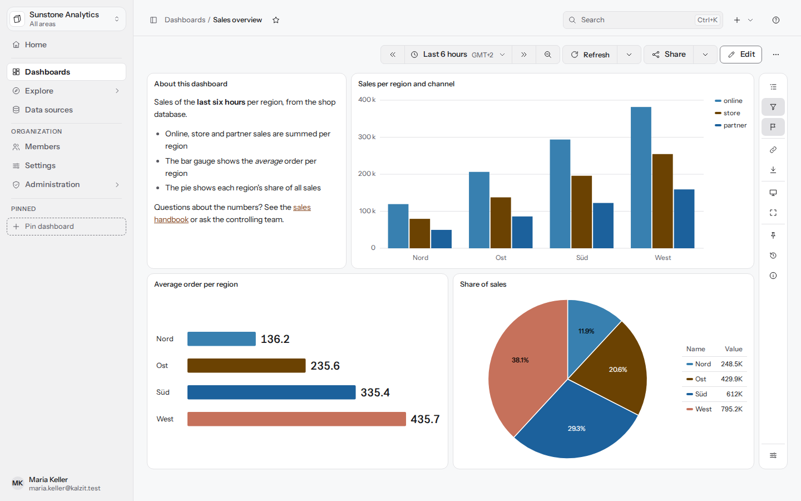
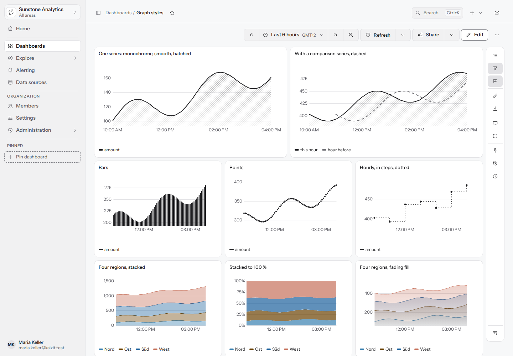
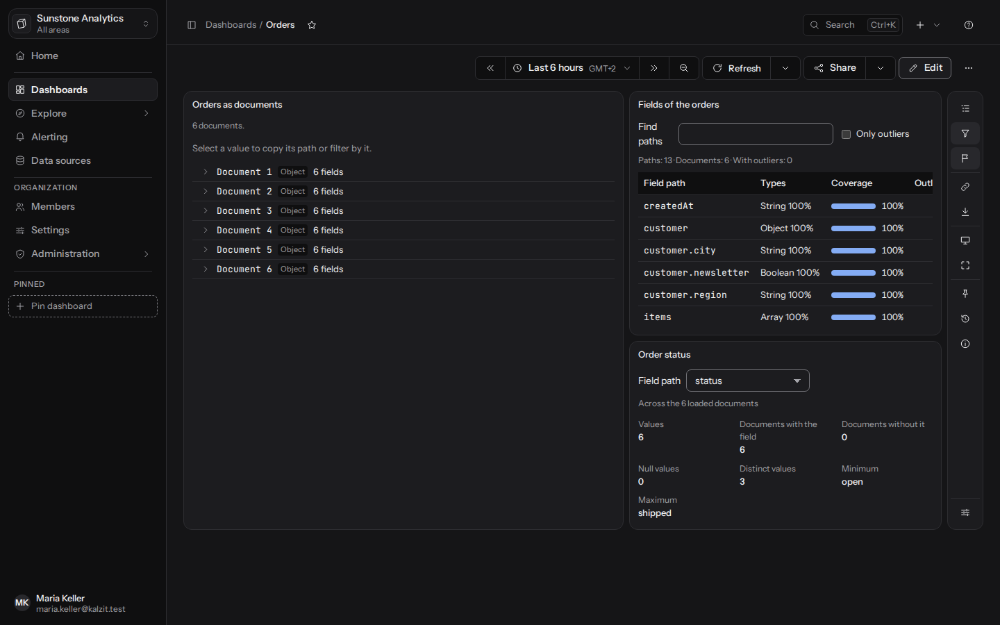
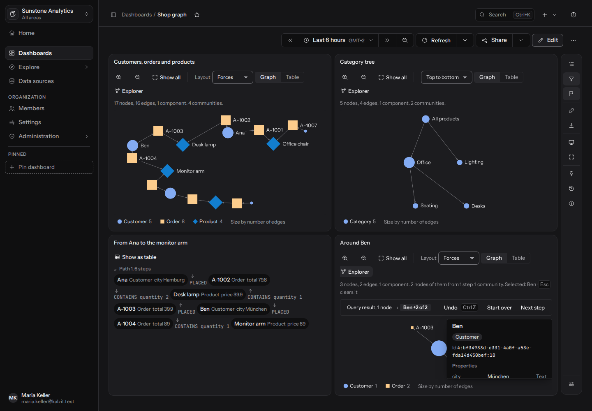
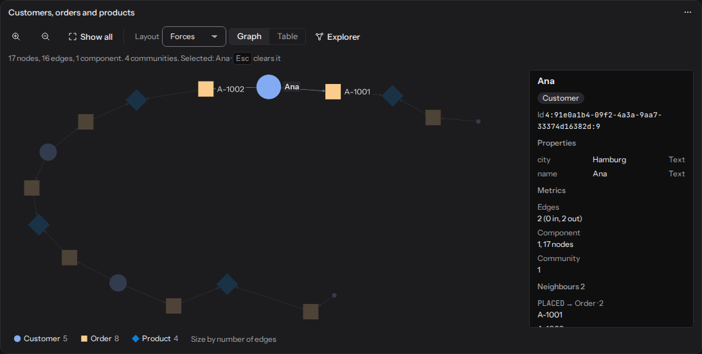
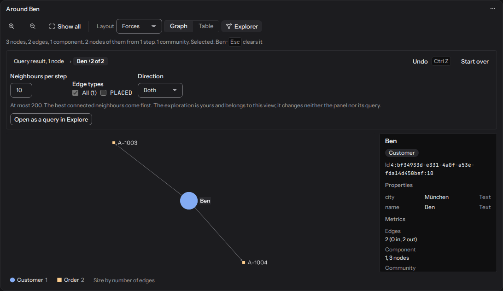
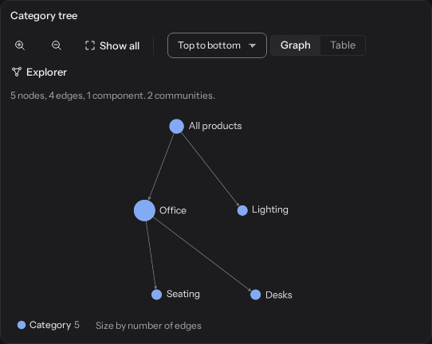
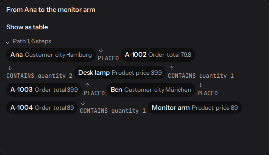

[English](../panels.md) | Deutsch

# Panels

Ein Panel macht aus dem Ergebnis seiner Abfragen eine Visualisierung. Jedes Ergebnis hat eine von
drei Formen, und ein Panel sagt, welche Formen es versteht:

| Form | Typische Quelle | Panels |
|---|---|---|
| `frame` (Tabelle, Zeitreihe) | SQL, Prometheus, CSV-Dateien, Such-Aggregationen | Zeitreihe, Kennzahl, Messuhr, Balkenanzeige, Balkendiagramm, Tabelle, Kreisdiagramm, Histogramm, Heatmap, Zustandsverlauf, Statusraster, Text |
| `documents` | MongoDB, JSON-Dateien, HTTP JSON, Suchtreffer | Dokument-Explorer, Schema, Feldverteilung, Dokumentkarte |
| `graph` | Neo4j, Memgraph, TigerGraph | Netzwerk, Hierarchie, Pfade |

Im Panel-Editor zeigt die Auswahl **Visualisierung** jede Art mit einer kleinen Zeichnung und
einer kurzen Beschreibung und bietet die Arten, die zum Ergebnis passen, zuerst an; **N weitere
zeigen, die nicht zu diesem Ergebnis passen** listet den Rest. Dokumente werden nur durch einen
ausdrücklichen Schritt zur Tabelle (siehe
[Dokumente als Tabelle](calculated-fields.md#dokumente-als-tabelle)); nichts wird hinter deinem
Rücken umgewandelt. Wie Panels platziert, bearbeitet und gespeichert werden, steht auf der Seite
[Dashboards](dashboards.md).

## Optionen, die jedes Panel hat

**Feldoptionen** (bei Frame-Panels) gelten für alle Felder und lassen sich je Feld oder Reihe
überschreiben. Sie sind gruppiert als:

- **Einheit und Anzeige**: **Einheit**, **Nachkommastellen**, **Anzeigename**, **Text bei
  fehlendem Wert**.
- **Minimum und Maximum**: leer folgt den Daten.
- **Schwellenwerte**: siehe unten.
- **Wertzuordnungen**: siehe unten.
- **Farben**: siehe unten.
- **Tabellenzellen**: nur Tabelle.
- **Abweichungen je Feld**: siehe unten.

### Einheiten

Das Menü **Einheit** ist gruppiert: Allgemein (Zahl ohne Einheit, kurz, Prozent 0 bis 100,
Prozent 0 bis 1, Teile pro Million), Daten (Bytes binär und dezimal, Bits), Raten (Bytes, Bits,
Operationen, Anfragen pro Sekunde, Anfragen pro Minute), Dauern (Nanosekunden bis Tage), Währung,
Energie und Elektrizität (Watt, Wattstunde, Volt, Ampere, Hertz), Temperatur (Celsius,
Fahrenheit, Kelvin) sowie Datum und Uhrzeit (Datum und Uhrzeit, ISO 8601, Zeit ab jetzt). **Von
der Datenquelle** behält die Einheit, die die Quelle meldet; **Eigenes Suffix…** schreibt deinen
eigenen Text hinter den Wert. Von Hand eingetippte Einheiten in älteren Panels bleiben ein
einfaches Suffix. **Nachkommastellen** leer wählt je Wert eine sinnvolle Anzahl.

### Schwellenwerte

Schwellenwerte sind Stufen mit einer Farbe. **Schwellenwerte hinzufügen** legt eine Basis an
(„unter jeder Stufe“), und **Stufe hinzufügen** fügt einen Wert **Ab** mit einer Farbe hinzu.
**Stufen sind** entweder absolute **Werte** oder **Prozent zwischen Minimum und Maximum**.
Zeitreihen können die Schwellenwerte **Im Diagramm anzeigen**, als **Linien**, **Bereiche** oder
beides. Kennzahl, Messuhr, Balkenanzeige, Tabellenzellen und das Farbschema **Nach Schwellwert**
nutzen die Stufen, um Werte einzufärben.

### Wertzuordnungen

Ersetzen, was für einen Wert gezeigt wird. **Trifft** nach **Wert**, **Bereich** (Von, Bis) oder
**Regulärer Ausdruck** (RE2-Syntax: kein Lookaround und keine Rückverweise), dann **Anzeigen als**
ein Text und eine Farbe. Die erste Zuordnung, die zu einem Wert passt, entscheidet. Ein Dashboard
mit einem ungültigen Muster wird nicht gespeichert, und die Meldung nennt das Panel.

### Farben

Unter **Farben** das **Farbschema**:

| Schema | Wirkung |
|---|---|
| Palette (Kalzit-Standard) | Eine Palettenfarbe je Reihe, in der Reihenfolge der Reihen |
| Einzelfarbe | Dieselbe Farbe für jede Reihe |
| Nach Schwellwert | Linien und Werte nehmen die Farbe der Schwellenwert-Stufe, in der ihr Wert liegt |
| Verlauf grün-gelb-rot, blau, grau | Ein Verlauf von der ersten Reihe bis zur letzten |

Wähle für jede Reihe (die ersten paar; den Rest über **Abweichungen je Feld**) eine Farbe, eine
Linienart und eine Deckkraft. Eine Farbe ist eine Palettenfarbe, ein Ton (OK, Warnung, Kritisch,
Neutral) oder **Eigene Farbe** als `#rrggbb`; eine eigene Farbe bleibt in heller und dunkler
Darstellung gleich, und der Editor zeigt ihren Kontrast zum Panel und warnt, wenn er für Linien zu
gering ist (3:1).

### Abweichungen je Feld

**Abweichung hinzufügen** setzt Optionen nur für einige Felder: Treffer **Mit dem Namen** oder
**Passend zu einem regulären Ausdruck**, dann eine beliebige Option. Eine spätere Abweichung
gewinnt gegen eine frühere; **Standardwert für diese Felder leeren** zeigt die Option so, als
hätten die Standardwerte sie nicht gesetzt.

## Zeitreihe

Werte über die Zeit als Linien. Optionen: **Legende** (Liste, Tabelle, Ausgeblendet; Position
Unten oder Rechts; Werte Letzter, Minimum, Maximum, Mittelwert), **Tooltip** (Nächste Reihe, Alle
Reihen, Ausgeblendet), **Namen der Reihen** (Label-Namen in doppelten geschweiften Klammern, etwa
`{{job}} on {{instance}}`) und der **Diagrammstil**:

- **Zeichnen als**: Linien, Balken oder Punkte.
- **Linienverlauf**: linear, geglättet, Stufe davor, Stufe danach. **Linienstärke** (0 bis 10 px)
  und **Linienart** (durchgezogen, gestrichelt, gepunktet).
- **Fläche**: keine, voll oder schraffiert, mit **Deckkraft der Fläche** und einem
  **Farbverlauf** (ausblendend, Farbton oder ein Schema aus den Schwellenwerten).
- **Punkte zeigen**: wenn Platz ist, immer, nie, mit einer **Punktgröße**.
- **Lücken verbinden**: nie, immer oder bis zu einer Dauer; **Linie unterbrechen nach** einer
  Dauer.
- **Reihen stapeln**: aus, normal oder Prozent (100 %), in **Stapelgruppen**; positive Werte
  stapeln nach oben und negative nach unten.
- **Balkenausrichtung** und **Balkenbreite** (10 bis 100 % des Platzes zwischen zwei Punkten).
- **Vergleichsreihe**: gedämpft und gestrichelt gezeichnet.

Jede Diagrammoption lässt sich über eine Abweichung je Reihe setzen. Ein Panel mit einer Reihe
zeichnet in einem ruhigen Stil: eine helle Linie auf Dunkel (dunkel auf Hell), 2 px, geglättet,
mit einer ausblendenden Schraffur darunter. Für den älteren Stil (1 px, gerade, ohne Fläche) setze
Linienstärke 1, linearen Linienverlauf und Fläche keine und wähle unter Farbe eine Farbe für die
Reihe. Die Pfeiltasten links und rechts lesen die Werte zu einem Zeitpunkt vor.

## Kennzahl

Eine große Zahl je Feld mit optionaler Trendlinie. Optionen: **Wert** (Letzter, Mittelwert,
Minimum, Maximum, Summe), **Farbe** (Keine, Wert, Hintergrund), **Trend** (Keiner, Linie mit
Fläche), **Text** (Automatisch, Wert, Name und Wert, Name).

## Messuhr

Ein Wert auf einer Skala zwischen Minimum und Maximum, mit **Schwellenwerte am Rand zeigen**.

## Balkenanzeige

Werte als gefüllte Balken. **Stil**: **Balken** oder **Leuchtende Zellen**. Ein Ergebnis mit einem
Namen und einem Wert je Zeile zeigt einen Balken je Zeile; sonst wird jedes Feld ein Balken,
zusammengefasst mit **Wert**. Optionen: **Wert** (in der Textfarbe, in der Farbe des Balkens,
ausgeblendet), **Namen** (vor dem Balken, über dem Balken, ausgeblendet), Ausrichtung.

## Balkendiagramm

Ein Balken je Zeile, gruppiert nach Feld. Optionen: **Ausrichtung** (Waagerecht, Senkrecht),
**Kategorienamen** (so viele, wie Platz haben, ausgeblendet), **Werte an den Balken anzeigen**,
Legende. Ein Balkendiagramm mit einer Reihe nimmt den ruhigen einfarbigen Stil der Zeitreihe an.
Bei vielen Zeilen werden nur die ersten gezeichnet; das Panel sagt das.

## Tabelle

Jede Zeile und Spalte, sortierbar per Klick auf eine Kopfzeile. Optionen: **Spaltenfilter** (Text
oder `>`, `<`, `=` und `!=` bei Zahlen), **In Seiten zeigen** mit **Zeilen pro Seite**. Unter
**Tabellenzellen**, je Spalte oder Feld: **Zellendarstellung** (Wert, Farbiger Text, Farbiger
Hintergrund, Balken, Link), ein **Link** (Webadresse, E-Mail-Adresse oder Pfad auf diesem Server;
`${__value}` ist der Wert der Zelle) und **Spaltenbreite (px)**. **Ein Klick auf eine Zeile
setzt** eine Dashboard-Variable auf den Wert der Zeile in der **Spalte für die Variable** (der
Name, den die Kopfzeile zeigt, oder der Feldname; leer nimmt die erste Spalte); diese Zelle wird
zu einer Schaltfläche, sodass auch die Tastatur sie erreicht.

## Kreisdiagramm

**Form** Kreis oder Ring. **Beschriftung** Keine, Prozent, Name oder Wert; **Position der
Beschriftung** Auf den Kreisstücken (ein Stück, das für seine Beschriftung zu klein ist, lässt sie
weg; Legende und Tooltip zeigen sie trotzdem) oder Neben dem Kreis. Die Legendentabelle kann den
Wert, den Anteil oder beides listen. **Wert** fasst Felder zu Stücken zusammen, wenn jedes Feld
eines wird.

## Histogramm

Wie sich Werte auf gleich breite Klassen verteilen. Optionen: **Klassen** (Anzahl; leer wählt eine
Anzahl nach der Datenmenge), **Klassenbreite**, **Alle Felder zusammen zählen**.

## Heatmap

Dichte über die Zeit in eingefärbten Klassen. **Felder**: **Werte zählen** (mit **Zeitabschnitte**
und **Wertklassen**) oder **Ein Datenfeld je Klasse**. **Farbskala**: Linear oder Quadratwurzel.

## Zustandsverlauf und Statusraster

Zustandsverlauf: Zustände über die Zeit als eingefärbte Abschnitte, auch über mehrere Abfragen.
Statusraster: der Status je Zeitpunkt als Raster aus Zellen. **Bekannte Zustandswörter einfärben**
färbt Werte wie ok, up, healthy, success und passed als gut; warning, degraded und pending als
Warnung; und down, error, failed, failure und critical als kritisch.

## Text

Text oder Markdown (**Format**: Markdown oder Reiner Text) in **Inhalt**, mit Dashboard-Variablen
als `$name` oder `${name}`. HTML wird als Text gezeigt.

## Dokument-Panels

Für Ergebnisse `documents` (siehe [Explore](explore.md#dokumente)):

- **Dokument-Explorer**: jedes Dokument als Baum mit dem Typ jedes Werts. Wähle einen Wert, um
  seinen Pfad zu kopieren oder danach zu filtern; die Pfeiltasten bewegen sich durch den Baum.
  **Ein Klick auf ein Dokument oder einen Wert setzt** eine Dashboard-Variable: auf den Wert am
  **Feldpfad für die Variable** im angeklickten Dokument (`customer.id`) oder, ohne Pfad, auf den
  angeklickten Wert (ein ganzes Dokument gibt seine `_id`). Eingabe auf einer Zeile und die
  Schaltfläche **$name setzen** tun dasselbe.
- **Schema**: jeder Feldpfad mit seinen Typen und seiner **Abdeckung**, mit Markierung von
  Feldern, die in manchen Dokumenten fehlen oder gemischte Typen haben; **Nur Ausreißer** grenzt
  die Liste ein.
- **Feldverteilung**: wie sich die Werte eines Felds (ein Pfad wie `items[].price`) verteilen, mit
  den häufigsten Werten. Bei MongoDB zählt die Datenbank das ganze Ergebnis, daher sagen die
  Zahlen **Über alle N Dokumente des Ergebnisses**, auch wenn nur eine Seite davon geladen ist; bei
  anderen Quellen zählen sie die geladenen Dokumente und sagen **Über die geladenen N Dokumente**.
  Ein Feld mit einem Punkt im Namen (`preis.netto`) wird als dieses Feld gezählt.
- **Dokumentkarte**: ein Dokument gut lesbar, Feld für Feld, mit Blättern durch die übrigen;
  **Titelfeld** benennt die Karte. Mit **Ein Klick auf einen Wert setzt** ist jeder Wert eine
  Schaltfläche, die die Variable auf den Wert am Feldpfad im gezeigten Dokument setzt oder auf
  den angeklickten Wert.

Hat eine Quelle mehr Dokumente, als ein Panel zeigt (**Die Quelle hat weitere.**), hängt **Weitere
Dokumente laden** unter dem Panel die nächsten an, bei MongoDB, Elasticsearch und OpenSearch sowie
JSON- und NDJSON-Dateien. Es setzt nur die gespeicherte Abfrage des Panels fort, sodass auch
Betrachter es nutzen können; Aktualisieren oder ein anderer Zeitraum beginnt wieder mit der ersten
Seite.

### Datenlinks aus Feldern, Knoten und Kanten

Der Dokument-Explorer, die Dokumentkarte und die Graph-Panels nehmen **Datenlinks**: einen Link an
einem **Feldpfad** (`customer.id`) oder, in Graph-Panels, an einer **Property des Knotens oder der
Kante** (`customerId`; `id` fällt auf die eigene ID des Elements zurück). Ein Link hat einen
**Titel**, eine **Adresse** und **In neuem Tab öffnen**. Die Adresse beginnt mit `https://`,
`http://` oder `/` für eine Seite von Kalzit; `${__value}` ist der Wert des Felds und `${__field}`
sein Name, Dashboard-Variablen wie `${region}` gehen auch, und jeder Wert wird für die Adresse
kodiert. Um ein anderes Dashboard mit dem Wert als Variable zu öffnen, schreib
`/dashboards/<id>?var-customer=${__value}`: Ein Dashboard nimmt Parameter `var-name` als
Startwerte seiner Variablen (eine Variable mit festen Werten nur einen ihrer Werte, eine Variable
mit einem Wert den ersten von mehreren; eine Konstante behält ihren eigenen) und nimmt sie dann
aus der Adresse heraus. Der Host einer Webadresse wird ausgeschrieben: Platzhalter und Variablen
gehören in Pfad, Abfrageteil oder Fragment, nie in den Host. Der Panel-Editor hält
**Übernehmen** zurück, bis jeder Datenlink ein Feld, einen Titel und eine erlaubte Adresse hat.

Wo Links erscheinen: Der Dokument-Explorer bietet die Links eines Felds an, solange sein Wert
ausgewählt ist (bei einem ganzen ausgewählten Dokument die Links all seiner Felder), die
Dokumentkarte unter ihrem Titel, die Panels Netzwerk und Hierarchie in den Details des Knotens
(und die einer Kante mit dem Nachbarn, zu dem sie führt) und das Panel Pfade mit jedem Knoten und
jeder Kante eines Pfads. Ein Link erscheint nur, wo das Feld einen einfachen Wert hat. Der Server
lehnt beim Speichern des Dashboards andere Adressen ab (`javascript:`, `data:`, `mailto:` oder
eine andere Website ohne Schema), höchstens 20 Links pro Panel, und Links öffnen sich immer mit
`rel="noopener noreferrer"`.

## Graph-Panels

Für Ergebnisse `graph` (siehe [Explore](explore.md#graphen)): **Netzwerk** (Knoten und Kanten in
einem freien Layout, WebGL; Gruppen und ein Explorer), **Hierarchie** (gerichtete Strukturen in
Schichten) und **Pfade** (Pfade als Folgen von Knoten und Kanten, zum Beispiel aus
`shortestPath`).

Die Optionen sind wie im Panel-Editor gruppiert:

- **Knoten**: **Property für den Knotennamen**; **Farbe nach** Label (mit **Farbe und Form je
  Label**: eine Palettenfarbe und eine Form für jedes Label), Property (eine Zahl entlang eines
  **Farbschemas**: Verlauf blau, grün-gelb-rot oder grau, mit einem automatischen oder festen
  **Bereich**; oder **Nach Wert (Text)**, eine Palettenfarbe je Wert; Knoten ohne die Property
  sind grau), Community oder Komponente (Communities werden im Browser bis 2.000 Knoten berechnet;
  darüber berechnet sie eine Neo4j-Quelle mit GDS oder eine Memgraph-Quelle mit MAGE, wenn du die
  Quelle abfragen darfst, siehe
  [Graph-Algorithmen](data-sources.md#graphalgorithmen-neo4j-gds-memgraph-mage)); **Knotengröße**
  nach Kanten, nach einer Property oder alle gleich, mit kleinster und größter Größe in px. Jedes
  Label gibt seinen Knoten auch eine Form, Kreis, Quadrat oder Raute, in der Reihenfolge der
  Labels, außer das Panel legt eine fest (**Form je Label**, egal was die Knoten einfärbt), sodass
  Labels auch ohne Farben auseinanderzuhalten sind, wie bei hohem Kontrast unter Windows; die
  Legende zeigt die Formen.
- **Kanten**: **Property für die Kantenstärke**, **Pfeile für die Richtung** und **Kantentyp
  beschriften**, jeweils immer, bei Auswahl oder nie.
- **Beschriftungen**: nach Zoomstufe (mit **Immer beschriften: die größten** N), immer oder nur
  die Auswahl.
- **Klick auf einen Knoten**: die **Aktion** (Details, Variable setzen, Nachbarn laden), die
  Dashboard-Variable, die ein Klick setzt, mit der Knoten-Property, die sie nimmt, und **Details
  zusätzlich öffnen**.
- **Layout** (nur Hierarchie): **Kalzit-Schichten (Standard)** oder **ELK geschichtet**, siehe
  unten.
- **Explorer**, **Limits und Gruppen** (**Knotenlimit**, **Knoten nach Label gruppieren**) und
  **Zeit** (eine Kanten-Property mit einem Zeitstempel fügt einen Zeitregler hinzu).
- **Datenlinks**: Links aus einer Property eines Knotens oder einer Kante, siehe
  [Datenlinks](#datenlinks-aus-feldern-knoten-und-kanten).

Einen Knoten auszuwählen öffnet seine Details neben der Zeichnung (in schmalen Panels darüber):
Labels, typisierte Properties, Kanten und Komponente sowie seine Nachbarn, gruppiert nach
Kantentyp und Richtung, mit **Nachbarn laden** und **$variable setzen**. Die Auswahl wird ruhig
gezeigt: der Name des Knotens fett auf einer neutralen Tönung, alles andere abgedunkelt.
Umschalt+Klick (oder die Leertaste auf der Tastatur) fügt Knoten zur Auswahl hinzu; **Nur Auswahl
zeigen** (S) blendet den Rest aus, und eine Variable mit mehreren Werten nimmt die Werte aller
ausgewählten Knoten (**$customers setzen (2 Werte)**). **Anheften** (P) behält einen Knoten, wenn
du Explorer-Schritte zurücknimmst. Deine angehefteten Knoten und deine Auswahl werden für dich an
diesem Dashboard-Panel auf dem Server aufbewahrt; sie ändern weder das Panel noch seine Abfrage.
Die Legende unter der Zeichnung blendet Labels aus und ein, und **Layout** wechselt für diese
Ansicht zwischen Kräften und Schichten. Das Netzwerk verteilt seine Knoten über das Panel, soweit
das Panel Platz hat, sodass Knoten nicht aufeinanderliegen und die Namen, die passen, neben ihrem
Knoten stehen; ein Name, der einen Knoten, einen anderen Namen oder den Rand des Panels verdecken
würde, erscheint, sobald Hineinzoomen ihm Platz gibt, und ein niedriges Panel zeichnet seine
Knoten kleiner. Immer gezeigte Beschriftungen (der Modus **Immer**) und die Beschriftungen
ausgewählter Knoten werden gezeichnet, egal was sie verdecken, sodass sie übereinanderliegen
können. Eine Auswahl gibt einer Variablen mit mehreren Werten höchstens 100 Werte und sagt das;
ein Klick auf einen Knoten, dessen Nachbarn sich nicht laden lassen, öffnet stattdessen seine
Details.

Der **Explorer** (in der Werkzeugleiste einschaltbar, mit der Panel-Option von Anfang an an) lädt
die Nachbarn eines Knotens Schritt für Schritt: Jeder Schritt erscheint in der Zeile **Schritte**,
ein Klick auf einen früheren Schritt nimmt alle späteren zurück (ab drei mit Rückfrage), ein
Schritt, der noch lädt, lässt sich abbrechen, und **Rückgängig** (Strg+Z) und **Von vorn** nehmen
Schritte zurück. **Nachbarn pro Schritt** (höchstens 200, die am besten vernetzten zuerst),
**Kantentypen** und **Richtung** gelten für den nächsten Schritt; **Weitere N laden** macht mit
den nächsten Nachbarn eines Knotens weiter. **Als Abfrage in Explore öffnen** macht aus dem
Gezeigten eine lesende Cypher-Abfrage im Editor von Explore. Nachbarn zu laden braucht
Abfragezugriff auf die Datenquelle; für TigerGraph-Quellen gibt es den Explorer nicht.

Eine **Hierarchie** ordnet höchstens 2.000 Knoten an; ein größeres Ergebnis bietet **Als Netzwerk
zeigen** an. Kanten, die einen Kreis schließen, werden vermerkt. Standardmäßig nutzt sie das
eigene Schichten-Layout von Kalzit. Unter **Layout** kannst du stattdessen **ELK geschichtet**
wählen (den Eclipse Layout Kernel), mit seiner **Richtung** (von oben nach unten, von links nach
rechts, von unten nach oben, von rechts nach links), **Knotenabstand** und **Schichtabstand** in px
und der **Kantenführung** (rechtwinklig oder Polylinie; Kanten werden trotzdem gerade gezeichnet,
die Führung bestimmt, wie viel Platz ELK für sie lässt). ELK wird erst geladen, wenn ein Panel es
nutzt, deshalb dauert die erste Zeichnung etwas länger und sagt „ELK wird geladen und ordnet den
Graphen an“; dasselbe Ergebnis bekommt immer dasselbe Layout. Kann ELK nicht laufen, zeigt das
Panel das Layout von Kalzit und sagt das. ELK läuft in einem Web Worker; ein Browser ohne Worker
ordnet höchstens 300 Knoten mit ELK an und zeigt für größere Graphen das Layout von Kalzit.
**Pfade** zeigt den ersten Pfad aufgeklappt und die anderen eingeklappt mit ihrer Kette aus
Knoten; jede Kante zeigt ihren Typ, ihre Richtung und ihre Properties, jeder Knoten seine Labels
und seine ersten zwei Properties; höchstens 50 Pfade, mit einem Hinweis, wenn es mehr gibt, und
**Als Tabelle zeigen**. Browser ohne WebGL 2 zeigen jeden Graphen als Tabelle; **Als Tabelle
zeigen** gibt es auch auf Wunsch. Tastatur: Mit Tab in die Zeichnung, die Pfeiltasten gehen zum
nächstgelegenen Knoten, Eingabe lädt Nachbarn oder öffnet eine Gruppe, Esc hebt die Auswahl auf.

| | |
|---|---|
|  |  |
| Hierarchie | Pfade |

Graph-Schritte (Anzahl je Label, Grad, Top N, gemeinsame Nachbarn, eine Tabelle aus dem Graphen)
wirken auf das Ergebnis eines Graph-Panels wie in Explore; siehe
[Graph-Schritte](explore.md#graph-schritte).
