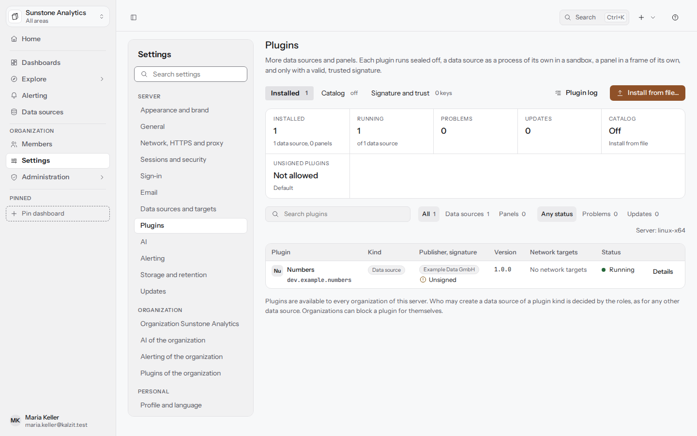
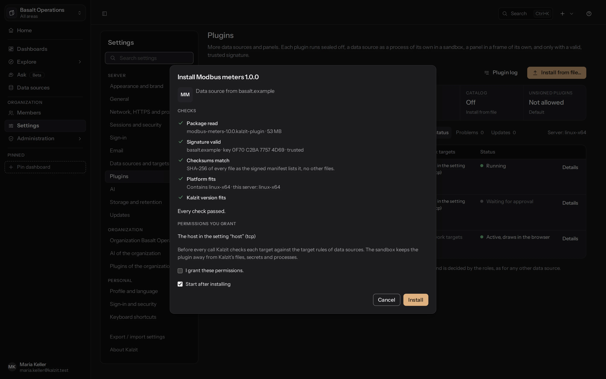
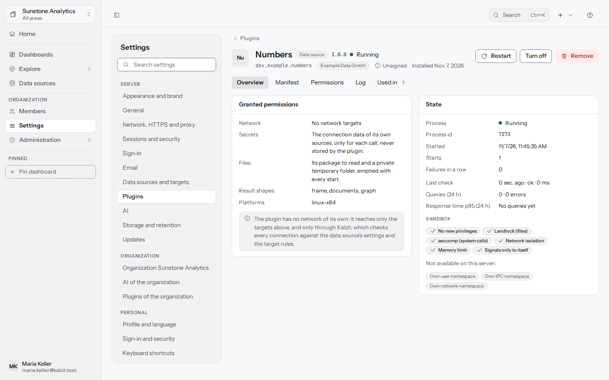
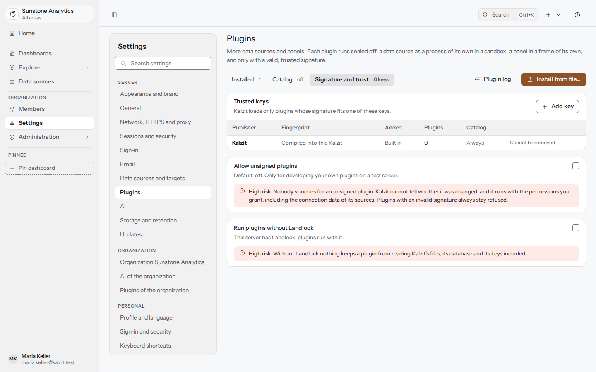
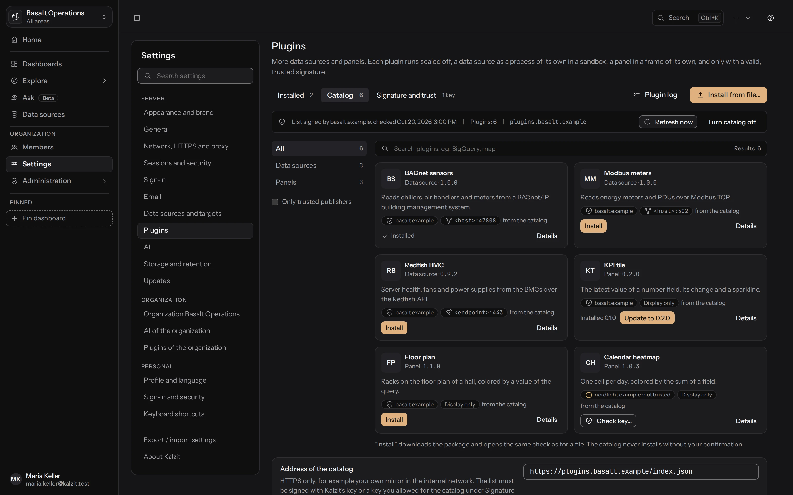
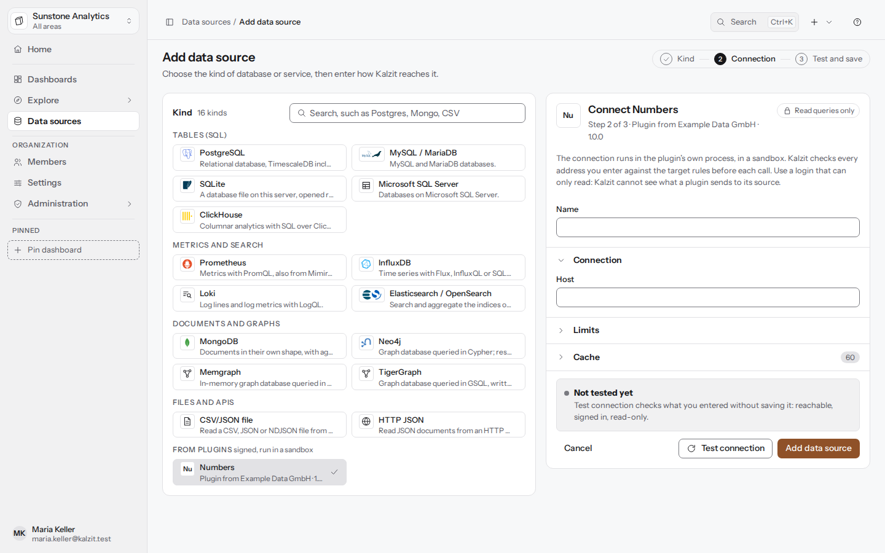
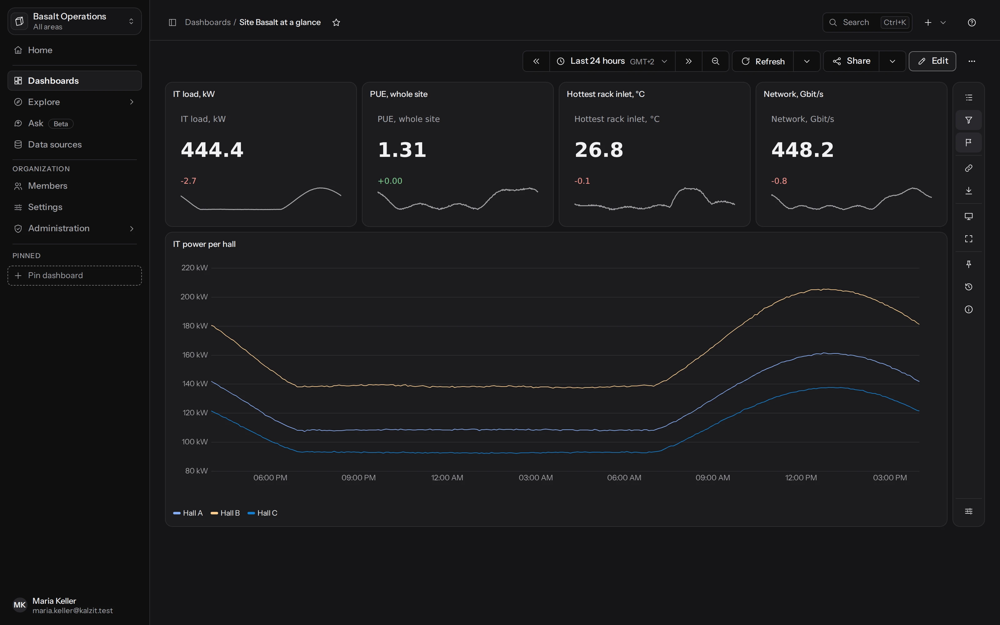

[English](../plugins.md) | Deutsch

# Plugins

Plugins fügen Kalzit Arten von Datenquellen und Panel-Typen hinzu. Ein Datenquellen-Plugin läuft als
eigener Prozess in einer Sandbox des Betriebssystems; ein Panel-Plugin läuft in deinem Browser, in
einem Rahmen, der von Kalzit abgeschottet ist („Panels aus Plugins“ unten). Ein Plugin wird nur
geladen, wenn seine Signatur zu einem vertrauenswürdigen Schlüssel passt: Kalzits eigenem Schlüssel
oder einem Herausgeber-Schlüssel, den ein Server-Admin hinzugefügt hat. Plugins installieren, ihnen
vertrauen und sie freigeben ist Sache der Server-Admins; Organisationen können ein Plugin für sich
sperren. API: [plugins](../../api/plugins.md).

Die Seite ist **Einstellungen > Plugins**, in der Gruppe **Server**, mit drei Tabs: **Installiert**,
**Katalog** und **Signatur und Vertrauen**. Jeder Tab hat eine eigene Adresse (`/settings/plugins`,
`#catalog`, `#trust`), und jedes Plugin eine eigene Seite (`/settings/plugins/<plugin id>`).

## Installierte Plugins

Eine Leiste oben zählt die installierten Plugins, wie viele laufen, die Probleme, wartende
Aktualisierungen, den Katalog und ob unsignierte Plugins erlaubt sind. **Alle**, **Probleme** und
**Updates** filtern die Tabelle, die je Plugin zeigt:

- **Plugin**: seinen Namen und seine ID, die zugleich die ID seiner Datenquellen-Art oder seines
  Panel-Typs ist.
- **Art**: **Datenquelle** oder **Panel**.
- **Herausgeber, Signatur**: den Herausgeber, wie das Manifest ihn nennt (ein neutrales Abzeichen,
  keine bestätigte Identität), und die Signatur: **Von Kalzit signiert**, **Signiert** mit der
  Schlüssel-ID in Vierergruppen, **Unsigniert** oder **Schlüssel nicht mehr vertraut**.
- **Version**, mit einer Aktualisierung, die auf Freigabe wartet.
- **Netzwerkziele**: die Ziele, die das Plugin angibt, feste Hosts wie
  `license.example.dev:443 (tls)` oder „der Host in der Einstellung `host`“.
- **Zustand** als Punkt und Wort: **Wartet auf Freigabe**, **Ausgeschaltet**, **Bereit, startet bei
  Bedarf**, **Läuft**, **Abgestürzt** mit der Zeit bis zum nächsten Versuch und der Nummer des
  Versuchs, **Angehalten** nach wiederholten Fehlern, **Nicht geladen** mit dem Grund (zum Beispiel
  ein Linux-Server ohne Landlock) und **Angehalten: Schlüssel nicht vertraut**.

## Aus Datei installieren

**Aus Datei installieren…** funktioniert ohne Internet, für jedes Plugin. Zieh das Paket (eine
ZIP-Datei, höchstens 256 MiB) auf den Dialog oder wähle es aus. Der Server prüft es, bevor irgendetwas
darin läuft, und der Dialog zeigt die Prüfungen aus seiner Antwort:

1. **Paket gelesen**: Name und Größe.
2. **Signatur gültig**: wer es signiert hat, mit der Schlüssel-ID. Ein unsigniertes Paket zeigt
   **Nicht signiert** mit einer Warnung und wird nur installiert, solange unsignierte Plugins
   erlaubt sind.
3. **Prüfsummen stimmen**: jede Datei so, wie das signierte Manifest sie listet, keine anderen
   Dateien.
4. **Plattform passt**: die Plattformen, die das Paket enthält, und die dieses Servers.
5. **Kalzit-Version passt**.
6. Bei einer Aktualisierung: **Ersetzt Version …** oder **wartet auf Freigabe**, wenn sie neue Ziele
   erreicht (die installierte Version läuft solange weiter).

Darunter listet **Berechtigungen, die du erteilst** die Netzwerkziele. Bei einer Aktualisierung sind
Ziele, die sie hinzufügt, als **neu in** der Version markiert und fett gesetzt, die anderen als **wie
bisher**. Nichts läuft, bevor du **Ich erteile diese Berechtigungen.** ankreuzt und **Installieren**
drückst; **Nach der Installation starten** schaltet das Plugin sofort ein. **Abbrechen** entfernt ein
neues Plugin wieder.

Ein abgelehntes Paket nennt den Schritt, der fehlgeschlagen ist, und warum, und die Schritte danach
werden übersprungen:

- **Signatur passt nicht zum Inhalt**: Das Paket wurde nach dem Signieren verändert oder ist
  beschädigt. Immer abgelehnt, auch wenn unsignierte Plugins erlaubt sind.
- **Herausgeber nicht vertraut**: Die Signatur ist gültig, aber ihrem Schlüssel wird nicht vertraut.
  **Schlüssel prüfen und vertrauen…** öffnet den Schlüsseldialog und vergleicht den Schlüssel, den du
  einfügst, mit dem, der das Paket signiert hat.
- **Keine passende Plattform**, **Braucht ein neueres Kalzit**, **Dateien passen nicht zum Manifest**
  und die Ablehnungen von Aktualisierungen (ein anderes Plugin, eine ältere Version, ein anderer
  Schlüssel oder eine andere Art: Ein Panel-Plugin wird nie zu einem Datenquellen-Plugin oder
  umgekehrt; entferne es und installiere das Paket als neues).
- Eine signierte Aktualisierung eines Plugins, das unsigniert installiert wurde, ist ein Wechsel des
  Herausgebers: Der Dialog sagt, dass das installierte Plugin unsigniert ist, nennt seine Version
  und die Datenquellen, deren Passwörter gelöscht werden, und installiert erst, nachdem du den Namen
  des Servers eingetippt hast.

<picture><source media="(prefers-color-scheme: light)" srcset="../../screenshots/gallery/plugin-install-light.webp"></picture>

## Die Seite eines Plugins

Die Seite zeigt ID, Herausgeber, Signatur, Lizenz und Installationsdatum des Plugins, und:

- **Berechtigungen freigeben…** für ein noch nicht freigegebenes Plugin, **Aktualisierung auf …
  freigeben…** für eine wartende Aktualisierung, **Neu starten**, **Einschalten** oder
  **Ausschalten** und **Entfernen**.
- **Übersicht**: die erteilten Berechtigungen (Netzwerkziele, die Verbindungsdaten seiner eigenen
  Quellen bei jedem Aufruf, sein Paket und ein privater temporärer Ordner) und der Zustand des
  Prozesses: Prozess-ID, Startzeit, Starts, Fehler in Folge, der letzte Fehler und die
  Sandbox-Schichten, die auf diesem Server wirken und fehlen.
- **Manifest-Datei**: `kalzit-plugin.toml` aus dem Paket, wie signiert.
- **Protokoll**: stdout und stderr des Prozesses (die letzten 2000 Zeilen), auf Wunsch auf stderr
  gefiltert, aktualisierbar und als Textdatei herunterladbar.
- **Genutzt in**: die Datenquellen der Art des Plugins in jeder Organisation.

Ein abgestürztes Plugin sagt, wann es wieder startet: Neustarts warten 10 s, 30 s, 1, 2, 5 und 10
Minuten, und danach bleibt das Plugin angehalten, bis jemand **Jetzt neu starten** wählt. Ein Absturz lässt nur
die Abfragen seiner eigenen Art fehlschlagen.

**Entfernen** fragt zuerst und sagt, wie viele Datenquellen in wie vielen Organisationen das Plugin
nutzen. Sie bleiben mit ihren Einstellungen und melden „Art nicht verfügbar“, bis es wieder
installiert ist. **Ausschalten** lässt das Plugin installiert; seine Quellen melden dasselbe, bis es
eingeschaltet wird.

## Signatur und Vertrauen

**Vertrauenswürdige Schlüssel** listet Kalzits eigenen Schlüssel (eingebaut, lässt sich nicht
entfernen) und die hier hinzugefügten Herausgeber-Schlüssel, mit Fingerabdruck, Datum und den
Plugins, die sie signiert haben.

- **Schlüssel hinzufügen**: der Name des Herausgebers und der öffentliche Schlüssel, wie der
  Herausgeber ihn angibt (base64 oder 64 Hex-Ziffern, auch als PEM-Block). Der Dialog zeigt den
  Fingerabdruck, die Schlüssel-ID in Vierergruppen; vergleiche alle 16 Zeichen mit denen des
  Herausgebers, zum Beispiel auf seiner Website, und kreuze **Ich habe den Fingerabdruck
  verglichen.** an.
- **Entfernen**: Hat der Schlüssel installierte Plugins oder wartende Aktualisierungen signiert,
  nennt der Dialog die Plugins, die anhalten, und die Aktualisierungen, die verworfen werden;
  **Entfernen und anhalten** entfernt ihn.

**Unsignierte Plugins erlauben**, standardmäßig aus, ist dafür gedacht, eigene Plugins auf einem
Testserver zu entwickeln. Beim Einschalten fragt Kalzit zur Bestätigung nach dem Namen des Servers.
Solange es an ist, sagt ein Band auf jeder Plugin-Seite das, mit **Ausschalten**. Eine kaputte
Signatur bleibt in jedem Fall abgelehnt; unsignierte Plugins, die in der Zwischenzeit installiert
wurden, laufen weiter, wenn es wieder ausgeschaltet wird.

Unter Linux lässt **Plugins ohne Landlock ausführen** Plugins auf einem Server starten, dessen Kernel
kein Landlock bietet. Ohne Landlock hält nichts ein Plugin davon ab, Kalzits Dateien zu lesen; auch
dieser Schalter fragt nach dem Namen des Servers. Ohne den Schalter startet ein Plugin, dessen
Netzwerk sich nicht begrenzen lässt (kein seccomp-Filter und kein Network Namespace), überhaupt
nicht.

## Katalog

Der Katalog ist eine signierte Liste von Plugins zum Installieren. Er ist **standardmäßig aus**, und
solange er aus ist, baut Kalzit für ihn keine Verbindung auf. Installieren aus einer Datei
funktioniert immer, mit oder ohne ihn.

Um ihn zu nutzen, trägt ein Server-Administrator im Tab Katalog die **Adresse des Katalogs** ein,
eine `https://`-Adresse der Liste, und schaltet **Katalog verwenden** ein. Standardmäßig gibt es
keine Adresse; es kann der Katalog des Projekts sein oder dein eigener Spiegel im internen Netz. Die
Liste muss mit Kalzits Plugin-Schlüssel signiert sein oder mit einem Herausgeber-Schlüssel, den du
für den Katalog erlaubt hast: unter **Signatur und Vertrauen** **Für den Katalog erlauben…** an einem
vertrauenswürdigen Schlüssel, nach einer Bestätigung. Einem Schlüssel nur für Plugins zu vertrauen,
lässt ihn den Katalog nicht signieren. Die Signatur liegt neben der Liste unter derselben Adresse
mit angehängtem `.sig`. Pakete und Weiterleitungen auf anderen Hosts als dem des Katalogs müssen
öffentliche Adressen sein, und die Adresse des Katalogs kann nie Kalzit selbst sein. **Erneut laden
alle** legt fest, wie oft Kalzit ihn lädt (standardmäßig alle 24 Stunden). **Über Proxy laden**
(standardmäßig an) schickt die Liste und die Plugin-Downloads über den Proxy aus **Netzwerk, HTTPS
und Proxy**; ausgeschaltet gehen sie direkt hinaus. Ohne Proxy dort ändert es nichts. Die vier
Einstellungen lassen sich auch in der Umgebung setzen (`KALZIT_SETTING_PLUGINS_CATALOG_ENABLED`,
`..._URL`, `..._REFRESH_HOURS`, `..._USE_PROXY`); der Tab zeigt sie dann nur lesbar.

Kalzit lädt die Liste selbst, mit denselben Zielregeln wie für Datenquellen (erlaubte Ziele,
Metadaten-Adressen abgelehnt), nur über HTTPS, und schickt nichts außer seiner Version und
Plattform. Es übernimmt eine Liste nur, wenn

- ihre Signatur sich mit einem vertrauenswürdigen Schlüssel prüfen lässt; eine veränderte Liste wird
  immer abgelehnt,
- sie neuer ist als jede zuvor vom selben Schlüssel übernommene Liste: Eine ältere (ein Rollback)
  wird abgelehnt, auch nachdem sich die Adresse geändert hat,
- sie nicht abgelaufen ist: Jede Liste sagt, bis wann sie gilt (höchstens 31 Tage), und eine
  abgelaufene Liste bietet nichts zum Installieren an.

Schlägt eine Prüfung fehl, sagt der Tab warum und behält die zuvor übernommene Liste; **Jetzt
aktualisieren** versucht es sofort erneut.

Die Liste zeigt jedes Plugin mit seiner Art, Version, seinem Herausgeber, dem Schlüssel, der es
signiert, und ob du ihm vertraust, und den Netzwerkzielen, die es angibt, mit einer Suche und **Nur
vertraute Herausgeber**. Die Kategorien links sind ein Baum: **Datenquellen** und **Panels**, jeweils
mit den Kategorien, die die Liste für ihre Plugins nennt (etwa Datenbanken oder Karten). **Details**
zeigt die Schlüssel-ID, die Größe des Pakets, die Quelle und SHA-256. **Installieren** oder **Auf …
aktualisieren** (angeboten, wenn die Liste eine neuere Version hat als die installierte) lädt das
Paket herunter und öffnet dieselbe Prüfung wie **Aus Datei installieren**: Das Paket muss genau das
sein, das die Liste nennt (Größe, SHA-256, ID, Version, Art, Schlüssel und Netzwerkziele), signiert
mit einem vertrauenswürdigen Schlüssel (nie unsigniert, egal was der Schalter für unsignierte
Plugins sagt), und danach folgt jede Prüfung einer Datei, mit den Berechtigungen zum Erteilen, bevor
irgendetwas läuft. Bis eine Version hier installiert ist, sind ihre Art und Netzwerkziele das, was
die Liste sagt, und als **laut Katalog** markiert; sobald ihr Paket hier ist, sind es die des Pakets
selbst. Für ein unsigniert installiertes Plugin wird eine signierte Version in der Liste nicht als
Aktualisierung angeboten: **Signierte … prüfen** führt zur Bestätigung eines Wechsels des
Herausgebers. Ein Herausgeber, dessen Schlüssel du nicht vertraust, hat **Schlüssel prüfen…**, das
**Signatur und Vertrauen** öffnet, um den Schlüssel zu vergleichen und hinzuzufügen.
Datenquellen-Plugins und Panel-Plugins installieren sich aus dem Katalog gleich; ein Panel ist dann
eine Visualisierung im Panel-Editor wie nach einer Installation aus einer Datei.

Die Liste kann Versionen zurückziehen (zum Beispiel nach einem Sicherheitsproblem): Sie sind als
**Zurückgezogen** markiert und lassen sich nicht installieren, und eine installierte Version, die
die Liste zurückzieht, wird oben im Tab genannt, mit dem Grund. Das Aktualisieren der Liste von Hand
und jede Installation daraus stehen im Audit-Log, ebenso Änderungen ihrer Einstellungen.

<picture><source media="(prefers-color-scheme: light)" srcset="../../screenshots/gallery/plugins-catalog-light.webp"></picture>

## Plugins der Organisation

**Einstellungen > Plugins der Organisation**, für Mitglieder mit `plugins:configure` (Admins und
Eigentümer), listet die Plugins des Servers mit einem Schalter **Angeboten**. Ein hier
ausgeschaltetes Plugin wird in **Datenquelle hinzufügen** nicht angeboten, und die Quellen der
Organisation mit seiner Art melden „Art nicht verfügbar“. Die Änderung gilt sofort und lässt sich
rückgängig machen.

## Datenquellen mit Plugin-Arten

In **Datenquelle hinzufügen** haben die Plugin-Arten eine eigene Gruppe, **Aus Plugins** (signiert,
laufen in einer Sandbox), jede mit den Buchstaben des Plugins und „Plugin von *Herausgeber* ·
*Version*“. Das Formular nutzt die Beschriftungen und Hilfetexte aus dem Manifest des Plugins in
deiner Sprache. In der Liste der Datenquellen trägt eine Quelle mit Plugin-Art ein neutrales
Abzeichen **Plugin · *Herausgeber***.

In Explore und im Panel-Editor nimmt eine Quelle mit Plugin-Art ihre Abfrage als ein JSON-Objekt, in
der Form, die das Plugin beschreibt (siehe seine Dokumentation); Kalzit schickt sie so, wie sie
geschrieben ist.

## Panels aus Plugins

Ein installiertes, freigegebenes und eingeschaltetes Panel-Plugin ist eine Visualisierung wie die
eingebauten: im Panel-Editor unter **Visualisierung**, nach den eingebauten Typen, mit einem
Abzeichen **Plugin** und dem Herausgeber, den sein Manifest nennt. Seine Optionen erscheinen unter
**Optionen der Visualisierung**, gebildet aus dem Manifest des Plugins.

Das Panel zeichnet die Ergebnisse der eigenen Abfragen des Panels, sonst nichts: Es läuft in einem
abgeschotteten Rahmen ohne Netzwerk, kann deine Sitzung, Cookies oder andere Panels nicht lesen und
Kalzit nicht aufrufen. (Eine Lücke bleibt dem Browser überlassen: Ein Browser, der die Richtlinie
nicht kennt, die WebRTC sperrt, würde ein Panel WebRTC-Verbindungen öffnen lassen; installiere
Panel-Plugins nur von Herausgebern, denen du vertraust.) Es darf um mehr Höhe bitten, seine Optionen
ändern, während du das Panel bearbeitest, und darum bitten, einen Link zu öffnen: Kalzit zeigt dann,
wohin er führt (**Führt zu**, die Website fett), die volle Adresse und den Titel des Links als
**Text des Plugins**, und öffnet ihn erst, wenn du **Öffnen** wählst. Adressen mit versteckten oder
richtungsändernden Zeichen werden abgelehnt. Ein Panel, das nicht innerhalb von 10 Sekunden
startet oder versucht, seinen Rahmen zu verlassen, zeigt einen Fehler mit **Erneut versuchen**. Ist
sein Plugin ausgeschaltet, entfernt oder für deine Organisation gesperrt, sagt das Panel das
stattdessen.

<picture><source media="(prefers-color-scheme: light)" srcset="../../screenshots/gallery/dashboard-plugin-panel-light.webp"></picture>

Das Release bringt das Beispiel-Panel **KPI tile** mit (`dev.kalzit.panel-kpi`, signiert mit
Kalzits Schlüssel): der letzte Wert eines Zahlenfelds mit einer Sparkline, mit den Optionen Feld,
Nachkommastellen und Beschriftung.

Betrachter sehen die Panels eines Plugins auf den Dashboards, die sie lesen dürfen; eines
hinzuzufügen braucht das Recht, das Dashboard zu bearbeiten. Die Entwicklerkonsole des Browsers
zeigt die Logzeilen eines Plugins und was Kalzit von ihm abgelehnt hat, für die Person, die das
Plugin schreibt.

## Sandbox und Netzwerk

Ein Datenquellen-Plugin läuft in einer Sandbox des Betriebssystems, und die Seite des Plugins listet
die Schichten, die wirken, und alle, die auf diesem Server fehlen:

- **Windows**: ein eingeschränktes Token mit niedriger Integrität in einem Job-Objekt (Speicher- und
  Prozessgrenzen, endet mit Kalzit), in einem eigenen AppContainer ohne Netzwerkzugriff. Ein Plugin
  kann weder Kalzits Datenordner noch andere Prozesse lesen. Unter Windows starten Plugins nicht,
  solange eine von Kalzits Dateien mit Geheimnissen (`kalzit.toml` mit einem Passwort, der
  TLS-Schlüssel) für sie lesbar ist; die Seite des Plugins nennt die Datei. Eine Datei, die andere
  lokale Konten lesen dürfen, ist dort eine Warnung.
- **Linux**: Landlock (das Dateisystem nur lesbar und nur dort sichtbar, wo nötig), ein
  seccomp-Filter, der Netzwerk-Sockets und andere riskante Systemaufrufe ablehnt, und, wo das System
  es erlaubt, User und Network Namespaces. Ohne Landlock starten Plugins nicht, außer **Plugins ohne
  Landlock ausführen** ist an, und sie laufen nie, während Kalzit als `root` läuft.

Ein Plugin hat **kein eigenes Netzwerk**. Es bittet Kalzit um jede Verbindung, und Kalzit verbindet
sich nur mit einem Ziel, das das Manifest des Plugins für die Einstellungen dieser Datenquelle
angibt, geprüft gegen die Zielregeln für Datenquellen (erlaubte Ziele, Cloud-Metadaten-Adressen
abgelehnt) und nie mit Kalzit selbst; dann reicht es die Verbindung durch. Abgelehnte Verbindungen
erscheinen im Protokoll des Plugins und im Audit-Log. Die genauen Listen stehen in der
[API-Referenz](../../api/plugins.md#sandbox) und ihrem Abschnitt über die Netzwerkverbindungen der Plugins.

## Plugins schreiben

Datenquellen-Plugins werden in Rust mit dem Kalzit-Plugin-SDK (`plugin-sdk/`) geschrieben und mit
dem Werkzeug `kalzit-plugin` gepackt und signiert; Panel-Plugins sind ein JavaScript-Bundle, das die
Nachrichten-API für Panels spricht. Die Anleitung für Autoren ist [Writing
plugins](../../plugins/authoring.md), mit den Beispielen in `examples/plugins` („CSV and JSON over
HTTP“, `dev.kalzit.csv-http`, und KPI tile).
