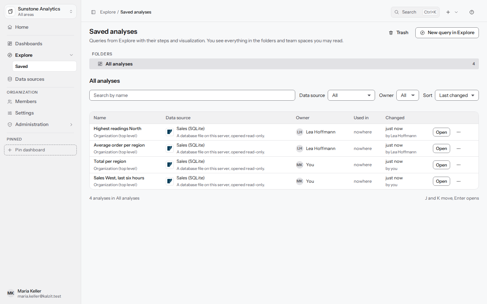
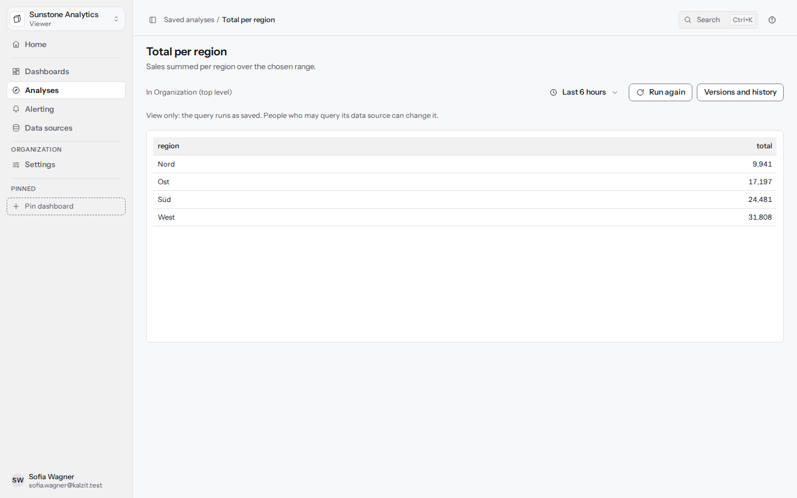

[English](../saved-analyses.md) | Deutsch

# Auswertungen

Eine Auswertung ist eine Abfrage aus Explore, die unter einem Namen aufbewahrt wird: ihre
Datenquelle und Abfrage, die Schritte und die gewählte Visualisierung. Auswertungen liegen wie
Dashboards in Ordnern und Team-Bereichen und folgen denselben Rechten; Dashboard-Panels können eine
zeigen und bleiben mit ihr verknüpft. API: [Auswertungen](../../api/analyses.md).

## In Explore speichern

**Speichern** (Strg+S) neben **Abfrage ausführen** öffnet **Auswertung speichern** für eine
Abfrage, die noch nicht gespeichert ist:

- **Name**, Pflichtfeld.
- **Ablage**: die oberste Ebene der Organisation, einer ihrer Ordner oder ein Ordner eines
  Team-Bereichs. Die Zeile darunter sagt, wer die Auswertung sehen wird, und dass nur Personen, die
  die Datenquelle abfragen dürfen, die Abfrage ändern können.
- **Beschreibung**, optional.
- **Wird gespeichert**: die Datenquelle, die Abfragen, die Anzahl der Schritte und die
  Visualisierung.
- **Zeitraum mitspeichern** ist standardmäßig aus: Die Auswertung öffnet sich dann mit dem gerade
  eingestellten Zeitraum, und ein Dashboard-Panel verwendet den Zeitraum des Dashboards.
  Eingeschaltet wird der verwendete Zeitraum mit ihr gespeichert.

Nach dem Speichern zeigt Explore Ablage und Namen der Auswertung über der Werkzeugleiste,
„Gespeichert … von dir“ neben den Schaltflächen und eine neutrale Markierung **Geändert**, sobald
die Abfrage, die Schritte, die Visualisierung oder ein mitgespeicherter Zeitraum von der
gespeicherten Version abweichen. **Speichern** speichert dann eine neue Version. Das Menü daneben
bietet:

| Eintrag | Was er tut |
|---|---|
| Speichern unter… (Strg+Umschalt+S) | Eine Kopie unter neuem Namen und an neuer Ablage; Explore arbeitet mit der Kopie weiter |
| Umbenennen und Beschreibung | Nur Name und Beschreibung; nicht gespeicherte Änderungen an der Abfrage bleiben ungespeichert |
| Verschieben… | Eine andere Ablage, mit derselben Sichtbarkeitszeile wie im Speicherdialog |
| Versionen und Verlauf | Jedes Speichern; vergleiche eines mit der aktuellen Version oder stelle es als neue Version wieder her |
| Änderungen verwerfen | Lädt nach Rückfrage die gespeicherte Version neu |

Ohne das Recht, die Auswertung zu speichern, wird aus **Speichern** **Speichern unter**.

## Öffnen

**Öffnen** (Strg+O) in Explore listet die Auswertungen auf, die zuletzt geänderte zuerst; tippe zum
Filtern, Pfeil nach oben und unten zum Bewegen, Eingabe zum Öffnen. Öffnen lädt Abfrage, Schritte
und Visualisierung in Explore und führt sie aus. Auswertungen erscheinen auch in der Befehlspalette
(Strg+K) mit ihrem Namen.

## Die Liste

**Gespeichert** liegt in der Seitenleiste unter **Explore**. Die Liste zeigt links die Ordner und
Team-Bereiche mit der Anzahl der Auswertungen darin, eine Suche, Filter für **Datenquelle** und
**Eigentümer** (alle, du oder eines deiner Teams) und die Sortierung (**Zuletzt geändert**, **Name
A bis Z** oder **Zuletzt geöffnet**, wobei das zuletzt von dir Geöffnete zuerst kommt). Der Kopf
führt zum **Papierkorb** mit seiner Anzahl und zu einer neuen Abfrage in Explore. Jede Zeile zeigt
Name und Ablage, die Datenquelle, ihren Eigentümer (**Eigentümer**: das Eigentümer-Team, wenn sie
einem Team gehört, sonst wer sie angelegt hat; **Du** für deine eigenen, **Unbekannt**, sobald das
Konto entfernt wurde; **Du** im Filter meint, was du angelegt hast und keinem Team gehört), die
Dashboards, die sie verwenden (**Genutzt in**), und wann und von wem sie zuletzt geändert wurde.
J und K wechseln zwischen den Zeilen, Eingabe öffnet.

Ein leerer Ordner bietet **Explore öffnen** und **Aus anderer Ablage verschieben**; das listet die
Auswertungen auf, die du verschieben darfst, und verschiebt die gewählte in den Ordner. Eine Suche
ohne Treffer in einem Ordner sagt, wie viele Treffer die anderen Ablagen enthalten, mit **In allen
Ablagen suchen** und **Filter zurücksetzen**.

**Öffnen** und der Name öffnen die Auswertung in Explore, wenn du ihre Datenquelle abfragen darfst.
Ohne dieses Recht (Betrachter, oder eine Quelle, die nicht für dich freigegeben ist) öffnen sie sie
**zum Ansehen und Ausführen**: Die Seite zeigt Titel, Beschreibung, Ablage, Datenquelle und
Zeitraum (den mitgespeicherten, oder wähle einen anderen), führt die gespeicherten Abfragen so aus,
wie sie gespeichert sind, und zeichnet das Ergebnis mit seinen Schritten und seiner
Visualisierung; **Erneut ausführen** führt sie noch einmal aus, **Versionen und Verlauf** listet
ihre Speicherstände. Nur wer die Quelle abfragen darf, sieht **In Explore bearbeiten**. Betrachter
finden die Liste als **Auswertungen** in der Seitenleiste, da sie kein Explore haben.

Das Zeilenmenü bietet **In Explore öffnen** (oder **Ansehen und ausführen**), **Zum Dashboard
hinzufügen…** (als verknüpftes Panel), **Duplizieren**, **Verschieben…**, **Link kopieren**,
**Versionen** und **In den Papierkorb**. Eine Auswertung, die Dashboards noch zeigen, kann nicht in
den Papierkorb; der Dialog listet diese Dashboards. Der Link **Papierkorb** unter den Ordnern
listet Auswertungen im Papierkorb zum Wiederherstellen oder endgültigen Löschen (endgültiges
Löschen braucht die Admin-Stufe an der Auswertung).

## In einem Dashboard-Panel

Ein neues Panel im Panel-Editor fragt, womit es beginnt: **Neue Abfrage**, **Aus gespeicherter
Auswertung** oder **Aus anderem Panel** (eine Kopie eines Panels desselben Dashboards).

**Aus gespeicherter Auswertung** listet die Auswertungen (**Alle**, **Team dieses Dashboards**,
**Meine**) mit einer Live-Vorschau über den Zeitraum des Dashboards. Auswertungen, die nur ein Team
sieht, lassen sich nicht in einem Dashboard verwenden, und Auswertungen, deren Datenquelle du nicht
abfragen darfst, werden gelistet, lassen sich aber nicht wählen. Wähle, wie sie verwendet wird:

- **Verknüpft** (Standard): Das Panel führt die aktuellen Abfragen und Schritte der Auswertung aus,
  sodass eine gespeicherte Änderung der Auswertung in jedem Dashboard erscheint, das sie verknüpft.
  Das Panel behält seinen eigenen Titel und seine eigene Visualisierung. Seine Abfragen sind im
  Panel schreibgeschützt: **In Explore bearbeiten** öffnet die Auswertung, **Verknüpfung lösen**
  macht aus den Abfragen des Panels eine eigene Kopie, **Entfernen** leert sie.
- **Als Kopie**: Abfragen und Schritte werden ins Panel kopiert und von da an dort bearbeitet.

Betrachter des Dashboards sehen nur das Ergebnis; sie brauchen keinen Zugriff auf die Auswertung
selbst.

## Konflikte

Explore prüft die geöffnete Auswertung alle 30 Sekunden auf neuere Versionen. Hat jemand anderes
eine gespeichert, nennt ein Hinweis, wer und wann, die Version, an der du arbeitest, und die
aktuelle, mit **Unterschiede ansehen** und **Neue Version laden**. Über eine neuere Version wird
nie stillschweigend gespeichert: Der Dialog **Neuere Version vorhanden** zeigt die Änderungen beider
Seiten und bietet **Als Kopie speichern…**, **Version N laden** (nach Rückfrage, wenn du nicht
gespeicherte Änderungen hast) und **Trotzdem überschreiben**, wofür nur das Recht zum Speichern
nötig ist; die überschriebene Version bleibt im Verlauf.
