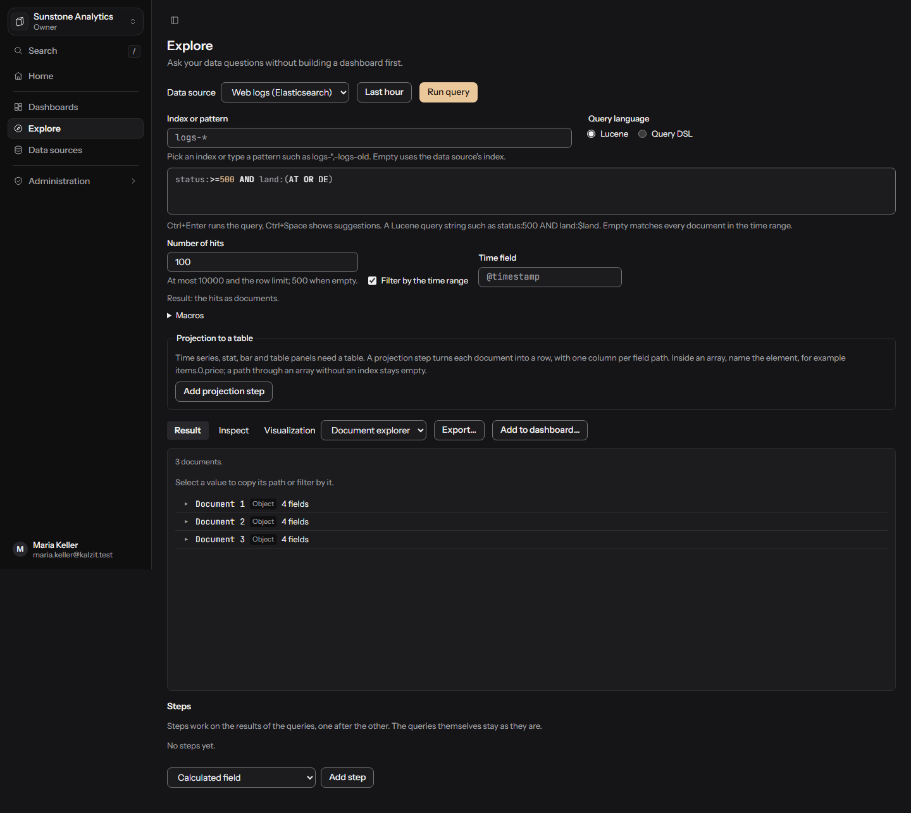
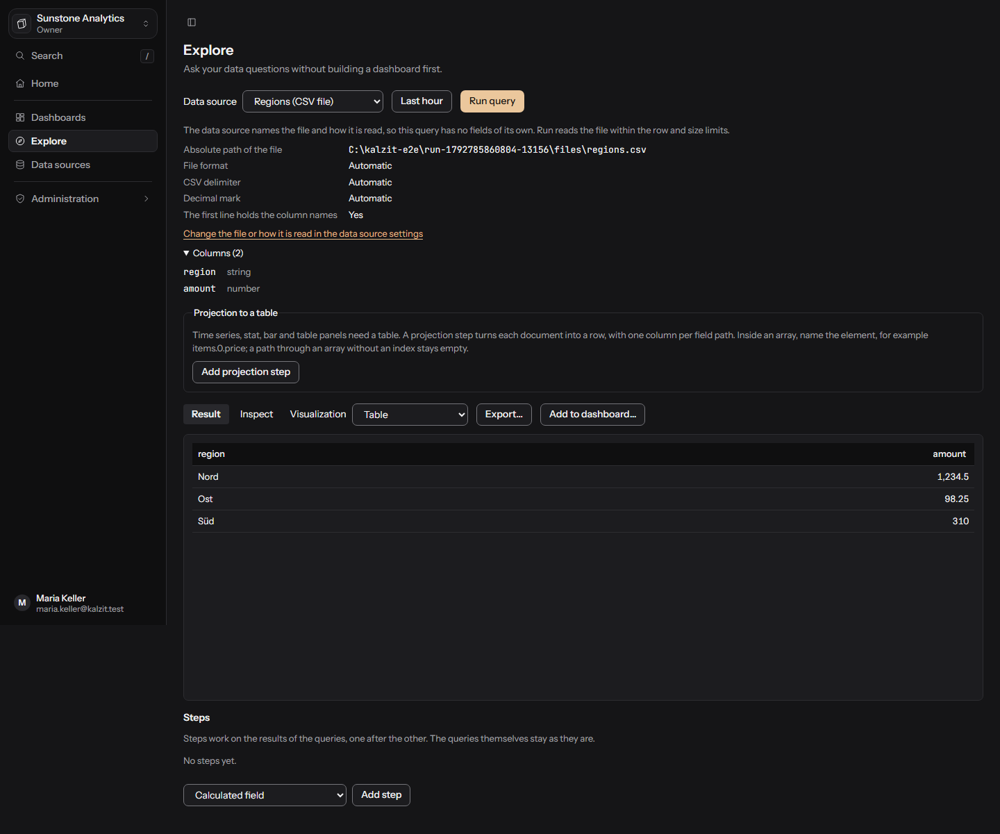
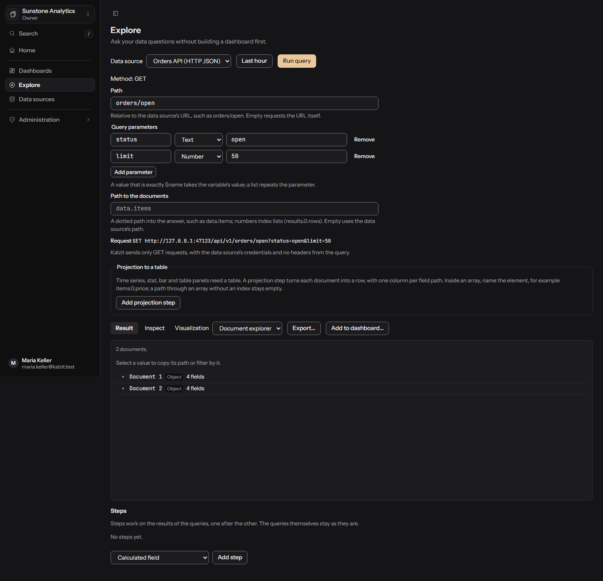

# Explore

Explore runs free queries without a dashboard, shows the result in a matching visualization, lets
you inspect it and add it to a dashboard. API: [data sources and queries](../api/datasources.md).

Explore needs the `datasources:query` permission (editors, admins and owners have it, and anyone
with query access to a data source). Viewers still see the dashboards shared with them, which run
their stored queries.

## Running a query

1. Pick a **Data source**. The last one you used is remembered.
2. Write the query in the editor (CodeMirror). Ctrl+Enter runs it, Ctrl+Space shows suggestions
   from the source's schema (tables, columns, metrics, labels, fields).
3. Press **Run query**. The **Result** tab shows the visualization; **Inspect** shows the result's
   size, the executed query and notes from the server.
4. Pick another **Visualization** if you like; types that do not fit the result come last.

A query the server would refuse says why before you run it. The time range is the one you set
for Explore; macros below pick it up. Variables and macros reach the database as parameters,
never as text in the query. Writing queries are always refused, see
[Data sources](data-sources.md#read-only).

## Queries per source kind

| Kind | Query | Result shape |
|---|---|---|
| PostgreSQL, MySQL and MariaDB, SQL Server, SQLite | One `SELECT` or `WITH` statement | `frame` |
| Prometheus | PromQL; optional **Instant query** and **Minimum step** | `frame` |
| Elasticsearch, OpenSearch | **Lucene** query string or **Query DSL** (JSON); index or pattern, number of hits, time field | `documents` (hits), `frame` (aggregations) |
| MongoDB | **Aggregation pipeline** (stages) or **Find** (filter, projection, sort, limit, skip) on a collection | `documents` |
| CSV, JSON, NDJSON files | No query of its own; the data source names the file and how it is read | `frame` (CSV), `documents` (JSON, NDJSON) |
| HTTP JSON | A **Path** below the source's URL, **Query parameters**, and the **Path to the documents** | `documents` |
| Neo4j, Memgraph | Cypher (reading only) | `graph` |
| TigerGraph | **Write GSQL** (`INTERPRET QUERY ...`) or **Run an installed query** | `graph` |

### Macros

Macros take the time range of the dashboard or of Explore:

- **SQL**: `$__timeFilter(column)` (true for rows in the range), `$__timeFrom`, `$__timeTo`,
  `$__interval` (a suggested grouping interval such as `1m`), `$__interval_ms`. Variables are
  written `$name`.
- **PromQL**: `$__interval`, `$__interval_ms`, `$__rate_interval` (four intervals, at least 1m, a
  safe window for `rate()`), `$__range`, `$__timeFrom`, `$__timeTo` (Unix seconds). Variables only
  inside quoted strings, such as `job="$job"`.
- **Cypher**: `$__timeFrom`, `$__timeTo` (UTC DateTime values), `$__timeFromMs`, `$__timeToMs`,
  `$__interval_ms`.
- **Lucene and Query DSL**: `$__timeFrom`, `$__timeTo` (Unix ms), `$__interval`, `$__interval_ms`;
  in Lucene variables become quoted phrases, in Query DSL a macro or variable is written as a
  whole string such as `"$__interval"`.
- **MongoDB**: in a `$match` or filter, `{"$__timeFilter": "ts"}` keeps the time range and
  `"${name}"` stands for a variable.

The editor lists the macros of the current kind next to the query.

### Search sources

Pick an **Index or pattern** (such as `logs-*,-logs-old`; empty uses the data source's index),
the **Query language**, the **Number of hits** (500 when empty) and whether to **Filter by the time
range** with a **Time field**. **Start from a template**: latest documents, count per value
(terms), count over time (date histogram), count per value over time. Aggregations answer a table
with one row per bucket.

### MongoDB

Choose **Collection** and **Query type**. In the pipeline view each stage is JSON, for example
`{ "$match": { "status": "paid" } }`, and can be moved, turned off and previewed (**Preview after
stage N**); **Raw pipeline** shows the whole list. Database types use Extended JSON such as
`{ "$oid": "..." }`. Stages that write (`$out`, `$merge`) are refused by the server. A disabled
stage is not saved with the query.

### Files and HTTP JSON

A file source shows the file, how it is read and its columns. An HTTP JSON source sends only `GET`
requests; its preview shows the request.

## Result shapes

Every result keeps its native shape. Conversions are explicit steps you add.

### Frames

Tables and time series. A time series panel needs a time field and at least one number field.
Pick a table, time series, stat, bar chart or any other [frame panel](panels.md).

### Documents

A `documents` result stays a set of documents. Use the document explorer, schema, field
distribution or document card ([panels](panels.md#documents-panels)). Selecting a value in the
tree can add a filter on that path to the query. For a table, use the explicit projection step:
**Add projection step** names columns by field path (`items.0.price` for an element of an array),
with optional names and types. Remove the step and you get the documents back. A result shows at
most a limited number of documents (**Cut off at N documents**) and **Load more documents** fetches
the next ones.

### Graphs

A `graph` result stays nodes and edges: the **Network**, **Hierarchy** or **Paths** panel
([panels](panels.md#graph-panels)). Return paths from the query (for example with `shortestPath`)
to use the path panel. In explorer mode a click loads a node's neighbours.

## Steps

The **Steps and actions** side panel holds analysis steps that work on the results one after the
other: calculated fields, joins, statistics, trend, moving average, correlation, comparison with
the previous period, group, pivot and the documents projection. The queries stay as they are. See
[Calculated fields and statistics](calculated-fields.md).

## Add to dashboard

**Add to dashboard...** puts the query, its data source, the visualization and the steps into a
panel: choose **An existing dashboard** (you may change) or **A new dashboard**, then **Add panel**.
The dashboard's history records the save as "Panel added from Explore".

## Export

**Export...** downloads the result with all active steps applied; see [Export](export.md).

## Query history

**History** in the Explore toolbar opens a panel with the queries you ran in Explore.

- It is private to you: nobody else can read it, administrators included. Each organization has
  its own history for you.
- Entries are kept for 30 days, at most 500 per organization. Only successful runs are kept, and
  running the same query again just moves the latest entry to the top.
- The text you typed is stored as typed, including any values in it (an id, an email address).
  Do not put secrets into queries. Results are never stored.
- **Search history** finds entries by their query text, **Filter by data source** keeps one source.
  Entries of a data source you may no longer query are not listed.
- **Load into the editor** puts a query in the editor without running it; **Run again** loads and
  runs it.
- **Delete from history** removes one entry; **Clear history** removes all of them after a
  confirmation and cannot be undone.
