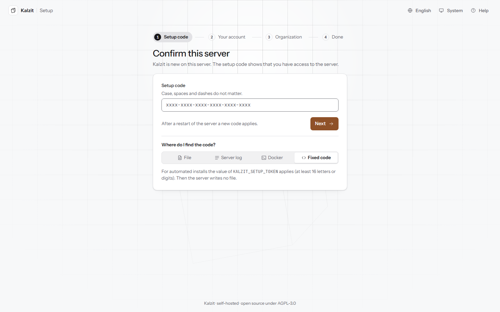

# Getting started

This page takes you from a fresh server to a first query on a dashboard. Installing and starting
the server is described in [Installation](installation.md) (the container image) and the
[README](../../README.md#quick-start); an operator also finds backups and services in
[ARCHITECTURE](../ARCHITECTURE.md).

## First setup

On the first start Kalzit asks for a one-time **setup code**. Open the server's address, by
default `http://localhost:3000`. Setup has four steps; **Back** keeps everything you entered.

1. **Setup code** (Einrichtungscode): enter the code and press **Next**. It is checked right
   away. **Where do I find the code?** shows the way for each kind of installation, the one that
   fits this server first:
   - **File**: `setup-token.txt` in the data directory, by default
     `C:\ProgramData\Kalzit\data\setup-token.txt` on Windows and
     `/var/lib/kalzit/setup-token.txt` on Linux.
   - **Server log**: the log says at start where the file is; it never contains the code.
   - **Docker**: `docker exec kalzit kalzit setup-code` (with Compose:
     `docker compose exec kalzit kalzit setup-code`).
   - **Fixed code**: the value of `KALZIT_SETUP_TOKEN`, for automated installs.

   Case, spaces and dashes do not matter. After several wrong codes you have to wait; the button
   counts down the time. A restart of the server makes a new code: the page then says that the
   code you entered is no longer valid, rather than wrong.
2. **Your account**: your name, email address and a password of at least 12 characters. The
   rules below the field are ticked off while you type; a mix of characters is recommended, not
   required. This account becomes the owner of the first organization and a server admin.
3. **Organization**: the organization's name, and the defaults for everyone who has not chosen
   otherwise: **Language**, **Theme** and **Time zone** (taken from your browser). Language and
   theme are the server's defaults, the time zone the organization's. Press **Finish setup**:
   only now are the organization and the account created, and you are signed in.
4. **Done**: the next steps as tiles. **Add a data source** opens the dialog to connect one,
   **Explore with sample data** adds the sample database that ships with Kalzit (see below) and
   opens Explore on it, **Invite people** leads to the members. **Go to Home** opens Start.

If Kalzit is already set up, the setup page only says so and leads to sign-in. If someone else
finished setup while you filled in the form, the last step says so; if the server was restarted
in between, you go back to the code with everything else kept.

### Sample data

Kalzit ships a small, read-only SQLite database with orders, products, customers and regions
for trying things out. **Explore with sample data** on the last setup step adds it as a data
source named **Sample data** (Beispieldaten), once per organization; it needs the right to add
data sources. Kalzit writes the file to the `samples` folder of its data directory, the one
place there a SQLite source may read. Remove the source like any other; the file stays.

## Sign in

Enter the **Email address** and **Password** of your account and press **Sign in**. The password
field can show what you typed and warns when Caps Lock is on. After too many failed sign-ins you
have to wait: the page says how long, and the button counts down until you can try again.
**Forgot password?** explains that an admin of your organization can reset it. When your
session ended while you worked, the page says so and takes you back to where you were after
signing in. Accounts are local for now; sign-in through OIDC or LDAP is planned (M5). There is
no "Stay signed in" choice yet: a session lasts as long as the server's session settings allow.

The bar on top has **Language**, **Theme** and **Help**. A language or theme you choose there
becomes your preference when you sign in, unless you already have one. **Help** opens this page
and [Installation](installation.md); both ship with Kalzit and can be read without an account.

## Your first data source

A data source is a connection to a database or service. Only admins and owners add them.

1. Open **Data sources** and press **Add data source**.
2. Pick the kind (for example PostgreSQL) from the cards, grouped as Tables (SQL), Metrics and
   search, Documents and graphs, Files and APIs. The search box finds a kind by name.
3. Enter the connection, either as fields or as a connection string, and a name.
4. Press **Test connection** to check what you entered (nothing is saved yet), then **Add data
   source**.

Use a database login that can only read; see [Data sources](data-sources.md) for every kind and
what the check does.

## Your first query in Explore

1. Open **Explore**, pick the data source and write a query, for example a `SELECT` on a SQL
   source.
2. Press **Run query** or Ctrl+Enter.
3. The result appears in a visualization that fits its shape (a table, a time series, documents or
   a graph). The **Inspect** tab shows the executed query and the server's notes.

Details: [Explore](explore.md).

## Your first dashboard

The quickest way: in Explore press **Add to dashboard...**, choose **A new dashboard** and press
**Add panel**. The dashboard opens with the panel.

Or start from the dashboard list: **Dashboards**, **New dashboard**, a title, **Create**; then
**Edit**, **Add** and pick a visualization. In the panel editor choose the data source, write the
query and press **Apply**, then **Save...** to keep the dashboard as a new version.

Details: [Dashboards](dashboards.md) and [Panels](panels.md).

## First steps card

Until you have done the basics, the sidebar shows a **First steps** card: **Add a data source**,
**Create a dashboard**, **Invite a colleague**. It ticks off what is done and can be hidden.

## Next

- Invite colleagues: [Administration](administration.md#members).
- Make the numbers meaningful: [calculated fields and statistics](calculated-fields.md).
- Learn the keys: press `?` anywhere.
