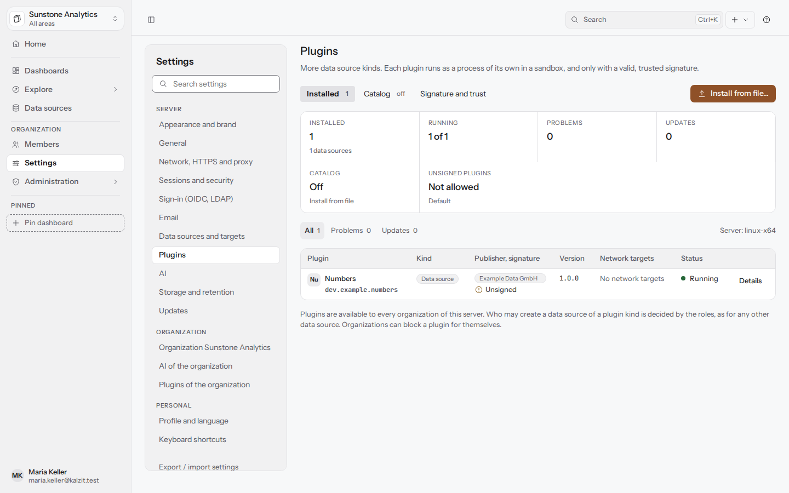
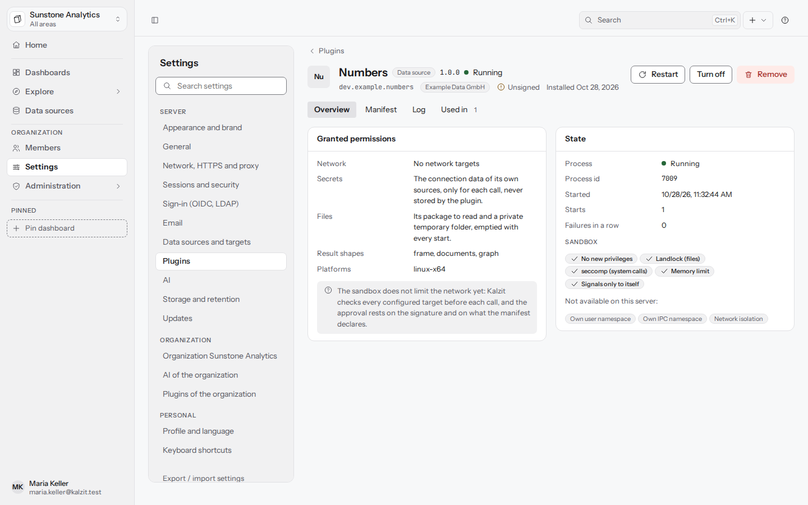
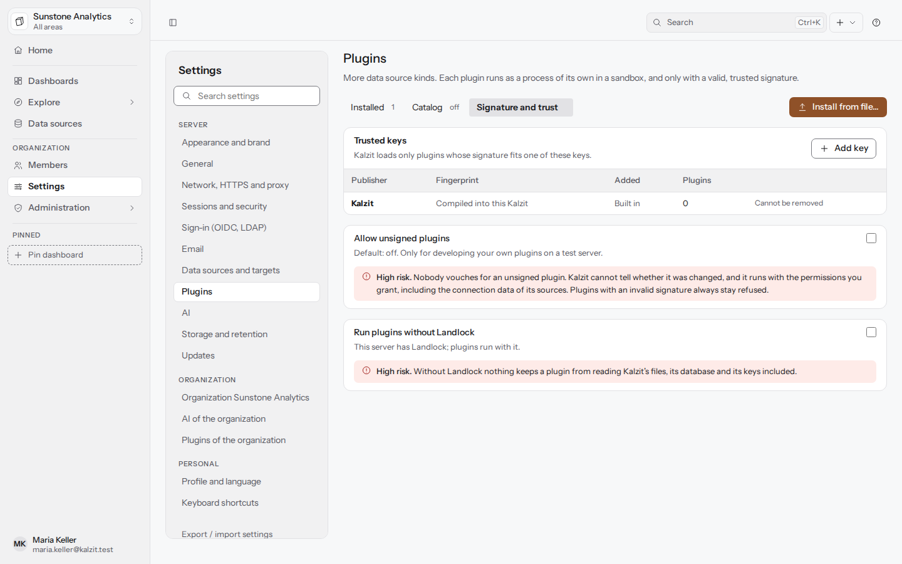
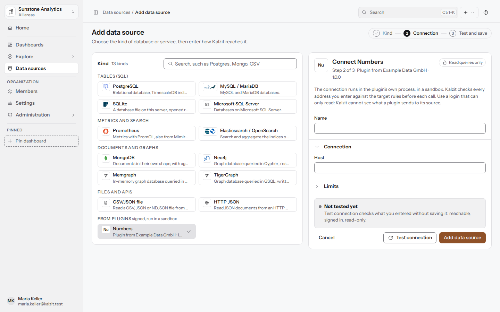

# Plugins

Plugins add data source kinds to Kalzit. Each plugin runs as a process of its own in a sandbox of
the operating system and is loaded only when its signature fits a trusted key: Kalzit's own key or
a publisher key a server admin added. Installing, trusting and approving plugins is for server
admins; organizations can block a plugin for themselves. API: [plugins](../api/plugins.md).

The page is **Settings > Plugins** (Verwaltung > Plugins), in the **Server** group, with three
tabs: **Installed** (Installiert), **Catalog** (Katalog) and **Signature and trust** (Signatur und
Vertrauen). Each tab has its own address (`/settings/plugins`, `#catalog`, `#trust`), and each
plugin its own page (`/settings/plugins/<plugin id>`).

## Installed plugins

A strip on top counts the installed plugins, how many run, the problems, waiting updates, the
catalog and whether unsigned plugins are allowed. **All**, **Problems** and **Updates** filter the
table, which shows per plugin:

- **Plugin**: its name and id, which is also the id of its data source kind.
- **Kind**: Data source (Datenquelle); panel plugins follow later.
- **Publisher, signature**: the publisher as the manifest names it (a neutral badge, not a
  confirmed identity) and the signature: **Signed by Kalzit**, **Signed** with the key id in groups
  of four, **Unsigned**, or **Key no longer trusted**.
- **Version**, with an update that waits for approval.
- **Network targets**: the targets the plugin declares, fixed hosts such as
  `license.example.dev:443 (tls)` or "the host in the setting `host`".
- **Status** as a dot and a word: **Waiting for approval**, **Turned off** (Ausgeschaltet),
  **Ready, starts when needed**, **Running** (Läuft), **Crashed** (Abgestürzt) with the time
  until the next attempt and the attempt number, **Stopped** (Angehalten) after repeated failures,
  **Not loaded** with the reason (for example a Linux server without Landlock), and **Stopped: key
  not trusted**.

## Install from file

**Install from file...** (Aus Datei installieren) works without internet, for every plugin. Drop
the package (a zip file, at most 256 MiB) on the dialog or choose it. The server checks it before
anything in it runs, and the dialog shows the checks from its answer:

1. **Package read**: name and size.
2. **Signature valid**: who signed it, with the key id. An unsigned package shows **Not signed**
   with a warning, and only installs while unsigned plugins are allowed.
3. **Checksums match**: every file as the signed manifest lists it, no other files.
4. **Platform fits**: the platforms the package contains and this server's.
5. **Kalzit version fits**.
6. For an update: **Replaces version ...**, or **waits for approval** when it reaches new targets
   (the installed version keeps running meanwhile).

Below, **Permissions you grant** lists the network targets. For an update, targets it adds are
marked **new in** the version and set in bold, the others **as before**. Nothing runs before you
tick **I grant these permissions.** and press **Install**; **Start after installing** turns the
plugin on right away. **Cancel** removes a new plugin again.

A refused package names the step that failed and why, and the steps after it are skipped:

- **Signature does not match the content**: the package was changed after signing or is damaged.
  Always refused, also when unsigned plugins are allowed.
- **Publisher not trusted**: the signature is valid, but its key is not trusted.
  **Check key and trust...** opens the key dialog and compares the key you paste with the one that
  signed the package.
- **No matching platform**, **Needs a newer Kalzit**, **Files do not match the manifest**, and the
  refusals of updates (another plugin, an older version, another key).

## A plugin's page

The page shows the plugin's id, publisher, signature, license and installation date, and:

- **Approve permissions...** for a plugin not approved yet, **Approve update to ...** for a waiting
  update, **Restart**, **Turn on** or **Turn off**, and **Remove**.
- **Overview**: the granted permissions (network targets, the connection data of its own sources
  for each call, its package and a private temporary folder) and the state of the process: process
  id, start time, starts, failures in a row, the last error and the sandbox layers in force and
  missing on this server.
- **Manifest**: `kalzit-plugin.toml` from the package, as signed.
- **Log**: stdout and stderr of the process (the last 2000 lines), filtered to stderr if you like,
  refreshed and downloaded as a text file.
- **Used in** (Genutzt in): the data sources of the plugin's kind in every organization.

A crashed plugin says when it starts again: restarts wait 10 s, 30 s, 1, 2, 5 and 10 minutes, and
after that the plugin stays stopped until **Restart now**. A crash fails only the queries of its
own kind.

**Remove** asks first and says how many data sources in how many organizations use the plugin.
They stay with their settings and answer "kind not available" until it is installed again.
**Turn off** keeps the plugin installed; its sources answer the same until it is turned on.

## Signature and trust

**Trusted keys** (Vertrauenswürdige Schlüssel) lists Kalzit's own key (built in, cannot be removed)
and the publisher keys added here, with fingerprint, date and the plugins they signed.

- **Add key**: the publisher's name and the public key as the publisher gives it (base64 or 64 hex
  digits, also as a PEM block). The dialog shows the fingerprint, the key id in groups of four;
  compare all 16 characters with the publisher's, for example on their website, and tick **I
  compared the fingerprint.**
- **Remove**: when the key signed installed plugins or waiting updates, the dialog names the
  plugins that stop and the updates that are dropped; **Remove and stop** removes it.

**Allow unsigned plugins** (Unsignierte Plugins erlauben), off by default, is meant for developing
your own plugins on a test server. Turning it on asks for the server's name as a confirmation.
While it is on, a band on every plugin page says so, with **Turn off**. A broken signature stays
refused either way; unsigned plugins installed meanwhile keep running when it is turned off again.

On Linux, **Run plugins without Landlock** lets plugins start on a server whose kernel offers no
Landlock. Without Landlock nothing keeps a plugin from reading Kalzit's files; the switch also
asks for the server's name.

## Catalog

The catalog, a signed list of plugins to install from, is not built yet. The tab says what it will
do and shows its switch turned off; installing from a file works with the same checks.

## Plugins of the organization

**Settings > Plugins of the organization** (Plugins der Organisation), for members with
`plugins:configure` (admins and owners), lists the server's plugins with a switch **Offered**
(Angeboten). A plugin turned off here is not offered in **Add data source**, and the
organization's sources of its kind answer "kind not available". The change applies at once and
can be undone.

## Data sources of plugin kinds

In **Add data source** the plugin kinds have a group of their own, **From plugins** (signed, run
in a sandbox), each with the plugin's letters and "Plugin from *publisher* · *version*". The form
uses the labels and help texts of the plugin's manifest in your language. In the data source list
a source of a plugin kind carries a neutral badge **Plugin · *publisher***.

In Explore and the panel editor, a source of a plugin kind takes its query as one JSON object, in
the form the plugin describes (see its documentation); Kalzit sends it as written.

## Sandbox and network

What the sandbox holds on Windows and Linux is described in the
[API reference](../api/plugins.md#sandbox). The network is not limited by the sandbox yet: Kalzit
checks every configured target against the data source target rules before each call, and the
approval rests on the signature and the targets the manifest declares.
