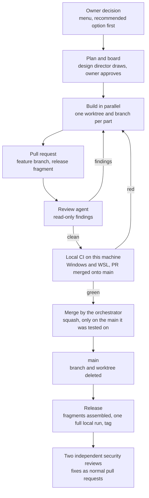
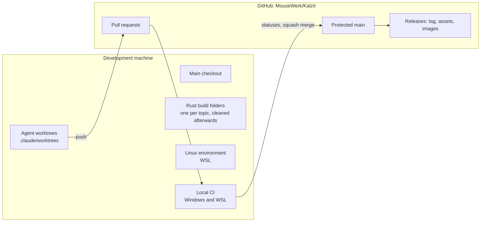

# How Kalzit is built

This page describes the working process for Kalzit: who does what, how a change goes from a
decision to a release, and where the work runs. `CLAUDE.md` holds the binding rules. This page
gives the overview, and `CLAUDE.md` wins where the two differ.

## Roles

| Role | Does | Never does |
|---|---|---|
| Owner | Decides direction and design questions, approves boards, changes repository and machine settings, installs releases on the demo system | - |
| Orchestrator | Plans the work, writes the briefs, starts and steers the agents, integrates branches, resolves conflicts, runs the local CI and merges pull requests, runs the release gate, reports to the owner | Pushes to `main`, force-pushes, changes settings without the owner |
| Design director | Draws the boards in `docs/design/blueprint/`, reviews the look and wording of UI pull requests against the approved board, advises on product questions at milestone starts | Implements code, merges, or runs in parallel with a second design director |
| Builders | Implement one scoped part each, in their own worktree and branch, with tests, docs and a release fragment; open the pull request | Merge, or touch another builder's files |
| Reviewers | Read a pull request (diff, files on the branch, the board, `CLAUDE.md`) and report findings with severity and a concrete fix | Check out branches in the main folder, edit, commit or push |
| Research agents | Surveys, audits and code searches that end in a report | Change code |

Builders with complex, UI-heavy or security-relevant parts get a stronger model. Clearly
specified parts and read-only reviews get a lighter one. Expensive models are used where their
judgement matters most, so the usage limits last through the day.

## From decision to release

1. **Decision.** Open questions go to the owner as a selection menu with the recommended option
   first. Decisions that change the plan are recorded in `docs/PLAN.md` and, when standing, in
   `CLAUDE.md`.
2. **Board.** A new screen or a larger UI change starts with a board. Implementation follows the
   approved board. A review that finds a gap in a board turns it into a decision for the owner.
3. **Build.** Larger stages are split into parts with clear file ownership. Each part has its own
   branch (`m<n>/`, `fix/`, `feat/`, `ux/`, `docs/`) and worktree. Shared files get small,
   documented interfaces, so the parts can merge in any order.
4. **Pull request.** It contains the change, its tests, its docs and a fragment in
   `docs/releases/unreleased/`. Commits are authored as the owner and carry no trailers.
5. **Review.** Every pull request gets a read-only review. Its findings go back to the builder.
   The pull request moves on only when the review has no open findings.
6. **CI.** The local CI (`tools/local-ci`) tests the pull request merged onto the current
   `main`, on Windows and in WSL, and posts the statuses `local/windows` and `local/linux`;
   `main` requires both. A red status goes back to the builder. Tests are never weakened or
   skipped to get green.
7. **Merge.** The orchestrator merges with `tools/local-ci/merge.sh`: a squash merge, only when
   both statuses passed for exactly the content the merge makes (the merged tree; otherwise it
   runs the CI first). Several pull requests can be tested and merged as one batch, and
   `tools/local-ci/gh-run.sh` runs the same test on GitHub's runners, for example overnight.
   `main` takes no direct or force pushes.
8. **After the merge.** The branch and its worktree are deleted, together with local build
   folders.
9. **Release.** The release pull request assembles the fragments into
   `docs/releases/v<version>.md` and bumps the version. The tag follows one full local CI run
   on the release commit (`tools/local-ci/run.sh --ref origin/main --full`). Releases
   are published on GitHub only.
10. **Security.** After each milestone release, two independent security reviews take place.
    Their fixes are normal pull requests.

## Where the work runs

- **Machine:**
  - Builds use a dedicated folder per topic and are cleaned up afterwards, so the disk does not
    fill up.
  - Unit tests run with limited workers.
  - Targeted tests run locally. The full suites run in CI.
  - Port 3000 is reserved for the owner's demo. Nothing else starts or updates the demo.
- **GitHub:**
  - `main` is protected: pull requests only, the statuses `local/windows` and `local/linux`
    required, linear history, no force push.
  - Releases are built by the release workflow from a tag.
  - Signing keys and CI secrets live only in GitHub environments.

## CI

CI runs on the owner's machine (`tools/local-ci`, details in its README): the Windows leg in Git
Bash and the Linux leg in WSL, at the same time, with build folders kept between runs. GitHub's
shared runner pool was too slow for the queue. `.github/workflows/ci.yml` stays as the reference
the scripts mirror and runs only by hand; a change to a job there belongs in the scripts too.

| Run | What runs |
|---|---|
| `run.sh <pr>` | The jobs for the areas the pull request changes (`.github/scripts/changes.sh`), on the PR merged onto the current `main` |
| `run.sh <pr> --full` | Everything |
| `run.sh --ref origin/main --full` | Everything, on that commit: the release gate |

- **Areas.** Docs and boards run only the change detection test (and `roadmap` for the
  README's progress bars). A change under `.github/` or `tools/local-ci/`, or a path no area
  knows, runs everything.
- **Statuses.** Each leg posts one status to the PR's head commit, naming the `main` commit it
  ran on. `merge.sh` merges only when that is still the current `main`.
- **Not covered locally.** `packages (arm64)`; the release workflow still builds and checks
  arm64. The Windows installer test (`--msi`) installs a service on the machine and runs only
  when asked, for example before a release.

## Visual comparison

Every screen of the UI is photographed in light and dark at 360, 1280, 2560 and 3440 px wide
(30 screens, one or two of each area, also at 1280 px with twice the device scale:
`HIDPI_SCREENS` in `ui/e2e/visual/variants.ts`), and compared pixel by pixel with an approved
baseline (`ui/e2e/visual.config.ts`, pictures in `ui/e2e/visual/baselines/<width>/`). The
screens are the pages of the UI sweep (`ui/e2e/sweep/pages.ts`, held against the router, so a
new route is photographed too), the four setup steps and Explore with each result shape.

- **Where it runs.** Linux with Chromium only: fonts are drawn differently on Windows and macOS,
  so the baselines are Linux pictures and the comparison skips on other systems. It runs in the
  Linux leg of the local CI (job `visual`) and in the Linux e2e job of `ci.yml`.
- **Same pictures every run.** Its own server with a fresh data folder, seeded once with fixed
  names; the fixture data lies around a fixed moment and the pages run on a clock fixed to it;
  times the server stamps during the run are moved to that moment; counters that grow with the
  run (page views of public links, recent dashboards, the Explore history) are held still;
  animations, the caret and hover are off. What differs by machine (the run folder, the server's
  port, the host name, ids the server makes up) is masked. Two runs on the same commit give no
  difference.
- **Threshold.** Per pixel, a color distance of 0.1 (YIQ, 0 to 1) counts as equal; one pixel
  beyond it fails the screen. The threshold is not raised to get a run green; a failing
  comparison is never accepted on its own.
- **When it fails.** The run lists the screens that differ (console, `summary.md`, the job
  summary on GitHub) and keeps expected, actual and diff pictures per screen: locally in
  `ui/e2e/.output/visual-diffs/`, in the local CI in the run's log folder
  (`linux-visual-diffs/`), on GitHub as the artifact `visual-diffs`. Look at the diff: an
  unintended change is a bug to fix.
- **Updating baselines.** Only on purpose, with `npm run visual:update` on Linux (WSL works),
  or on GitHub with `gh workflow run visual.yml --ref <branch> -f update=true` and the artifact
  `visual-baselines` unpacked into `ui/e2e/visual/baselines/`. It writes only the screens that
  changed; a removed screen's files are deleted by hand (a test fails on baselines without a
  screen). Commit the pictures with the change that caused them.
- **Review.** The reviewer opens every changed baseline in the pull request (GitHub shows image
  diffs side by side and as swipe) and checks that each change is the intended one. The pull
  request template asks for it.

## Keeping things clean

- One topic per branch and pull request. Unrelated findings become their own task.
- Worktrees, branches and build folders of merged work are removed right away.
- README screenshots in `docs/screenshots/` are refreshed after visible UI changes.
- The website describes only published releases.
