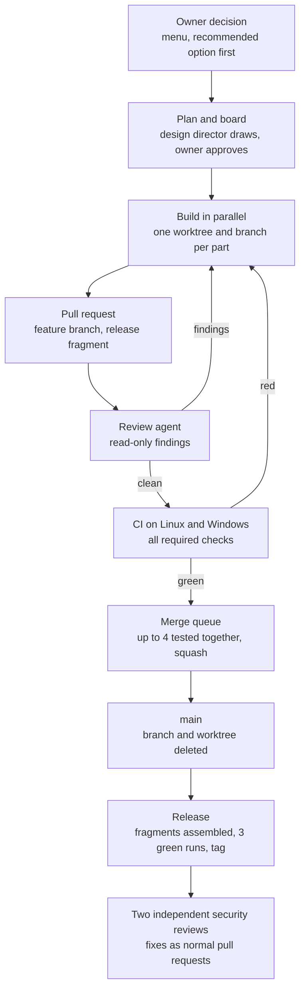
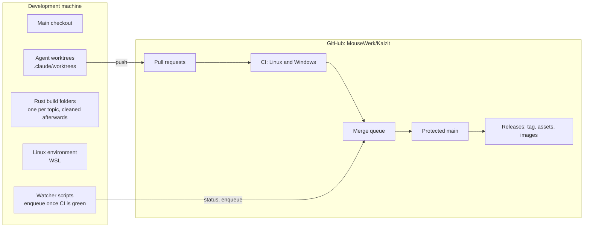

# How Kalzit is built

This page describes the working process for Kalzit: who does what, how a change goes from a
decision to a release, and where the work runs. `CLAUDE.md` holds the binding rules. This page
gives the overview, and `CLAUDE.md` wins where the two differ.

## Roles

| Role | Does | Never does |
|---|---|---|
| Owner | Decides direction and design questions, approves boards, changes repository and machine settings, installs releases on the demo system | - |
| Orchestrator | Plans the work, writes the briefs, starts and steers the agents, integrates branches, resolves conflicts, enqueues pull requests, runs the release gate, reports to the owner | Pushes to `main`, force-pushes, changes settings without the owner |
| Design director | Draws the boards in `docs/design/blueprint/`, reviews the look and wording of UI pull requests against the approved board, advises on product questions at milestone starts | Implements code, merges, or runs in parallel with a second design director |
| Builders | Implement one scoped part each, in their own worktree and branch, with tests, docs and a release fragment; open the pull request | Merge, enqueue, or touch another builder's files |
| Reviewers | Read a pull request (diff, files on the branch, the board, `CLAUDE.md`) and report findings with severity and a concrete fix | Check out branches in the main folder, edit, commit or push |
| Research agents | Surveys, audits and code searches that end in a report | Change code |

Builders with complex, UI-heavy or security-relevant parts get a stronger model. Clearly
specified parts and read-only reviews get a lighter one. Expensive models are used where their
judgement matters most, so the usage limits last through the day.

## From decision to release

1. **Decision.** Open questions go to the owner as a selection menu with the recommended option
   first. Decisions that change the plan are recorded in `docs/PLAN.md` and, when standing, in
   `CLAUDE.md`.
2. **Board.** A new screen or a larger UI change starts with a board. Implementation follows the
   approved board. A review that finds a gap in a board turns it into a decision for the owner.
3. **Build.** Larger stages are split into parts with clear file ownership. Each part has its own
   branch (`m<n>/`, `fix/`, `feat/`, `ux/`, `docs/`) and worktree. Shared files get small,
   documented interfaces, so the parts can merge in any order.
4. **Pull request.** It contains the change, its tests, its docs and a fragment in
   `docs/releases/unreleased/`. Commits are authored as the owner and carry no trailers.
5. **Review.** Every pull request gets a read-only review. Its findings go back to the builder.
   The pull request moves on only when the review has no open findings.
6. **CI.** Required checks on `main`: server, UI and end-to-end tests on Linux and Windows, plus
   PostgreSQL, data sources and audit. A red check goes back to the builder. Tests are never
   weakened or skipped to get green.
7. **Merge queue.** Pull requests merge only through the queue. It builds up to four at once on
   top of each other and squash-merges them. `main` takes no direct or force pushes.
8. **After the merge.** The branch and its worktree are deleted, together with local build
   folders.
9. **Release.** The release pull request assembles the fragments into
   `docs/releases/v<version>.md` and bumps the version. The tag follows three green CI runs on
   the release commit (merge queue, push, and a manual run on a branch pointing at it). Releases
   are published on GitHub only.
10. **Security.** After each milestone release, two independent security reviews take place.
    Their fixes are normal pull requests.

## Where the work runs

- **Machine:**
  - Builds use a dedicated folder per topic and are cleaned up afterwards, so the disk does not
    fill up.
  - Unit tests run with limited workers.
  - Targeted tests run locally. The full suites run in CI.
  - Port 3000 is reserved for the owner's demo. Nothing else starts or updates the demo.
- **GitHub:**
  - `main` is protected: merge queue only, no force push.
  - Releases are built by the release workflow from a tag.
  - Signing keys and CI secrets live only in GitHub environments.

## CI

CI runs on GitHub-hosted runners (`.github/workflows/ci.yml`; the area rules are in
`docs/ARCHITECTURE.md`, "CI"). The free runner pool takes about 20 jobs at once and a full run
has about 30, so pull requests run only what they need, and the gate before `main` stays full.

| Event | What runs | Cancelled by a newer run |
|---|---|---|
| Merge queue (`merge_group`) | Everything, on Windows and Linux | Never |
| Push to `main` or `release/**` | Everything, on Windows and Linux | Never |
| Manual run (`workflow_dispatch`, release gate) | Everything, on Windows and Linux | Never |
| Pull request | Only the jobs for the areas it changes | Yes, by a newer push |
| Draft pull request | As a pull request, without e2e, the data source jobs, `msi`, `docker` and `packages` | Yes, by a newer push |

- **Areas.** The `changes` job reads the pull request's changed paths. Docs and boards run
  nothing but `changes` (and `roadmap` for the README's progress bars). A UI change skips
  `server`, `postgres`, `ldap`, the data source jobs, `plugins` and the other server-only jobs.
  A server change skips `ui`. A change under `.github/`, a path no area knows, or a failed
  `changes` job runs everything.
- **No idle runners.** A job without work is skipped through its job-level condition and boots
  no runner. GitHub counts a skipped job as passed, also for a required check.
- **Required checks.** `server (<os>)`, `ui (<os>)` and `e2e (<os>)` are small jobs at the end
  of `ci.yml` that follow the matrix jobs `server tests`, `ui checks` and `e2e tests`. A
  matrix job skipped as a whole reports no check per system, so it cannot carry the required
  name itself. On a pull request these jobs start only to fail when the jobs they follow
  failed. In the queue, on `main` and in a manual run they always run and pass only when the
  jobs they follow passed. `postgres`, `datasources` and `audit` are plain jobs and report
  their own checks.
- **Drafts.** A draft holds back the heavy jobs. Marking it ready for review starts a new run
  with them.
- **Concurrency.** A newer push to a pull request cancels its running CI. Every queue entry,
  every push to `main` and every manual run has its own group and always finishes, so the
  three green runs of a release gate (queue, push, manual run) can run side by side.
- **Caches.** Merge queue runs restore caches but never save them. One Rust debug cache per
  system is saved by `server tests` and read by the PostgreSQL, LDAP, update rights, data
  source and ACME jobs. One e2e-profile cache per system is saved by `e2e tests` and read by
  `msi` and `packages`.

## Keeping things clean

- One topic per branch and pull request. Unrelated findings become their own task.
- Worktrees, branches and build folders of merged work are removed right away.
- README screenshots in `docs/screenshots/` are refreshed after visible UI changes.
- The website describes only published releases.
