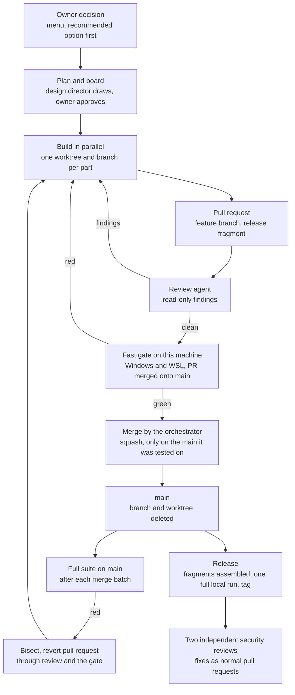
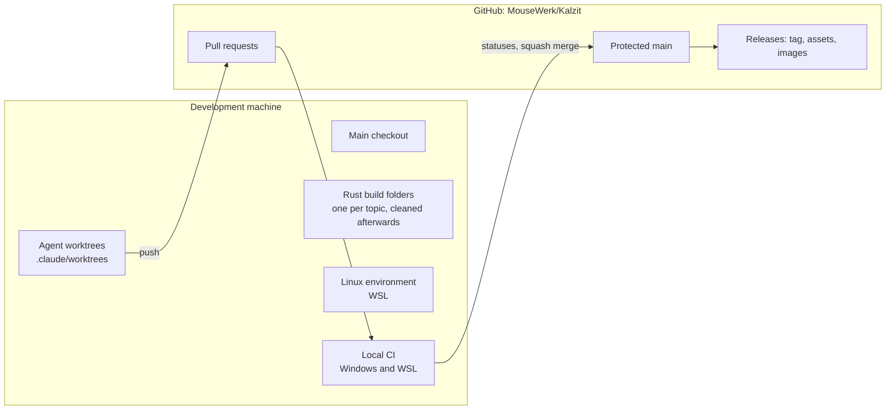

# How Kalzit is built

This page describes the working process for Kalzit: who does what, how a change goes from a
decision to a release, and where the work runs. `CLAUDE.md` holds the binding rules. This page
gives the overview, and `CLAUDE.md` wins where the two differ.

## Roles

| Role | Does | Never does |
|---|---|---|
| Owner | Decides direction and design questions, approves boards, changes repository and machine settings, installs releases on the demo system | - |
| Orchestrator | Plans the work, writes the briefs, starts and steers the agents, integrates branches, resolves conflicts, runs the local CI and merges pull requests, runs the release gate, reports to the owner | Pushes to `main`, force-pushes, changes settings without the owner |
| Design director | Draws the boards in `docs/design/blueprint/`, reviews the look and wording of UI pull requests against the approved board, advises on product questions at milestone starts | Implements code, merges, or runs in parallel with a second design director |
| Builders | Implement one scoped part each, in their own worktree and branch, with tests, docs and a release fragment; open the pull request | Merge, or touch another builder's files |
| Reviewers | Read a pull request (diff, files on the branch, the board, `CLAUDE.md`) and report findings with severity and a concrete fix | Check out branches in the main folder, edit, commit or push |
| Research agents | Surveys, audits and code searches that end in a report | Change code |

Builders with complex, UI-heavy or security-relevant parts get a stronger model. Clearly
specified parts and read-only reviews get a lighter one. Expensive models are used where their
judgement matters most, so the usage limits last through the day.

## From decision to release

1. **Decision.** Open questions go to the owner as a selection menu with the recommended option
   first. Decisions that change the plan are recorded in `docs/PLAN.md` and, when standing, in
   `CLAUDE.md`.
2. **Board.** A new screen or a larger UI change starts with a board. Implementation follows the
   approved board. A review that finds a gap in a board turns it into a decision for the owner.
3. **Build.** Larger stages are split into parts with clear file ownership. Each part has its own
   branch (`m<n>/`, `fix/`, `feat/`, `ux/`, `docs/`) and worktree. Shared files get small,
   documented interfaces, so the parts can merge in any order.
4. **Pull request.** It contains the change, its tests, its docs and a fragment in
   `docs/releases/unreleased/`. Commits are authored as the owner and carry no trailers.
5. **Review.** Every pull request gets a read-only review. Its findings go back to the builder.
   The pull request moves on only when the review has no open findings.
6. **CI.** The local CI (`tools/local-ci`) runs the fast gate on the pull request merged onto
   the current `main`, on Windows and in WSL (about 30 minutes: fmt, clippy, unit and core
   integration tests, the UI checks and build, the smoke e2e set), and posts the statuses
   `local/windows` and `local/linux`; `main` requires both. A red status goes back to the
   builder. A failed job runs once more only to diagnose: the status stays red, and a pass on
   that rerun goes to the flaky log as a test to fix. Tests are never weakened, skipped or
   quarantined to get green.
7. **Merge.** The orchestrator merges with `tools/local-ci/merge.sh`: a squash merge, only when
   both statuses passed the fast gate (or the full suite) for exactly the content the merge
   makes (the merged tree; otherwise it runs the gate first). Several pull requests can be
   tested and merged as one batch, and `tools/local-ci/gh-run.sh` runs the same test on
   GitHub's runners, for example overnight. `main` takes no direct or force pushes.
8. **After the merge.** The branch and its worktree are deleted, together with local build
   folders. The full suite runs on `main` after each merge batch, or within the hour when `main`
   changed (`tools/local-ci/main-watch.sh`). When it fails, it bisects the batch and opens a
   pull request that reverts the merge that broke it; that revert goes through review and the
   gate like any other pull request, and the change comes back with its fix.
9. **Release.** The release pull request assembles the fragments into
   `docs/releases/v<version>.md` and bumps the version. The tag follows one full local CI run
   on the release commit (`tools/local-ci/run.sh --ref origin/main --full`). Releases
   are published on GitHub only.
10. **Security.** After each milestone release, two independent security reviews take place.
    Their fixes are normal pull requests.

## Where the work runs

- **Machine:**
  - Builds use a dedicated folder per topic and are cleaned up afterwards, so the disk does not
    fill up.
  - Unit tests run with limited workers.
  - Targeted tests run locally. The full suites run in CI.
  - Port 3000 is reserved for the owner's demo. Nothing else starts or updates the demo.
- **GitHub:**
  - `main` is protected: pull requests only, the statuses `local/windows` and `local/linux`
    required, linear history, no force push.
  - Releases are built by the release workflow from a tag.
  - Signing keys and CI secrets live only in GitHub environments.

## CI

CI runs on the owner's machine (`tools/local-ci`, details in its README): the Windows leg in Git
Bash and the Linux leg in WSL, at the same time, with build folders kept between runs. GitHub's
shared runner pool was too slow for the queue. `.github/workflows/ci.yml` stays as the reference
the scripts mirror and runs only by hand; a change to a job there belongs in the scripts too.

| Run | What runs |
|---|---|
| `run.sh <pr>` | The fast gate for the areas the pull request changes (`.github/scripts/changes.sh`), on the PR merged onto the current `main`: enough to merge |
| `run.sh <pr> --full` | The full suite on the same content |
| `main-watch.sh` | The full suite on `main` after each merge batch, or hourly when `main` changed; bisect and revert pull request on a failure |
| `run.sh --ref origin/main --full` | The full suite on that commit: the release gate |

- **Two stages** (owner decision 2026-11-24). The fast gate (about 30 minutes when the server
  crate changed, less for UI-only changes) runs fmt,
  clippy, the unit tests and the core integration tests, the UI checks, build and bundle
  budget, and 30 core e2e flows (`@smoke`) in Chromium on both systems. The full suite (70 to
  160 minutes) runs every test in every browser, the databases and services, packages, docker
  and the MSI, on `main` after the merges. A merge needs the gate only.
- **Failures.** A failed job runs once more, only to diagnose; the status stays failure. Tests
  that failed and then passed on rerun go to `C:/Users/klein/kz-ci/flaky.log` and the run's
  summary, which lists those that needed it more than twice in 7 days: they need a root-cause
  fix. A full-suite failure on `main` is bisected to the merge that caused it and reverted
  through a pull request; an intermittent one (every failed job passed on its rerun) is
  reported for a fix instead. Nothing is skipped, quarantined or retried into a pass.
- **Areas.** Docs and boards run only the change detection test (and `roadmap` for the
  README's progress bars). A change under `.github/` or `tools/local-ci/`, or a path no area
  knows, runs everything of the stage.
- **Statuses.** Each leg posts one status to the PR's head commit, naming the tested tree and
  the `main` commit it ran on (`passed gate tree ...` or `passed tree ...`). `merge.sh` merges
  only when a merge would make exactly that tree.
- **Not covered locally.** `packages (arm64)`; the release workflow still builds and checks
  arm64. The Windows installer test (`--msi`) installs a service on the machine and runs only
  when asked, for example before a release.

## Keeping things clean

- One topic per branch and pull request. Unrelated findings become their own task.
- Worktrees, branches and build folders of merged work are removed right away.
- README screenshots in `docs/screenshots/` are refreshed after visible UI changes.
- The website describes only published releases.
